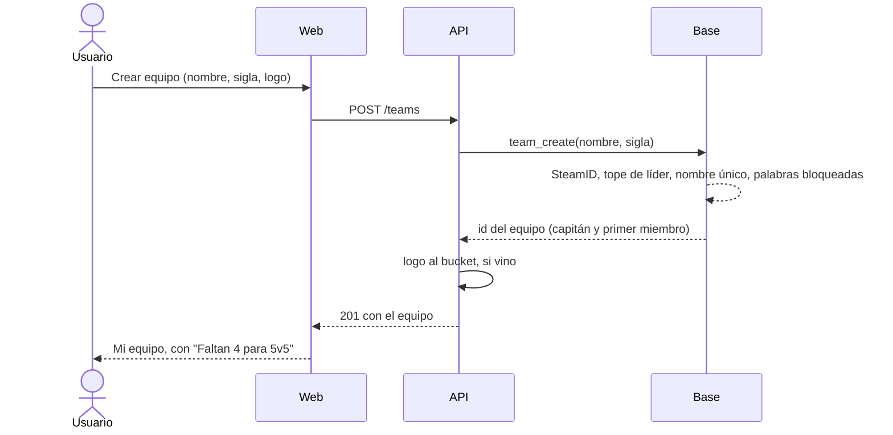

# Plan: crear un equipo al instante, sin aprobación del admin

> Planeación original. Estado: **aprobado por Daniel (2026-11-01)**.

Hoy, para tener un equipo, el usuario manda una solicitud (`team_requests`) y un admin la aprueba (`approve_team_request`), que es la que crea el equipo. Daniel pidió el 2026-11-01 que cualquiera pueda crear un equipo y que quede creado en el acto, y que lo que el equipo puede hacer dependa de cuántos miembros tiene.

## Decisiones tomadas

| Tema | Decisión | Por qué |
|---|---|---|
| Quién crea | Cualquier usuario con el SteamID vinculado | Ya era la condición para pedir uno |
| Cuántos lidera | Tope configurable por el admin: `team_config.max_led`, que arranca en **1** (Daniel, 2026-11-01). Cuenta los equipos oficiales activos donde es capitán | Sin el filtro del admin, evita equipos basura. Se puede ser **miembro** de varios equipos, como hoy |
| Nombre y sigla | Las mismas reglas que al renombrar (E11): nombre de 2 a 40, sigla de 1 a 6 en mayúsculas, palabras bloqueadas, únicos entre los equipos oficiales activos sin distinguir mayúsculas | Ya están escritas y probadas en `team_rename` |
| Logo | Opcional al crear, igual que en la solicitud (multipart) | Sin cambios para el usuario |
| Para qué es apto | La ficha del equipo y Mi equipo muestran los modos para los que alcanza (`eligible_modes`): "Apto para 5v5 · 2v2" o "Faltan 2 para 5v5". Cuentan los miembros activos con rol jugador o suplente (el coach no juega) | Daniel, 2026-11-01 |
| Torneos | Sin cambios: la inscripción ya exige los activos del modo y los suplentes que permite el torneo | Ya está |
| Ranking de equipos | Solo aparecen los equipos con el mínimo de 5v5 (5 jugadores o suplentes). Si un equipo baja de 5, sale del ranking hasta completarse; sus resultados no se pierden | Daniel, 2026-11-01 |
| Buscar equipo | Aparecen todos, también los incompletos (son los que buscan gente) | Daniel, 2026-11-01 |
| Solicitudes pendientes | La migración crea el equipo de cada solicitud pendiente válida y avisa al usuario. Las que ya no se pueden crear (nombre tomado, sin SteamID, tope) se rechazan con el motivo | Nadie queda esperando una aprobación que ya no existe |
| Lo viejo | `team_requests` queda como historial; `approve_team_request`, `reject_team_request`, `cancel_team_request`, `PUT`/`DELETE /me/team-request` y `/admin/team-requests` se borran. La pantalla de solicitudes de Administración se quita | No queda ningún camino que espere al admin |

## 1. El flujo completo

## 2. Base de datos (replanteo `40_equipo_al_instante.sql`, con inversa y pruebas)

- `team_config.max_led int not null default 1` (de 1 a 10).
- `team_create(p_name, p_tag) returns uuid`: valida y crea el equipo (`kind = 'official'`, `founded_at = now()`) con el usuario como capitán, dueño y primer miembro. Errores: sin SteamID (`400`), tope de líder (`409`, con el tope en `details`), nombre o sigla tomados (`409`), palabra bloqueada (`400`).
- `team_eligible_modes(p_team)`: por cada modo activo de `game_modes`, cuántos faltan (`0` = apto).
- `team_ranking`: filtro de 5 o más miembros activos jugadores o suplentes.
- Migración de las solicitudes pendientes, y borrado de las funciones y triggers de aprobación (las notificaciones viejas de `team_request_*` se siguen mostrando).

## 3. API

- `POST /api/v1/teams` (multipart: `name`, `tag`, `logo` opcional) → `201` con `TeamDetail`.
- `TeamDetail` y `MyTeam` suman `eligible_modes: [{ code, players_per_team, missing }]`.
- `GET`/`PUT /admin/teams/config` suman `max_led`.
- Se borran `PUT`/`DELETE /me/team-request` y `GET`/`POST /admin/team-requests…`. `GET /me/team-request` queda para mostrar una solicitud vieja rechazada, si la hay.
- Contrato del frontend y errores nuevos (`TEAM_LEAD_LIMIT`, `TEAM_NAME_TAKEN`).

## 4. Frontend (después del merge)

- "No tengo equipo": el formulario pasa de "Solicitar equipo" a **"Crear equipo"** y lleva directo a Mi equipo.
- Mi equipo y la ficha pública: chips de aptitud por modo.
- Administración › Equipos: el tope de equipos por líder (junto al máximo de miembros). Se quita la pestaña de solicitudes de equipo de Administración › Jugadores.

## 5. Requisitos antes de empezar

- Nada externo. Supabase local con la `39` (ya cargada).

## 6. Orden de implementación

1. Replanteo `40` con sus pruebas e inversa.
2. API, tipos y pruebas de integración; contrato.
3. Commit en `feat/backend-api-fase-1` y merge en `feat/frontend-fase-1`.
4. Frontend: crear equipo, aptitud, configuración; pruebas; commit.
5. Despliegue: la `40` va después de la `39` en staging y en el corte.
