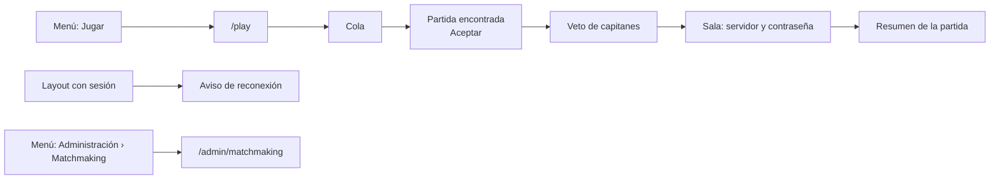

# Frontend del matchmaking en `feat/frontend-fase-1`: documentación

## Qué hace

El frontend nuevo tiene la pantalla para jugar en la cola del matchmaking y su administración. Sale del trabajo de Kyan en `kyan/pruebas` ([`2026-10-28-matchmaking`](../2026-10-28-matchmaking/)), con el diseño ajustado al resto de la web y sin los cosméticos de la tienda.

- **`/play` (Jugar):** tu equipo, el panel de partida (ELO, modo, servidor, invitaciones y Buscar partida), amigos, bloqueo, sanciones y el resumen de la temporada. Después de la cola vienen la confirmación, el veto de capitanes, la sala y el resumen de la partida.
- **`/admin/matchmaking`:** General, Mapas, Sonidos, Servidores, Salas, Reportes y Métricas. Solo para admins.
- **Aviso de reconexión:** si te caes de una partida en curso, el aviso aparece arriba de cualquier página con sesión.
- **`/demo/matchmaking`:** la misma pantalla con una simulación en memoria, solo en `pnpm dev`.

## De dónde salen los datos

Las pantallas leen de un `MmSource` (`source.ts`). Hay dos:

| Fuente | Dónde se usa | Qué hace |
|---|---|---|
| `apiMmSource` (`apiSource.ts`) | `/play`, `/admin/matchmaking` y el aviso de reconexión | Llama a `/api/v1/mm/*` con `authFetch` y escucha el WebSocket. Las rutas no están en la OpenAPI de `feat/backend-api-fase-1` todavía, así que no usa tipos generados |
| `createDemoSource()` (`demo.ts`) | `/demo/matchmaking` y las pruebas | Simula la cola, la confirmación, el veto, el servidor y el mix sin API |

## Diseño

Se usan las piezas comunes del proyecto:

| Parte | Cómo se ve |
|---|---|
| Encabezado de Jugar | Título "Jugar" y descripción, sueltos arriba como en Partidas. A la derecha: partidas en vivo, conexión en tiempo real, Activar sonido y Configuración |
| Tu equipo y panel de partida | Una sola `Card variant="outline"`. El panel queda a la derecha (abajo en el celular), separado por una línea |
| Amigos, Bloqueo, Sanciones, En vivo, Tus últimas partidas y Los mejores | `Card variant="outline"` con el encabezado de las tarjetas del perfil |
| Administración | `AdminHeader` y `AdminTabs`, y los formularios en `Card variant="outline"` |
| Sala de la partida | Las piezas de la sala del mix: `MapBackdrop`, `SideTable` y `StatsTabs` |
| Textos | En tuteo, como el resto de la web |

## VIP y cosméticos

- **VIP:** el bloqueo de compañeros (si `blocks_vip_only`) y el sonido propio son para VIP (`is_vip()`). La insignia es `Badge variant="vip"`, la misma de la web.
- **Cosméticos de la tienda:** no están. Las tarjetas muestran la foto o las iniciales y el nick sin efectos. El fondo de miniperfil, el marco del avatar y el efecto del nombre llegan con la tienda, cuando se apruebe ([`2026-10-29-tienda-puntos-backend`](../2026-10-29-tienda-puntos-backend/PLAN.md)). En `kyan/pruebas` están en `features/shop/cosmetics.tsx` y `public/cosmetics/`.

## Permisos

`matchmaking` es una sección de Administración (`ADMIN_SECTIONS`). Como el resto, solo la ven los admins: organizadores y moderadores no entran.

## Dónde está cada cosa

| Qué | Archivo / ubicación |
|---|---|
| Pantalla de Jugar | `web/frontend/src/features/matchmaking/PlayPage.tsx`, `GroupSlots.tsx`, `PlayBar.tsx`, `PlayFeed.tsx`, `FriendsPanel.tsx`, `BlockPanel.tsx` |
| Confirmación, invitaciones, veto y grupo | `AcceptDialog.tsx`, `InviteDialog.tsx`, `VetoBoard.tsx`, `PartyMenu.tsx` |
| Sala y resumen | `web/frontend/src/features/matchmaking/room/` |
| Administración | `web/frontend/src/features/matchmaking/admin/` |
| Aviso de reconexión | `ReconnectBanner.tsx`, montado en `src/routes/_app.tsx` |
| Sonidos y avisos del navegador | `alert.ts`, `SoundSettings.tsx` |
| API y socket | `apiSource.ts`, `socket.ts`, `queries.ts` |
| Simulación | `demo.ts` |
| Tipos | `types.ts` |
| Rutas | `src/routes/_app/play.tsx`, `src/routes/_app/admin.matchmaking.tsx`, `src/routes/demo.matchmaking.tsx` |
| Menú y permisos | `src/features/shell/lib/nav.ts`, `src/auth/permissions.ts` |
| Pruebas | `PlayPage.test.tsx`, `labels.test.ts`, `admin/AdminMatchmaking.test.tsx` |
