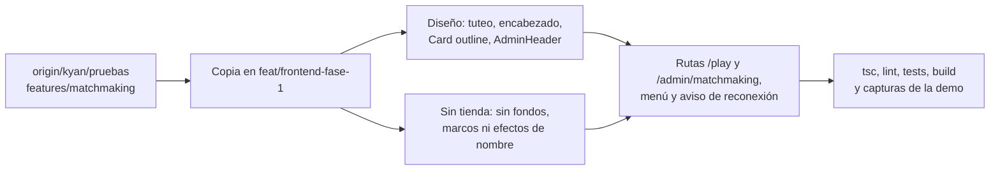

# Plan: traer el frontend del matchmaking a `feat/frontend-fase-1`

> Planeación original. Estado: **aprobado por Daniel** (2026-11-01), después de comparar las dos versiones en el [artifact](https://claude.ai/artifact/96VZS9JBGUvbcpBKM752vj) ("Kyan" contra "Propuesta").

El frontend del matchmaking ([`2026-10-28-matchmaking`](../2026-10-28-matchmaking/)) solo existe en `kyan/pruebas`: `/play`, `/admin/matchmaking`, el aviso de reconexión y la demo `/demo/matchmaking`. Este plan lo trae a `feat/frontend-fase-1` con dos cambios pedidos por Daniel:

1. **Que se sienta como el resto de la web.** No es un rediseño: se usan las piezas y los textos que ya usan las otras páginas.
2. **Sin los cosméticos de la tienda.** La tienda de puntos no está aprobada ni en producción ([`2026-10-29-tienda-puntos-backend`](../2026-10-29-tienda-puntos-backend/PLAN.md) sigue como propuesta). El fondo de miniperfil, el marco del avatar y el efecto del nombre llegan con la tienda.

## Decisiones tomadas

| Tema | Decisión | Por qué |
|---|---|---|
| Cómo se trae | Se copian los archivos del matchmaking desde `origin/kyan/pruebas` (`4079c8a2`), no se mezcla la rama | `kyan/pruebas` trae además la tienda, el anticheat, misiones y una docena de demos que no van en esta rama |
| Textos | **Tuteo**, como el resto de la web ("Arma tu partida", "Puedes volver en…", "(tú)") | El matchmaking estaba en voseo y era lo que más lo hacía sentir de otro lado |
| Encabezado de Jugar | Título "Jugar" (el nombre del menú) y descripción sueltos arriba, como Partidas. Los indicadores (en vivo, conexión, sonido, configuración) van a la derecha | Ninguna otra página mete el título dentro de una tarjeta con foto |
| Tarjeta principal | Una sola `Card variant="outline"`, sin la foto de la landing ni el degradé. El panel de partida queda separado por una línea, no como una tarjeta dentro de otra | Es la tarjeta común del proyecto (`CLAUDE.md` del frontend, "Componentes comunes") |
| Paneles de abajo | `Card variant="outline"` con el encabezado de las tarjetas del perfil (`border-b px-4 py-3.5`), sin íconos en el título | Igual que Resumen del perfil |
| Administración › Matchmaking | `AdminHeader` (título y subtítulo) y `AdminTabs`. Los formularios, en `Card variant="outline"` | Como Baneos, Clips y el resto de Administración |
| Sala de la partida | Sin cambios de diseño (solo el texto "(vos)") | Ya usa las piezas de la sala del mix (`MapBackdrop`, `SideTable`, `StatsTabs`) |
| Cosméticos | Se sacan `features/shop/cosmetics.tsx` y `public/cosmetics/`. Las tarjetas muestran `PlayerAvatar` y el nick normal. Los tipos pierden `background_url`, `frame_url` y `name_class` | Son de la tienda. La API del matchmaking tampoco los manda ("Datos que todavía no llegan" en la documentación del matchmaking) |
| VIP | Se queda. La insignia pasa a `Badge variant="vip"` | El VIP fase 0 está en producción. El bloqueo de compañeros y el sonido propio dependen de `is_vip()`, no de la tienda |
| Anticheat | No se trae. El link "Vincular el agente" sigue como `<a href>` | Es otro requerimiento (`kyan/anticheat-backend`) |
| Demo | `/demo/matchmaking` viene, solo en `pnpm dev`, sin cosméticos | La usan las pruebas y sirve para revisar el diseño sin API |

## 1. El flujo completo

## 2. Archivos que vienen de `kyan/pruebas`

| Archivo | Qué es |
|---|---|
| `src/features/matchmaking/**` | Jugar, sala, veto, administración, demo y pruebas (44 archivos) |
| `src/routes/_app/play.tsx` | `/play` con la API real (`apiMmSource`) |
| `src/routes/_app/admin.matchmaking.tsx` | `/admin/matchmaking` |
| `src/routes/demo.matchmaking.tsx` | La demo, solo en desarrollo |

## 3. Archivos de esta rama que cambian

| Archivo | Cambio |
|---|---|
| `src/routes/_app.tsx` | `ReconnectBanner` arriba de cada página con sesión |
| `src/auth/permissions.ts` | Sección de Administración `matchmaking` (solo admin) |
| `src/features/shell/lib/nav.ts` | "Jugar" en el grupo Jugar y "Matchmaking" en Administración |
| `src/features/mixes/components/MixRoom.tsx` | Exporta `SideTable`, que usan las estadísticas de la sala |

## 4. Cambios sobre lo de Kyan

- **Diseño:** `PlayPage`, `PlayBar`, `FriendsPanel`, `BlockPanel`, `PlayFeed` y `admin/*`, según la tabla de decisiones.
- **Textos:** unos 25 en voseo pasan a tuteo, en los componentes, `labels.ts` y `alert.ts`.
- **Sin tienda:** `GroupSlots`, `room/RoomOverview`, `BlockPanel`, `SoundSettings`, `types.ts` y `demo.ts`.
- **Pruebas:** `PlayPage.test.tsx`, `AdminMatchmaking.test.tsx` y `labels.test.ts` se ajustan a los textos y la estructura nuevos.

## 5. Requisitos antes de empezar

- Nada nuevo para instalar: las dependencias son las mismas.
- La API del matchmaking no está en `feat/backend-api-fase-1`. `apiSource.ts` usa `authFetch` sin tipos generados, así que no hace falta `pnpm gen:api`.

## 6. Orden de implementación

1. Copiar los archivos de la sección 2 desde `origin/kyan/pruebas`.
2. Aplicar los cambios de diseño y textos (los mismos de la "Propuesta" del artifact).
3. Sacar los cosméticos de la tienda.
4. Rutas, menú, permisos, aviso de reconexión y `SideTable`.
5. Ajustar las pruebas.
6. `pnpm typecheck`, `pnpm lint`, `pnpm test` y `pnpm build`.
7. Capturas de `/demo/matchmaking` en 1440 y 390 px.
8. `DOCUMENTACION.md`, `GUIA_IMPLEMENTACION.md` y la fila del README.
