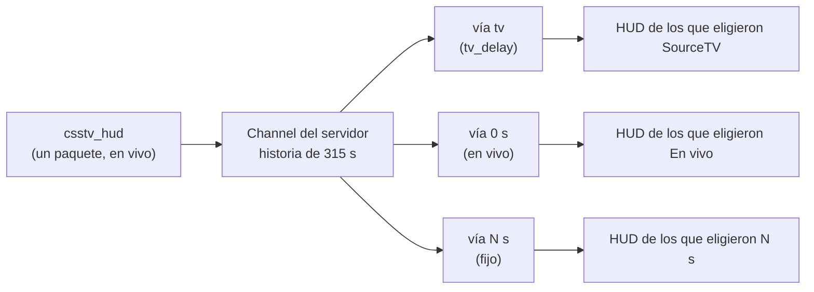

# Retraso del HUD por streamer y por servidor: documentación

## Qué hace

Cada streamer elige en `/control` con cuánto retraso va su HUD, **para cada servidor**:

- **SourceTV (N s)**, el valor por defecto: sigue el `tv_delay` del servidor, como siempre. Sirve para transmitir desde la SourceTV.
- **En vivo** (0 s): para transmitir desde un observador dentro del juego.
- **Fijo**, de 1 a 300 s: para compensar una demora propia del stream.

El servidor de CS no se entera de nada. `csstv_hud` sigue mandando cada paquete una sola vez y en vivo. El relay del VPS guarda los últimos 315 s de paquetes de cada servidor y arma una **vía** por cada retraso que alguien esté mirando. Si cuatro streamers miran flow con SourceTV y uno en vivo, flow tiene dos vías y cada streamer recibe la suya.

## Reglas

- **Por streamer y por servidor:** la elección se guarda en el `Control` de cada streamer, en `delays: { <id del servidor>: modo }` (`"local"` en el modo local). Elegir SourceTV borra la entrada. Al cambiar de servidor, cada uno trae su propio retraso; si no tiene, SourceTV.
- **Cualquier streamer** puede elegir En vivo (decidido por Daniel el 2026-11-01).
- **Vía nueva:** se arma con la historia. Lo que ya cumplió el retraso se aplica con su hora lógica (`llegada + retraso`), y así el reloj de la ronda y el kill feed dan igual que en una vía que estuvo desde el principio. El resto se encola. Pasar de SourceTV a En vivo hace saltar el HUD hacia adelante, y al revés hacia atrás.
- **Vías sin uso:** cada 30 s (en `refresh`) se marcan las vías de los que tienen `/hud` o `/control` abierto. Las que pasan 60 s sin marcarse se borran. La vía `tv` no se borra nunca.
- **Forzado global:** si el `"delay"` de `hud.json` (VPS) o de `relay.json` (local) no es `null`, todos van por la vía `tv` con ese valor. `/control` muestra los botones deshabilitados y "Fijado en la configuración del relay". Lo que el streamer haya elegido se guarda igual y vuelve a valer cuando el forzado se saca.
- **Aviso:** si el retraso es menor que el `tv_delay`, `/control` avisa en rojo que el HUD va adelantado a la SourceTV y muestra plata y vida en tiempo real.
- **Log del relay:** `<alias>: retraso de <servidor> → en vivo / SourceTV (N s) / N s.` En el modo local, `Retraso: …`.

## API del relay

- `POST api/control` acepta `{ "delay": { "server": "<uuid o local>", "mode": "tv" | "live" | 1..300 } }`. Lo inválido se ignora, como el resto de `/control`.
- `GET api/status` suma `delayMode`, `delayLocked` y `tvDelay`. `delaySeconds` ahora es el retraso de la vía del streamer.

## Dónde está cada cosa

| Qué | Archivo |
|---|---|
| Historia, vías, `laneKey`, `touch`, `prune`, `parseDelayMode` | `hud/relay/src/channel.ts` |
| `delays` en `Control`, `mergeDelays`, `delayModeOf`, `LOCAL_SERVER` | `hud/relay/src/control.ts` |
| Estado por vía, `status`, log del cambio y `housekeeping` | `hud/relay/src/hub.ts` |
| Modo local y versión 2.3.0 | `hud/relay/src/main.ts` |
| Tarjeta Retraso | `hud/relay/public/control.html` y `control.js` |
| Pruebas | `hud/relay/test/retraso.test.ts` |
