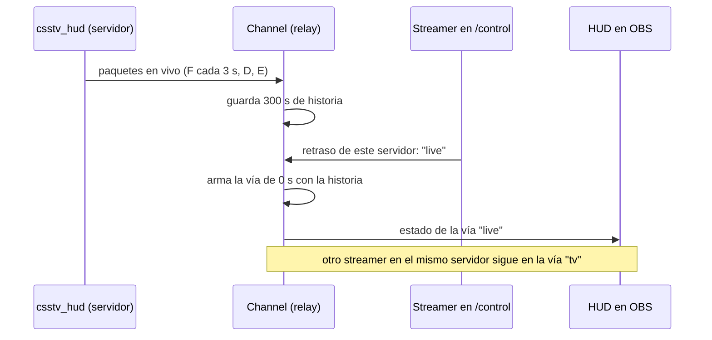

# Plan: cambiar el retraso del HUD desde /control, por servidor

> Planeación original. Estado: **propuesta**, pendiente de aprobación.

Pedido por Daniel el 2026-11-01. A veces el HUD hace falta **en vivo**: cuando se transmite desde un observador dentro del juego y no desde la SourceTV. Hoy el retraso sale del `tv_delay` de cada servidor, y la única forma de cambiarlo es el `"delay"` de `/etc/cmleague/hud.json` en el VPS. Ese valor vale para todos los servidores a la vez y hay que reiniciar el relay para cambiarlo. Como solución urgente, el 2026-11-01 se dejó en `0` (respaldo en `hud.json.bak_20261101`).

## Decisiones tomadas

| Tema | Decisión | Por qué |
|---|---|---|
| Quién lo elige | Cada streamer, en su `/control`, **para cada servidor**. Se guarda en su `Control` como `delays: { <id del servidor>: modo }` | El retraso depende de cómo transmite cada uno: dos streamers pueden mirar el mismo servidor, uno por la SourceTV y otro desde adentro. Guardarlo por servidor evita que al cambiar de servidor se lleve el "en vivo" sin querer |
| Modos | `tv` (por defecto: sigue el `tv_delay` del servidor), `live` (0 s) y un número fijo de 1 a 300 s | `tv` es lo de hoy. `live`, lo urgente. El número sirve para compensar la demora propia del stream |
| Cómo se arma en el relay | Cada `Channel` guarda los paquetes de los últimos 300 s y arma una **vía** (cola y modelo propios) por cada retraso que alguien esté mirando. La vía `tv` siempre existe | Los paquetes llegan una sola vez por servidor; con la historia, una vía nueva se arma al instante reproduciendo lo ya recibido, sin esperar ni dejar el HUD vacío |
| Vías sin uso | Se borran si pasan 60 s sin nadie mirándolas (salvo `tv`) | No acumular modelos que nadie mira |
| `"delay"` de `hud.json` | Sigue existiendo, como **forzado global**. Si no es `null`, manda sobre todo y `/control` muestra el selector deshabilitado con "Fijado en el relay: X s" | Sirve de emergencia, como hoy. Al desplegar esto se vuelve a `null` |
| Aviso de ghosting | Con `live` o con menos que el `tv_delay`, `/control` muestra un aviso en rojo y el HUD no cambia. El relay escribe en su log quién lo cambió, en qué servidor y a cuánto | Con el HUD en vivo, el stream muestra plata y vida en tiempo real. Los streamers ya los aprueba un admin con la marca de streamer |
| Base, API, web y plugin | **No cambian.** Es solo el relay (`hud/relay`) | Lo de `/control` vive en el relay (`control.json` del VPS). Al no tocar el plugin, no hay despliegue a los servidores de juego |
| Modo local (`relay.json`) | Usa el mismo selector, con un solo servidor | Sale gratis: el modo local también usa `Channel` |
| Versión | Relay **2.3.0** | Cambio de funcionalidad |

## 1. El flujo completo

Cuando un streamer cambia el retraso, el relay le manda enseguida el estado de su vía nueva. Pasar de `tv` a `live` hace que el HUD salte hacia adelante; pasar de `live` a `tv`, que vuelva atrás. Las dos cosas son esperables y se avisan en `/control`.

## 2. Relay: `channel.ts` y `delay.ts`

- `Channel` deja de tener una sola `DelayQueue` y un solo `GameModel`:
  - `history`: los paquetes aceptados con su hora de llegada, de los últimos 300 s (con `csstv_hud_interval 0.25` son unos pocos miles por servidor).
  - `lanes: Map<"tv" | number, Lane>`: cada vía tiene su `DelayQueue`, su `GameModel` y la última vez que alguien la miró.
- `handle()` valida el paquete una sola vez (clave, secuencia y `tvDelay` como hoy), lo guarda en la historia y lo encola en todas las vías.
- Vía nueva de `d` segundos: aplica de la historia todo lo que llegó hace más de `d` y encola el resto. Cada paquete se aplica con su hora lógica (`llegada + d`), para que `phaseEndsAt`, el kill feed y `updatedAt` den bien en el HUD.
- La vía `tv` mantiene la regla de hoy: si el `tv_delay` baja, un paquete nuevo no sale antes que uno anterior.
- `delaySeconds(mode)` y `snapshot(mode)` reciben el modo. El forzado global de `hud.json` reemplaza al modo cuando no es `null`.

## 3. Relay: `control.ts` y `hub.ts`

- `Control` suma `delays: Record<string, "tv" | "live" | number>`. `mergeControl` acepta `{ delay: { server, mode } }`: el servidor tiene que ser un UUID, `mode` uno de los tres, y el número un entero de 1 a 300. Lo inválido se ignora, como el resto de `/control`. El modo local usa la clave `local`.
- `Hub`:
  - `stateFor(viewer)` y `tick()` usan la vía de cada streamer: ya no se manda el mismo `state` a todos los que miran un servidor, sino a los que miran esa vía.
  - `onControl` vuelve a mandar el `state` cuando cambió la vía, igual que hoy cuando cambia el servidor.
  - `status()` devuelve `delayMode`, `delaySeconds` y `delayLocked` (si lo fija `hud.json`), y `tvDelay` del servidor elegido.
  - Escribe en el log `<alias>: retraso de <servidor> → en vivo / SourceTV (N s) / N s`.
  - En cada `refresh()` (30 s) borra las vías que nadie mira hace 60 s.

## 4. `/control` (`control.html` y `control.js`)

Una tarjeta **Retraso** debajo de **Servidor**, solo con un servidor elegido:

- Tres botones, como los de servidor: `SourceTV (N s)`, `En vivo` y `Fijo`, este con un campo de segundos.
- Debajo, el retraso que tiene hoy el HUD.
- Con `En vivo`, o con un fijo menor que el `tv_delay`: el aviso rojo "El HUD va adelantado a la SourceTV: muestra plata y vida en tiempo real. Usalo solo si transmitís desde adentro del juego.".
- Con `delayLocked`: botones deshabilitados y "Fijado en el relay: X s".
- La línea de estado de arriba ya muestra `retraso X s`; ahora se agrega "(en vivo)" o "(SourceTV)".

## 5. Pruebas

En `hud/relay/test/` (hoy hay 34, con `node --test`):

- Dos streamers en el mismo servidor, uno en `tv` con `tv_delay` 30 y otro en `live`: el de `live` ve la kill al instante y el otro a los 30 s.
- Cambiar de `tv` a `live` a mitad de ronda: el estado nuevo trae la historia completa (jugadores, puntos y fase), no un HUD vacío.
- Vía de 10 s creada con 5 s de historia: muestra lo que tiene y completa el resto a tiempo.
- El reloj de la ronda (`phaseEndsAt`) de una vía armada con la historia coincide con el de una vía que estuvo desde el principio.
- `mergeControl`: modos válidos e inválidos, número fuera de rango y servidor que no es UUID.
- Con `"delay"` en `hud.json`: manda sobre los modos y `status` dice `delayLocked`.
- Una vía sin nadie mirándola se borra a los 60 s; la `tv` no.
- Las 34 de hoy siguen en verde.

Además, una prueba de humo con `pnpm simular 30` y dos pestañas de `/hud` con modos distintos.

## 6. Requisitos antes de empezar

- Nada nuevo. `pnpm` en `hud/relay` como siempre (`pnpm install --frozen-lockfile`).
- Para desplegar: el acceso por SSH al VPS, que ya funciona desde esta PC con el `ssh` de Windows (el agente tiene la llave).

## 7. Orden de implementación

1. `channel.ts` con la historia y las vías, y sus pruebas.
2. `control.ts` (`delays` y `mergeControl`) y sus pruebas.
3. `hub.ts` (estado por vía, `status`, log y limpieza) y el modo local en `main.ts`.
4. `/control`: la tarjeta Retraso y el aviso.
5. Todas las pruebas, `pnpm simular` con dos pestañas y el build.
6. Versión 2.3.0 y despliegue al VPS con `desplegar.sh hud`.
7. Volver `"delay"` a `null` en `/etc/cmleague/hud.json` y reiniciar `cmleague-hud`. A partir de ahí, cada streamer elige en `/control`.
8. `DOCUMENTACION.md`, `GUIA_IMPLEMENTACION.md`, la fila en `bitacora/README.md` y `PENDIENTES.md`.
