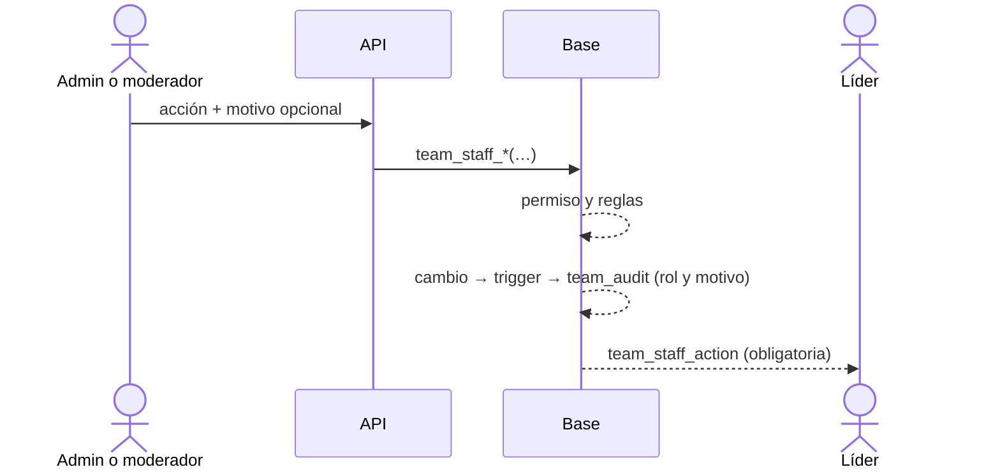

# Moderar equipos: documentación

## Qué hace

Administración › Equipos tiene dos pestañas:

- **Moderar equipos** (moderadores y admins): la lista de los equipos activos y un panel por equipo para corregirlo a mano. El panel tiene los datos, las acciones, el plantel y el historial de cambios.
- **Configuración equipo** (solo admin): el máximo de miembros y los equipos por líder, como estaba antes.

Cada acción del staff acepta un **motivo opcional** y le **avisa siempre al líder** con una notificación obligatoria, que no se puede apagar. Un equipo disuelto no aparece y no se reactiva: es como si no existiera, y uno nuevo con el mismo nombre es otro equipo.

## Quién puede qué

| Acción | Admin | Moderador |
|---|---|---|
| Ver la lista, el plantel y el historial | Sí | Sí |
| Cambiar nombre y sigla (sin la espera de 30 días del equipo) | Sí | Sí |
| Quitar el logo | Sí | Sí |
| Quitar a un miembro (no al líder) | Sí | Sí |
| Cambiar el líder (a un miembro con cuenta, sin el tope por líder) | Sí | No |
| Sumar un jugador sin invitación, cambiar un rol | Sí | No |
| Crear, disolver y borrar un equipo | Sí | No |
| Configuración equipo | Sí | No |

- **Al líder no se lo saca directo:** primero un admin cambia el líder (`409` si se intenta).
- **Nombre cambiado por el staff:** la espera de 30 días del equipo sigue contando desde su último cambio propio (`name_changed_at` no se toca). El equipo puede volver a cambiarlo con sus reglas, y si pone algo ofensivo lo frenan las palabras bloqueadas.
- **Palabras bloqueadas:** al moderador lo frena la base. El admin puede forzar (`force: true`), como antes.

## Historial (`team_audit`)

| Acción | Cuándo | `data` |
|---|---|---|
| `created` | Se crea el equipo | `name`, `tag` |
| `renamed` | Cambian el nombre o la sigla | `old_name`, `old_tag`, `name`, `tag` |
| `logo_changed` / `logo_removed` | Cambia o se quita el logo | — |
| `captain_changed` | Cambia el líder | `from`, `to` (alias) |
| `member_added` / `member_removed` / `member_left` | Alta, baja hecha por otro o salida propia | `player`, `role` |
| `role_changed` | Cambia el rol de un miembro | `player`, `from`, `to` |
| `dissolved` | Se disuelve | — |

- Lo llenan triggers en `teams` y `team_members`: queda todo, lo haga el equipo, un moderador, un admin o una carga sin usuario.
- `actor_role` es `team`, `moderator`, `admin` o `system`. Las acciones del staff lo fijan; si no, un admin o moderador que toca un equipo ajeno cuenta como staff, y el resto como el propio equipo.
- La baja masiva de una disolución queda como un solo `dissolved`.
- Lo leen solo moderadores y admins (RLS).

## Avisos

- **`team_staff_action`** va al líder, y también al anterior si cambió el líder. Lleva `team`, `action`, `by` (`admin` o `moderator`), `reason` y el jugador si aplica. Es obligatoria.
- **Al jugador**, los avisos de siempre (`team_removed`, `team_added`, `team_role_changed`) suman `reason` cuando el staff lo dio.

## Lista (`admin_team_list`)

Solo los equipos activos, con líder, miembros, jugadores (sin el coach), torneos abiertos o en curso, si el nombre o la sigla tienen una palabra bloqueada, y el último cambio. Filtros de la API: `blocked`, `incomplete` (menos de 5), `no_leader` e `in_event`, más la búsqueda por nombre, sigla o jugadores.

## La pantalla

- **Lista:** filtros (Todos, Palabra bloqueada, Incompletos, Sin líder, En un torneo) y búsqueda por nombre, sigla o jugador.
- **Panel del equipo elegido:**
  - datos (miembros, jugadores sin coach, torneos activos);
  - acciones: "Cambiar nombre y sigla" y "Quitar logo" para todo el staff, y "Sumar jugador" y "Disolver" solo para el admin;
  - plantel: rol editable y "Hacer líder" para el admin, "Quitar" para todo el staff (deshabilitado para el líder);
  - historial con autor, rol, motivo y fecha.
- **Cada acción** abre un diálogo con lo propio de la acción, el motivo opcional y el texto exacto del aviso que recibe el líder. Disolver pide escribir el nombre.
- **Configuración equipo:** solo para el admin; el moderador no ve la pestaña.
- **Notificación** del líder: "Un moderador cambió el nombre del equipo a X", con "Motivo: …" o "Sin motivo indicado".

## Dónde está cada cosa

| Qué | Archivo |
|---|---|
| Base | `supabase/replanteo/43_moderar_equipos.sql` (inversa y pruebas en `docs/bitacora/2026-10-14-replanteo-modelo-datos/`) |
| Rutas | `web/backend/src/routes/admin-teams.ts` |
| Esquemas | `web/backend/src/schemas/admin.ts` (`AdminTeamQuery`, `AdminTeamRow`, `TeamAuditEntry`, `ReasonBody`) |
| Pruebas | `web/backend/test/integration/moderar-equipos.test.ts` |
| Contrato | `docs/frontend/contrato/admin.md`, `notificaciones.md` y `README.md` |
| Pantalla | `web/frontend/src/features/admin/teams/` (ruta `routes/_app/admin.teams.tsx`) |
| Texto de los avisos | `web/frontend/src/features/shell/notifications/lib/model.ts` |
