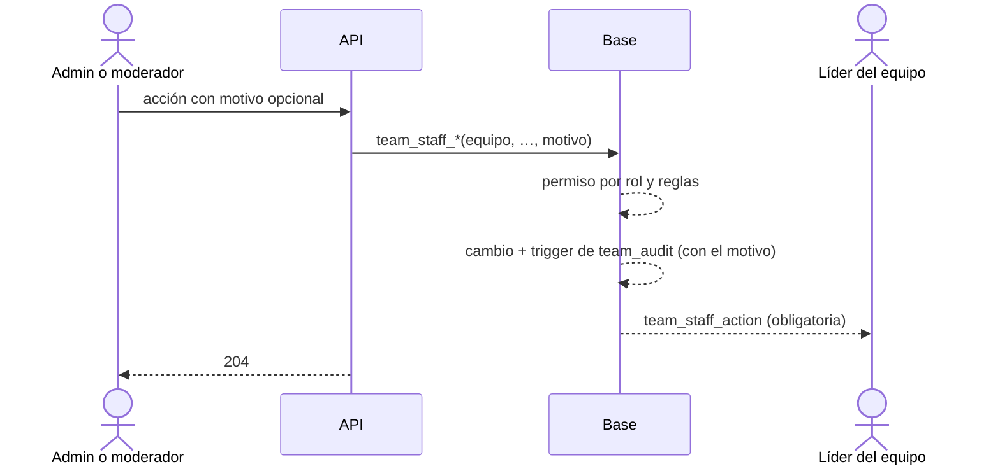

# Plan: moderar equipos (Administración › Equipos)

> Planeación original. Estado: **aprobado por Daniel (2026-11-01)** sobre el [artifact "Admin de equipos"](https://claude.ai/artifact/CE8aC1eeVaHffTmCBxAfHt).

## Decisiones tomadas

| Tema | Decisión | Por qué |
|---|---|---|
| Pestañas | Administración › Equipos tiene **Moderar equipos** (lista y panel) y **Configuración equipo** (lo que hay hoy: máximo de miembros y equipos por líder). Configuración, solo admin | Daniel |
| Admin | Todo: nombre y sigla, logo, líder, sumar y quitar miembros, roles, crear, disolver y borrar | Daniel |
| Moderador | Ver equipos, plantel e historial; cambiar nombre y sigla; quitar el logo; quitar miembros | Daniel: "los del mod todos me parecen bien" |
| Disueltos | No aparecen ni se reactivan: un disuelto es como si no existiera; uno nuevo con el mismo nombre es otro equipo | Daniel |
| Motivo | **Opcional** en cada acción del staff | Daniel |
| Aviso | **Siempre** se le avisa al líder (notificación obligatoria, no se puede apagar), con el motivo si lo hay. Si se quita a un miembro, el jugador recibe su aviso de siempre con el motivo | Daniel |
| Nombre cambiado por el staff | El equipo lo puede volver a cambiar con su regla de siempre (una vez cada 30 días, contado desde su último cambio) | Daniel |
| Quitar al líder | No se puede directo: primero el admin cambia el líder | Daniel |
| Historial | Tabla `team_audit` que llenan triggers: nombre y sigla, logo, líder, altas, bajas, roles y disolución, de cualquiera (equipo, moderador, admin). La ven admins y moderadores | Daniel: "historial de cambios sí" |

## 1. El flujo completo

## 2. Base de datos (replanteo `43_moderar_equipos.sql`, con inversa y pruebas)

- `team_audit (id, team_id, at, actor_id, actor_role, action, data, reason)`, RLS: la leen los moderadores y admins.
- Triggers de auditoría en `teams` y `team_members`. El motivo llega por `v34.audit_reason`. El rol del actor: `admin` o `moderator` si actúa sobre un equipo del que no es miembro; `team` si es del equipo; `system` sin usuario.
- Funciones del staff: `team_staff_rename`, `team_staff_remove_logo`, `team_staff_remove_member` (admin o moderador) y `team_staff_set_captain`, `team_staff_add_member`, `team_staff_set_role`, `team_staff_dissolve` (admin). Cada una avisa al líder con `team_staff_action`.
- `team_removed`, `team_added` y `team_role_changed` suman el motivo si lo hay.
- Vista `admin_team_list` para la lista: líder, miembros, jugadores (sin coach), torneos activos, si el nombre o la sigla tienen una palabra bloqueada y el último cambio.

## 3. API

- `GET /admin/teams` (moderador o admin): filtros `q`, `filter` (`blocked`, `incomplete`, `no_leader`, `in_event`) y paginado.
- `GET /admin/teams/{id}/history` (moderador o admin).
- `PATCH /admin/teams/{id}` (nombre y sigla: moderador o admin; líder: admin) con `reason`.
- `POST /admin/teams/{id}/logo/remove` y `POST /admin/teams/{id}/members/{playerId}/remove` (moderador o admin) con `reason`.
- `POST /admin/teams/{id}/members`, `PATCH /admin/teams/{id}/members/{playerId}` y `POST /admin/teams/{id}/dissolve` (admin) con `reason`.

## 4. Frontend

- Administración › Equipos con las dos pestañas; el moderador entra a la sección y ve solo Moderar equipos.
- Lista con filtros y búsqueda; panel con datos, acciones, plantel e historial; diálogos con motivo opcional y el texto del aviso.
- Texto de la notificación `team_staff_action` y el motivo en `team_removed`.

## 5. Orden

1. `43`, pruebas e inversa. 2. API, tipos, pruebas y contrato; commit y merge. 3. Frontend; pruebas; commit.
