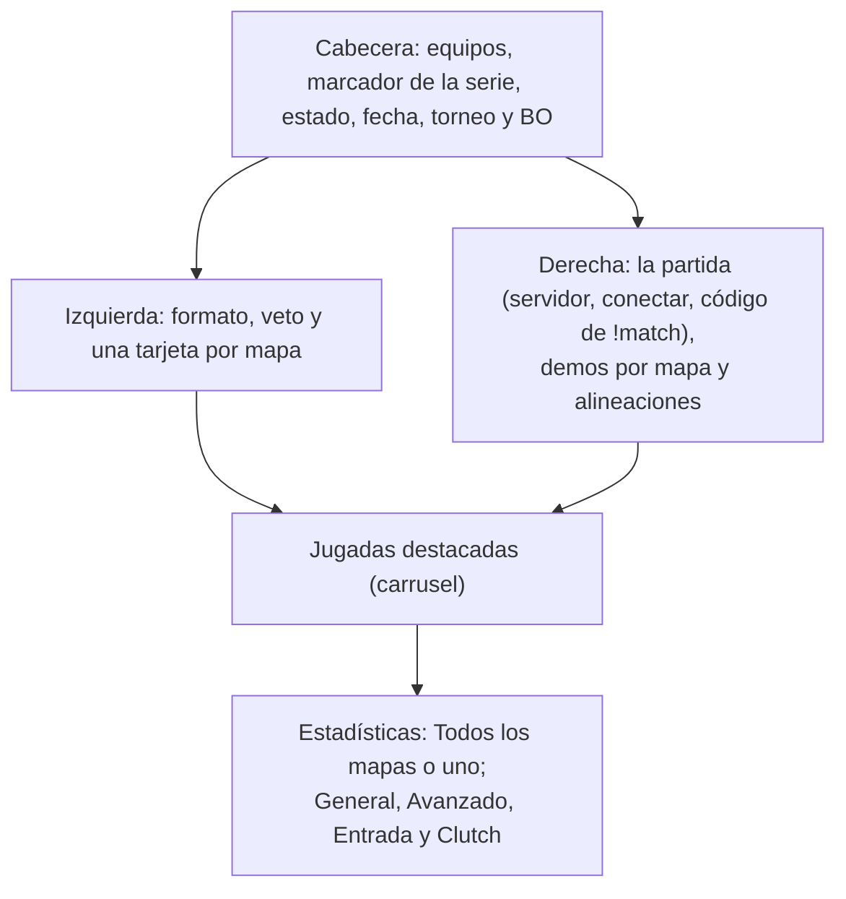

# Página de una serie de torneo o PCW: documentación

"Ver partida" en la Llave (y cualquier link a `/match/{id}` de una partida de torneo o PCW) abre la página de la serie. Un mix sigue abriendo su sala. Diseño aprobado en el [artifact](https://claude.ai/artifact/176QEQecgQE31Vrgtm6Ant) (opción 2).

## Qué muestra

| Parte | Detalle |
|---|---|
| Veto | En orden: "Titanes sacó de_nuke", "Mamba eligió de_tuscan"… y "de_cbble quedó como decisivo". Si el veto sigue, a quién le toca |
| Tarjeta de mapa | Resultado, PICK de quien lo eligió y el estado: decisivo, por jugar, en vivo (lleva a la sala en vivo), sin detalle (a mano) o no se jugó. Con stats, tocarla elige ese mapa en las estadísticas (y otra vez, vuelve a todos) |
| La partida | Servidor; hasta que termina, la dirección para conectar y el código de `!match` (solo a quien la API se lo da) |
| Demos | Una por mapa jugado: descargar con el tamaño, "subiéndose", "vencida" o "sin demo" |
| Alineaciones | Con mapas jugados, el rating de la serie; si no, el de las últimas 4 semanas en 5v5 ([`2026-11-01-rating-alineaciones`](../2026-11-01-rating-alineaciones/)) |
| Jugadas destacadas | Los clips de todos los mapas, por mapa y por puesto, con flechas. Cada uno con el tipo (ACE, 4K, 3K, 1v3…), el jugador, el mapa y la ronda. Al tocarlo, el video arriba del carrusel. Los que se están grabando dicen "Procesando clips…" y la lista se vuelve a pedir cada minuto. Si un mapa se jugó hace menos de 6 horas y su demo se está subiendo, también "Procesando clips…". Sin clips ni nada pendiente, la sección no aparece |
| Estadísticas | Las mismas tablas de la sala del mix (`RoomStats`). "Todos los mapas" es la suma (rating ponderado por rondas, Δ ELO sumado, clutches sumados). Un mapa: sus stats y su Δ ELO. Los mapas a mano no tienen stats: si ninguno tiene, un aviso. El mapa elegido va en la URL (`?map=<id del juego>`) |

## Estados

| Serie | Qué cambia |
|---|---|
| Por jugar | Sin marcador; servidor, conectar, código y "Empieza"; alineaciones con el rating reciente; las estadísticas dicen que aparecen con el primer mapa |
| En vivo | "En vivo" en la cabecera; la tarjeta del mapa en juego con su marcador lleva a la sala en vivo |
| W.O. | El aviso "Se definió por W.O." |
| Cancelada | El aviso con el motivo |

## API

`GET /api/v1/matches/{id}` de una serie suma, desde el 2026-11-01:

| Campo | Qué es |
|---|---|
| `games[].players` | Stats de cada mapa en los lados de la serie, con `elo_delta` y `clutches` (null si ese juego no tiene datos de clutch) |
| `games[].demo_size`, `games[].demo_status` | La demo de cada mapa |
| `series_players[].elo_delta` | La suma de los mapas (antes llegaba en null) |
| `series_players[].clutches` | La suma de los mapas con datos de clutch |

Los clips de cada mapa salen de `GET /api/v1/matches/{juego}/clips`.

## Dónde está cada cosa

| Pieza | Dónde |
|---|---|
| Página | `web/frontend/src/features/series/pages/SeriesRoom.tsx` |
| Lógica (mapas, veto, alineaciones, clips) | `web/frontend/src/features/series/lib/series.ts` (+ pruebas) |
| Clips | `web/frontend/src/features/series/api/queries.ts` |
| Tablas | `RoomStats` en `web/frontend/src/features/mixes/components/MixRoom.tsx` y `statsRoomFromLines` en `mixes/lib/room.ts` |
| Ruta | `web/frontend/src/routes/_app/match.$id.tsx` (`?stats=` y `?map=`) |
| API | `web/backend/src/routes/matches.ts`, `schemas/matches.ts` y `sumSeries` en `services/matches.ts` |
