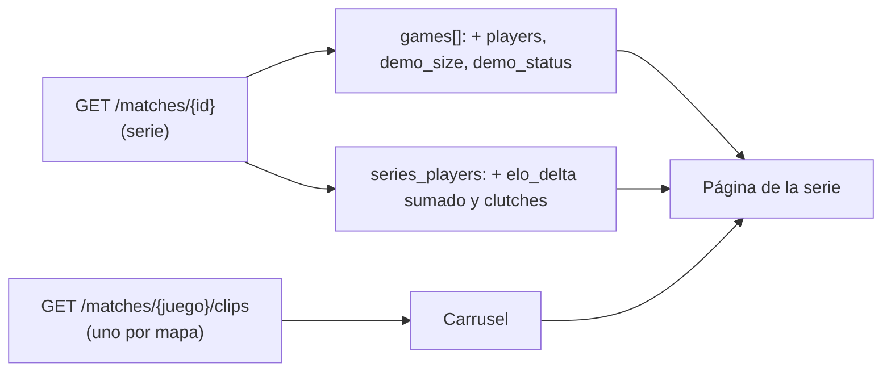

# Página de una serie de torneo o PCW: plan

Pedido por Daniel el 2026-11-01: "Ver partida" en la Llave lleva a `/match/{id}`, que para una serie de torneo o PCW decía "Próximamente". Diseño aprobado en el [artifact](https://claude.ai/artifact/176QEQecgQE31Vrgtm6Ant) (opción 2, inspirada en HLTV, con nuestros estilos).

## Decisiones (Daniel, 2026-11-01)

| Tema | Decisión |
|---|---|
| Diseño | Opción 2: cabecera de la serie; a la izquierda el veto y una tarjeta por mapa (resultado y quién lo eligió); a la derecha los datos de la partida, las demos y las alineaciones; abajo las jugadas destacadas y las estadísticas |
| Demos | En la columna derecha, una por mapa |
| Jugadas destacadas | Carrusel con los clips de todos los mapas, ordenados por mapa y por puesto. Al tocar uno se abre el video. Mientras se graban: "Procesando clips…". Sin demo o sin jugadas, no aparece |
| Estadísticas | Selector "Todos los mapas" o un mapa, y las pestañas de siempre (General, Avanzado, Entrada, Clutch). Tocar una tarjeta de mapa también lo elige |
| Δ ELO | Se muestra: en un mapa, el de ese mapa; en "Todos los mapas", la suma. Cada mapa jugado con `!match` es un mix con su ELO (decidido el 2026-10-15) |
| Swing y KAST | No: el plugin no manda los datos |

## Estados

| Serie | Qué muestra |
|---|---|
| Por jugar | Fecha, servidor, el veto si empezó y las alineaciones con el rating de las últimas 4 semanas en 5v5 |
| En vivo | El mapa en juego con su marcador y "Ver en vivo"; los mapas terminados con sus stats |
| Con mapas a mano | La tarjeta del mapa dice "sin detalle" y no se puede elegir. Si ningún mapa tiene stats, en lugar de la tabla, un aviso |
| W.O. | El resultado y el aviso, sin mapas ni stats |
| Cancelada | El motivo |

## Cambios

### API (`feat/backend-api-fase-1`)

1. `games[]` suma `players` (las stats de ese mapa en los lados de la serie, con su Δ ELO y sus clutches), `demo_size` y `demo_status`.
2. `series_players` suma el `elo_delta` de los mapas y los clutches (si algún mapa tiene datos de clutch). Hoy vienen en null.
3. Sin cambios en la base. Pruebas de integración.

### Frontend (`feat/frontend-fase-1`)

1. `/match/{id}`: si la partida es de torneo o PCW, la página de la serie (hoy, "Próximamente").
2. Las tablas de stats son las de la sala del mix (se separan en un componente que usan las dos).
3. Carrusel de clips con los de cada mapa (`GET /matches/{juego}/clips`).
4. Pruebas unitarias de lo que arma la página (mapas, quién eligió, estados) y una prueba de punta a punta.
