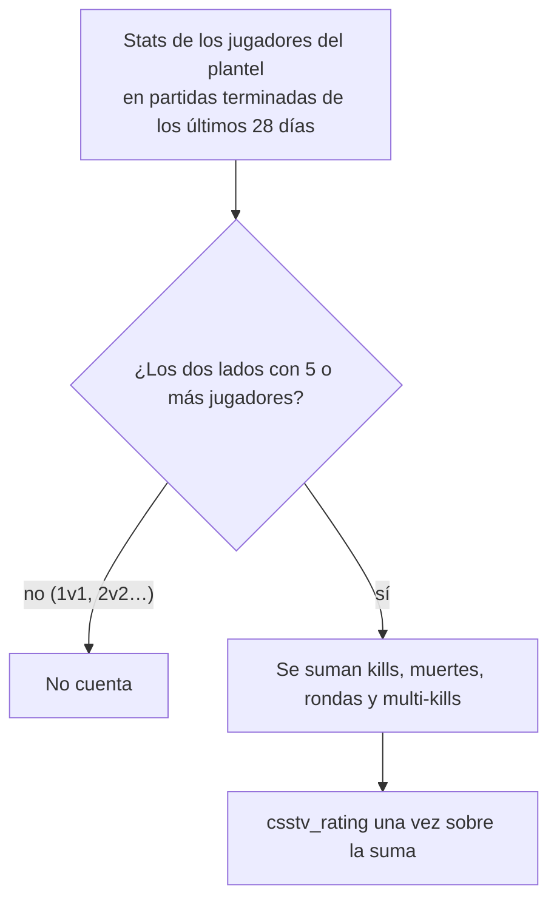

# Rating en las alineaciones de una serie: documentación

## Qué muestra la tarjeta de una partida de la Llave

| Estado de la serie | Rating de cada jugador | Título |
|---|---|---|
| Con al menos un juego vinculado terminado | El de la serie: stats sumadas de los juegos jugados | "Alineaciones · rating de la serie" |
| Sin jugar o con todos los mapas a mano | El de las **últimas 4 semanas en partidas 5v5** de cualquier tipo | "Alineaciones · rating de las últimas 4 semanas (5v5)" |
| Jugador sin partidas 5v5 en ese tiempo, o invitado | Sin número | — |

## Dónde está cada cosa

| Pieza | Dónde |
|---|---|
| Función | `public.player_recent_rating(p_players uuid[], p_days integer default 28)`: `player_id`, `rating`, `maps`. `security definer` (anon no lee `matches`); solo devuelve el agregado. Días entre 1 y 365 |
| Migración | `supabase/replanteo/44_rating_reciente.sql` |
| API | `GET /api/v1/matches/{id}`: `roster1[].rating` y `roster2[].rating` (`web/backend/src/routes/matches.ts`, `schemas/matches.ts`) |
| Pantalla | `web/frontend/src/features/events/components/bracket/MatchPopover.tsx` |
