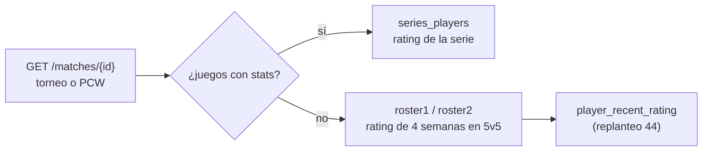

# Rating en las alineaciones de una serie: plan

Pedido por Daniel el 2026-11-01, con la captura de una serie suiza con los tres mapas cargados a mano: las alineaciones salían sin rating.

## Qué se pide

- Si la serie ya se jugó (con juegos vinculados), cada jugador muestra el **rating de la serie** (lo da `series_players`, E21).
- Si no se jugó, o se cargó a mano sin stats, cada jugador del plantel muestra su **rating general de las últimas semanas en partidas 5v5 de cualquier tipo**.

## Decisiones

| Tema | Decisión |
|---|---|
| Ventana | **4 semanas** (28 días). La función acepta otro valor por si se quiere ajustar |
| Qué es 5v5 | Una partida terminada con **al menos 5 jugadores con stats en cada lado**. Un reemplazo suma un sexto y no la descarta. Vale cualquier tipo: mix, juego de torneo o de PCW |
| Cómo se promedia | Igual que `player_stats`: las stats se suman y se calcula el rating una vez (pesa por rondas) |
| Sin partidas en la ventana | Sin rating (no se muestra número) |
| Invitados de PCW | Sin rating (no tienen ficha) |

## Cambios

1. **Base:** replanteo `44_rating_reciente.sql` con `player_recent_rating(jugadores, días)`, su inversa y pruebas SQL.
2. **API:** `RosterPlayer.rating` en el detalle de la partida.
3. **Frontend:** la tarjeta de la Llave usa `series_players` si hay; si no, el rating del plantel, con el título "Alineaciones · rating de las últimas 4 semanas (5v5)".

## Numeración

La `44` la toma este cambio. Las migraciones del anticheat de kyan pasan a `45`–`47` y la del matchmaking a `48` (o a la siguiente libre cuando se mergee).
