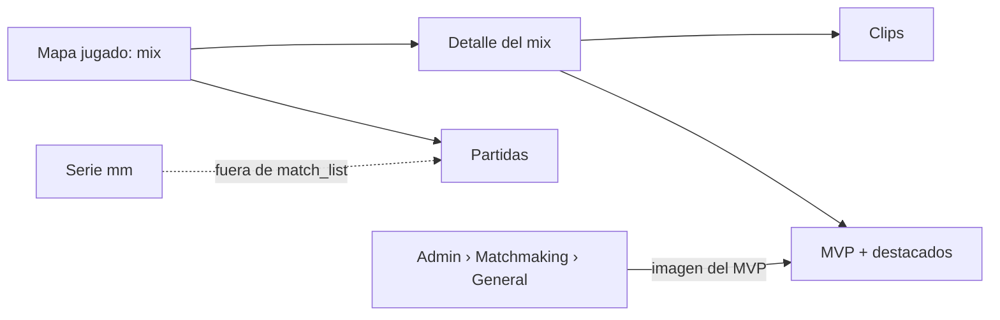

# Ajustes después del primer matchmaking: documentación

## Qué hace

Cinco arreglos que salieron del primer 1v1 del matchmaking (Daniel y kyan, 2026-11-02):

1. **Partidas ya no muestra la serie del matchmaking.** Solo queda el mapa jugado, como "Mix".
2. **La flecha de volver** vuelve a donde estabas. Si entraste directo con un link, va a la sección de siempre.
3. **El detalle de un mix terminado** tiene lo de la sala del matchmaking: tarjeta del MVP, destacados y "Lo más destacado" con los clips automáticos.
4. **La tarjeta del MVP** usa una imagen fija que sube un admin, en lugar de repetir la foto del mapa.
5. **El matchmaking responde al instante** a Aceptar y al baneo de un mapa, y pide menos veces el estado.

## 1. La serie del matchmaking

Cada partida del matchmaking es una fila `matches.kind = 'mm'`, un contenedor del veto, el chat y el resultado. Cuelga de ella el mapa jugado, que es un mix (`parent_match_id`).

- **Replanteo `53`:** `match_list` deja afuera `kind = 'mm'`. Así la serie no sale en Partidas, en el Inicio ni en "Mis partidas", y tampoco cuenta en los contadores por tipo.
- **Web:** si alguien abre `/match/<serie mm>` por un link viejo, lo lleva al mapa jugado.

## 2. Volver

`BackButton` (`components/brand`) se usa en la serie de torneo o PCW, el mix, el comparador, el equipo y el torneo de Administración.

| Cómo se llegó | Qué hace | Texto |
|---|---|---|
| Navegando dentro de la web | `router.history.back()` | "Volver" |
| Directo (link compartido, recarga en la primera página) | Va a la sección (`fallback`) | El nombre de la sección, por ejemplo "PCW" o "Torneos" |
| Ctrl, Cmd, Shift o clic del medio | Abre la sección en otra pestaña, como un link | |

## 3. Detalle del mix terminado

- `MixHighlights` (`features/mixes/components`) arma lo de arriba (MVP y destacados, `MvpAndLeaders` de la sala) y lo de abajo ("Lo más destacado", `Highlights` de la sala, con `GET /api/v1/matches/{id}/clips`).
- Solo con el mix terminado. Los cancelados y los en vivo quedan como antes.
- El mix no tiene foto ni nivel de cada jugador: la tarjeta muestra las iniciales.

## 4. Imagen del MVP

| Pieza | Detalle |
|---|---|
| Dato | `mm_config.mvp_image_url` (replanteo `54`). `null`: la tarjeta queda lisa |
| Subir | `PUT /api/v1/admin/mm/mvp-image` (admin, `multipart/form-data`, campo `file`). JPG, PNG o WebP, 4:1, de 800×200 a 2400×600, hasta 4 MB. Va al bucket `photos`, carpeta `mm/`. Borra la anterior |
| Quitar | `DELETE /api/v1/admin/mm/mvp-image`. Borra el archivo |
| Leer | `GET /api/v1/mm/mvp-image` (con sesión), `mvp_image_url` en la sala (`mm_lobby_json`) y en `GET /api/v1/admin/mm/config` |
| Pantalla | Administración › Matchmaking › General, tarjeta "Imagen del MVP". Se encuadra en 4:1 antes de subirla, como el banner de un torneo |

## 5. Rendimiento del matchmaking

| Antes | Ahora |
|---|---|
| Aceptar y banear se veían recién cuando volvía la API (1 a 2 s) | Se ven al tocar; si la API falla, vuelve atrás |
| Cada aviso del socket pedía el estado enseguida | Los avisos que llegan juntos (100 ms) se piden una vez |
| Una acción propia pedía el estado dos veces (la respuesta y su aviso) | Si la respuesta llegó después del último aviso, ya lo trae y no se vuelve a pedir |

Medido el 2026-11-02 en staging, antes del cambio:

- `GET /api/v1/mm/state` tarda de 0,7 a 1,4 s desde el VPS. `mm_my_state` en la base, de 50 a 300 ms. La llamada directa a Supabase, de 0,17 a 0,65 s.
- El socket no demora nada: reenvía el aviso apenas llega.
- **Queda para otra etapa:** que el aviso traiga el cambio en sí, para no tener que pedir el estado completo.

## Dónde está cada cosa

| Qué | Archivo |
|---|---|
| Replanteos | `supabase/replanteo/53_match_list_sin_mm.sql` y `54_mm_imagen_mvp.sql` (rama `feat/mm-claim-en-sala`) |
| Inversas | `docs/bitacora/2026-10-14-replanteo-modelo-datos/reversas/53_…` y `54_…` (misma rama) |
| API | `web/backend/src/routes/mm.ts` y `web/backend/test/unit/mm-mvp-image.test.ts` (misma rama) |
| Volver | `web/frontend/src/components/brand/BackButton.tsx` (rama `feat/frontend-fase-1`) |
| Detalle del mix | `web/frontend/src/features/mixes/components/MixHighlights.tsx` y `pages/MixRoomPages.tsx` |
| MVP y destacados | `web/frontend/src/features/matchmaking/room/RoomStats.tsx` (`MvpAndLeaders`) |
| Imagen en Administración | `web/frontend/src/features/matchmaking/admin/MvpImageCard.tsx` |
| Rendimiento | `web/frontend/src/features/matchmaking/queries.ts` y `VetoBoard.tsx` |
| Foto de cada jugador | `supabase/replanteo/55_mm_foto_jugador.sql` y `web/frontend/src/features/matchmaking/GroupSlots.tsx` |
| Pruebas SQL | `pruebas/53_54.sql`, `pruebas/55.sql` y `pruebas/correr_local.sh` (esta carpeta) |

## 6. La foto de cada jugador (agregado el 2026-11-02)

Pedido por Daniel después del plan: en Jugar no se veía la foto del usuario.

- **Causa:** `mm_player_card` solo usaba la foto de la ficha (`players.photo_url`), que casi nadie tiene. El resto de la web usa la de la ficha o, si no hay, el avatar del perfil (`player_overview`). Los compañeros del grupo ni siquiera traían foto, y la web la ponía en `null`.
- **Replanteo `55`:**
  - `mm_player_photo(ficha)` devuelve `coalesce(players.photo_url, profile_details.avatar_url)`.
  - La usan `mm_player_card` (tu tarjeta, la sala y los destacados) y `mm_my_state` › `party.members`.
- **Web:** `MmPartyMember.photo_url` y `GroupSlots` la usan.
