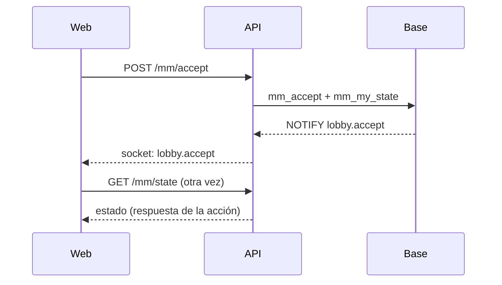

# Plan: ajustes después del primer matchmaking (1v1 de Daniel y kyan)

> Planeación original. Estado: **aprobado por Daniel (2026-11-02)**: la imagen del MVP va en Administración › Matchmaking › General, y del rendimiento solo los arreglos rápidos.

## Decisiones tomadas

| Tema | Decisión |
|---|---|
| 1. Partida doble en Partidas | La serie del matchmaking (`matches.kind = 'mm'`) es un contenedor: `match_list` la deja afuera. Queda el mapa jugado, que es un `mix` |
| 2. Botón de volver | Un componente común: si se llegó navegando dentro de la web, vuelve al paso anterior del historial; si se entró directo (link compartido), va a la sección de siempre |
| 3. Detalle del mix | El mix terminado suma lo de la sala del matchmaking: tarjeta del MVP, destacados y "Lo más destacado" con los clips automáticos |
| 4. Imagen del MVP | Una sola imagen, la sube un admin en Administración › Matchmaking › General. Se usa en la sala del matchmaking y en el detalle del mix. Sin imagen: fondo liso, no la foto del mapa |
| 5. Rendimiento | Solo los arreglos rápidos: respuesta inmediata en Aceptar y en el baneo de mapas, y que cada aviso del socket pida solo el estado del matchmaking (y no otra vez después de una acción propia). Los avisos con el cambio adentro quedan para otra etapa |

## 1. Lo que se midió (2026-11-02, staging)

- `GET /api/v1/mm/state`: 1,0–1,7 s desde la PC y 0,7–1,4 s desde el mismo VPS. `mm_my_state` en la base: 50–300 ms. La misma llamada directa a Supabase (`rpc/mm_my_state`): 0,17–0,65 s.
- El socket reenvía apenas llega el `NOTIFY`. Cada aviso invalida todas las consultas del matchmaking y vuelve a pedir el estado completo. Al aceptar, el estado se pide dos veces (la respuesta de la acción y el aviso propio).

## 2. Base de datos

- **`53_match_list_sin_mm.sql`:** `match_list` con `where m.kind <> 'mm'`. Se rehace desde su definición actual (`pg_get_viewdef`) para no copiar la vista a mano.
- **`54_mm_imagen_mvp.sql`:** `mm_config.mvp_image_url`. `mm_admin_config` y `mm_set_config` la leen y la escriben. `mm_lobby_json` la devuelve, y una función pública `mm_mvp_image()` la da para el detalle del mix.
- Las dos con inversa y pruebas.

## 3. API

- `POST` y `DELETE /api/v1/mm/admin/mvp-image`: subir y quitar la imagen. Admin, igual que el banner de un torneo (bucket, tamaño y tipos de imagen).
- La imagen llega a la web en el estado del matchmaking y en el detalle de la partida.

## 4. Web

- `BackButton` en `components/brand`, usado por la serie, el mix, el comparador y el torneo de Administración.
- Detalle del mix terminado: MVP, destacados y clips, con las piezas de la sala del matchmaking.
- `MvpCard` con la imagen del admin o fondo liso.
- Matchmaking › General: subir y quitar la imagen.
- Matchmaking: respuesta inmediata en Aceptar y en el baneo, y un socket que invalida solo el estado y no repite el pedido justo después de una acción propia.

## 5. Orden de implementación

1. Replanteos `53` y `54`, con pruebas en la base local.
2. API: rutas de la imagen, con pruebas.
3. Web: los cuatro cambios, con pruebas.
4. Documentación. Commit y despliegue cuando Daniel lo pida.
