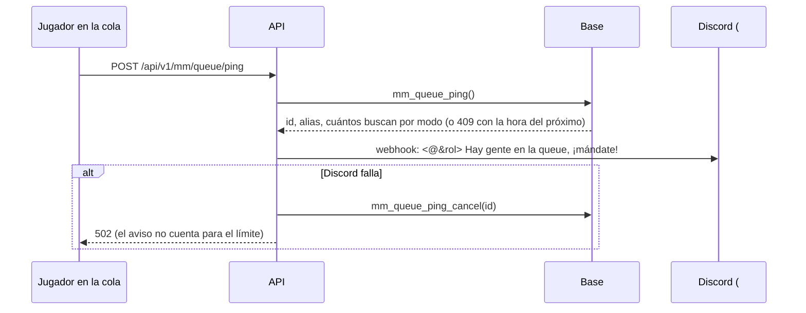

# Aviso de la cola del matchmaking en Discord: documentación

## Qué hace

Quien está buscando partida ve en la barra de "Buscando" el botón **"Avisar en Discord"**. Al tocarlo, en #avisos aparece:

```
@player Hay gente en la queue, ¡mándate!
5v5: 7 buscando · avisó Kyan
```

Sirve para juntar gente cuando la cola está floja. Hay **un aviso cada 15 minutos para todo el servidor**; mientras tanto, el botón queda gris y muestra cuánto falta. Los **moderadores y admins** pueden avisar siempre, aunque no estén en la cola.



## Reglas

| Regla | Dónde |
|---|---|
| Hay que estar en la cola (`mm_queue`), salvo moderadores y admins | `mm_queue_ping()` |
| Uno cada 15 minutos para todos, contando el último aviso de cualquiera; el staff no tiene límite | `mm_queue_ping_next()` |
| Dos botones a la vez no publican dos avisos | `pg_advisory_xact_lock` en `mm_queue_ping()` |
| Solo menciona al rol `@player`: el alias va sin markdown ni `@`, y `allowed_mentions` permite solo ese rol | `queuePingText()` y la ruta en `routes/mm.ts` |
| Si Discord no lo recibe, se borra el aviso (solo el propio y de hace menos de un minuto) | `mm_queue_ping_cancel()` |
| Sin el webhook configurado, la ruta responde 501 y no guarda nada | ruta `POST /api/v1/mm/queue/ping` |

## Datos

- **`mm_queue_pings`:** `id`, `user_id`, `mode` (null si avisó el staff sin estar en la cola), `by_staff`, `created_at`. Sin acceso directo: solo por las funciones.
- **Entorno de la API:** `DISCORD_QUEUE_WEBHOOK_URL` (secreto, tiene que empezar con `https://discord.com/api/webhooks/`) y `DISCORD_QUEUE_ROLE_ID` (el rol `@player`, `1559045996535873557`).

## API

| Ruta | Qué |
|---|---|
| `GET /api/v1/mm/queue/ping` | `{ staff, queued, next_at, can_ping }` para el botón |
| `POST /api/v1/mm/queue/ping` | Publica. 409 `CONFLICT` con `details.next_at` antes de los 15 minutos; 502 si Discord falla; 501 sin webhook |

## Dónde está cada cosa

| Qué | Archivo / ubicación |
|---|---|
| Base | `supabase/replanteo/57_mm_aviso_cola.sql` y su inversa (rama `feat/mm-claim-en-sala`) |
| API | `web/backend/src/routes/mm.ts` (`queuePingText` y las dos rutas), `src/env.ts`, `src/lib/errors.ts` (`V5701`) |
| Web | `web/frontend/src/features/matchmaking/PlayBar.tsx` (`QueuePing`), `source.ts`, `demo.ts`, `types.ts` |
| Entorno | `.env` de la raíz y `/etc/cmleague/api.env` del VPS |
