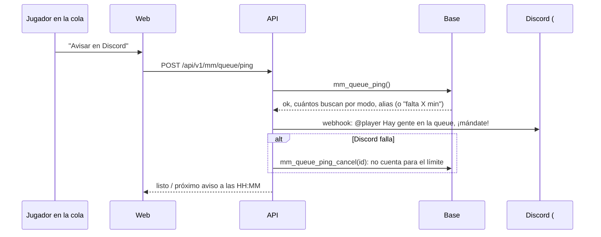

# Plan: aviso de la cola del matchmaking en Discord

> Planeación original. Estado: **aprobado por Daniel el 2026-11-02** (las decisiones de abajo son las suyas).

Quien está buscando partida toca **"Avisar en Discord"** y en el canal #avisos aparece "@player Hay gente en la queue, ¡mándate!", para juntar gente cuando la cola está floja.

## Decisiones tomadas

| Tema | Decisión | Por qué |
|---|---|---|
| Mención | El rol **@player** de Discord (`1559045996535873557`) | Le llega a quien quiere jugar, no a todo el servidor |
| Quién | Cualquiera **que esté en la cola**. Los **moderadores y admins**, siempre (estén o no en la cola) | El staff anima la cola cuando quiere |
| Límite | **Un aviso cada 15 minutos para todo el servidor**, sin límite por persona. El staff no tiene límite | Que el rol no se vuelva ruido |
| Webhook | En el entorno de la API (`DISCORD_QUEUE_WEBHOOK_URL`, `.env` de la raíz y el del VPS). Nunca en el repo ni en la web | Con esa URL cualquiera publica en #avisos |
| Prueba | En #avisos, **avisándole antes a Daniel** | Pinguea al rol de verdad |

## 1. El flujo

## 2. Base (replanteo `57`)

- **`mm_queue_pings`:** quién avisó, cuándo, el modo y si era del staff.
- **`mm_queue_ping()`:** exige estar en la cola (salvo el staff) y que el último aviso tenga más de 15 minutos (salvo el staff). Guarda el aviso y devuelve el id, el alias, cuántos buscan por modo y cuándo se puede avisar de nuevo.
- **`mm_queue_ping_status()`:** si la cuenta puede avisar ahora, desde cuándo, y si es del staff. Lo usa el botón.
- **`mm_queue_ping_cancel(id)`:** borra el aviso si Discord no lo publicó (solo el último, de esa cuenta y de hace menos de un minuto).

## 3. API

- `GET /api/v1/mm/queue/ping`: el estado del botón.
- `POST /api/v1/mm/queue/ping`: llama a la base y publica en el webhook con `allowed_mentions` limitado al rol (así el texto no puede mencionar a nadie más). Sin el webhook configurado, responde 501 y no guarda nada.

## 4. Web

- En la pantalla de "Buscando partida", el botón **"Avisar en Discord"**, con "Próximo aviso a las HH:MM" mientras corre el límite. En Administración no hace falta nada.

## 5. Requisitos

- El webhook y el ID del rol en el `.env` de la raíz (hecho el 2026-11-02) y en el entorno de la API del VPS.

## 6. Orden de implementación

1. Replanteo `57` con su inversa y pruebas SQL.
2. API con sus pruebas (el webhook simulado).
3. Web con sus pruebas.
4. Staging: la `57`, el entorno del VPS, la API y la web.
5. Avisarle a Daniel y probar en #avisos.
