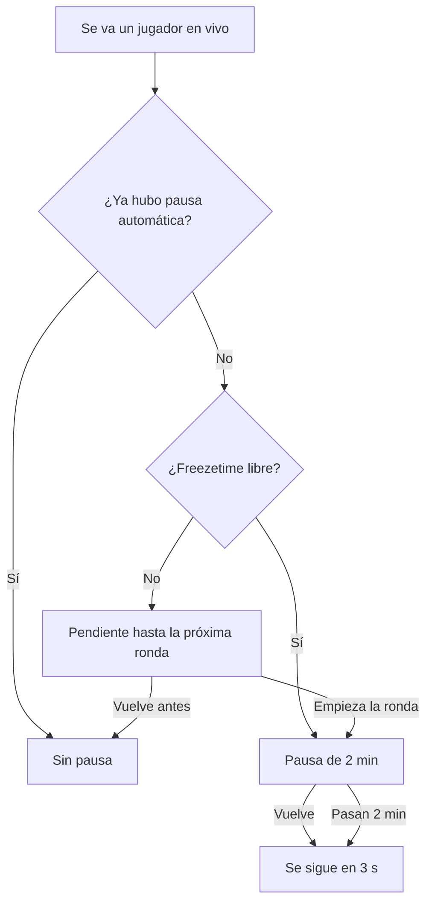
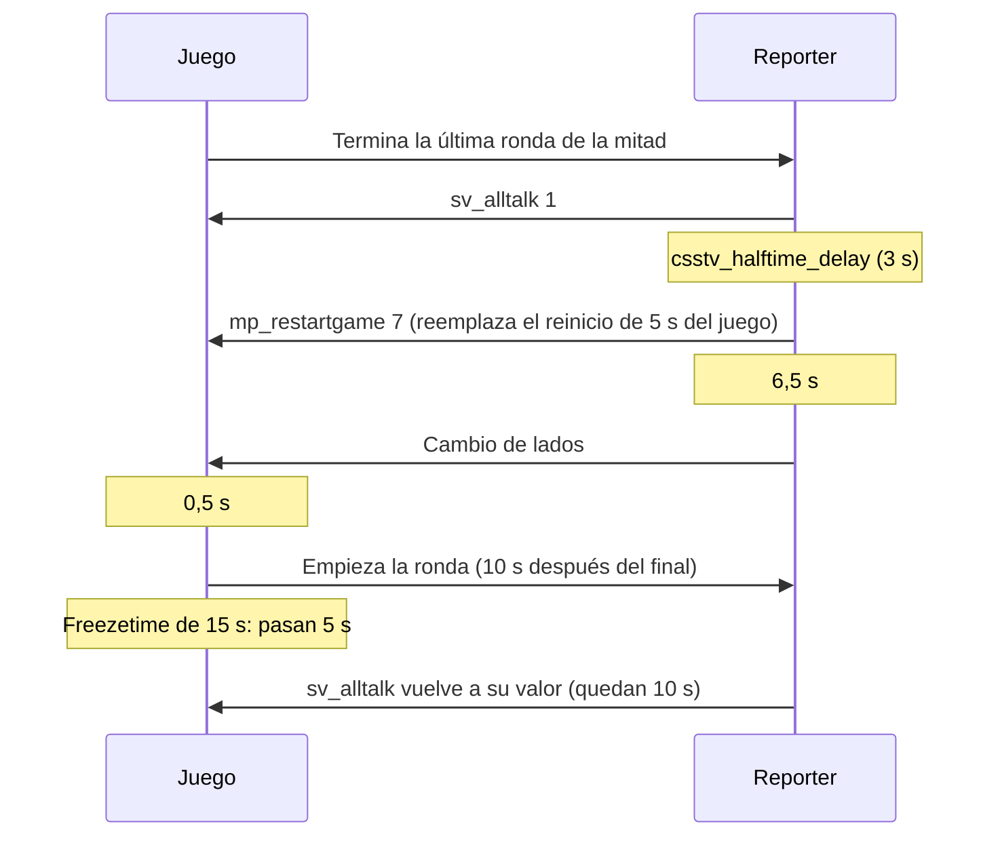

# Aviso de arranque, pausa automática y charla del medio tiempo: documentación

## Qué hace

Tres mejoras dentro de `csstv_reporter` 2.7.4 (2.8.3 en `kyan/pruebas`; el 2.8.2 es el matchmaking de Daniel, que todavía tiene la charla de la 2.7.3). La 2.7.3 tenía otra charla del medio tiempo, que se cambió (ver más abajo):

- **Aviso de arranque:** una campana suena tres veces y aparece un texto en el centro al empezar la ronda de cuchillo y el LO3.
- **Pausa automática:** si un jugador se va durante la partida, hay una pausa de 2 minutos que termina antes si él vuelve. Hay una sola por partida.
- **Charla del medio tiempo:** al terminar la última ronda de la mitad hay alltalk. La ronda siguiente empieza a los 10 segundos, ya con los lados cambiados, y el alltalk se apaga cuando quedan 10 segundos de freezetime. El freezetime y la compra son los de siempre.

## Reglas de la pausa automática

- Cuenta para cualquier jugador con estadísticas en la partida, sea cual sea el motivo de la salida: también si lo expulsa un admin.
- A mitad de ronda no se puede pausar: queda pendiente para el inicio de la próxima. Si el jugador vuelve antes, no hay pausa y no se gasta.
- Solo el regreso del jugador por el que se pausó la termina antes.
- No descuenta pausas tácticas. Si había una pedida para esa ronda, la automática la reemplaza.
- Si los dos equipos escriben `!unpause`, termina antes (salvo en `csstv_pause_mode 1`).

## Charla del medio tiempo

Corre en el medio tiempo y también en la mitad de cada prórroga. No corre al empezar una prórroga, porque ahí no se cambia de lado.

- El cambio de lados va medio segundo antes de la ronda nueva, para que nadie esté vivo y en el otro equipo durante la espera.
- No se toca `m_fRoundStartTime`. En la 2.7.3 se estiraba el freezetime 10 s y se bloqueaba la compra, pero `mp_buytime` (15 s) cuenta desde el comienzo del freezetime: cuando terminaba la charla quedaban unos 2 segundos para comprar.
- Si `mp_freezetime` es menor o igual que `csstv_half_alltalk_off`, el alltalk se apaga al empezar la ronda.

## ConVars

| ConVar | Valor | Qué hace |
|---|---|---|
| `csstv_autopause` | `1` | Activa la pausa automática |
| `csstv_autopause_time` | `120` | Segundos de esa pausa |
| `csstv_half_alltalk` | `10` | Segundos entre el final de la mitad y la ronda siguiente, con alltalk (0 = no hay charla y el cambio es como antes) |
| `csstv_half_alltalk_off` | `10` | Segundos de freezetime que quedan cuando se apaga el alltalk |

## Dónde está cada cosa

| Qué | Archivo / ubicación |
|---|---|
| Pausa, campana y charla | `server/addons/sourcemod/scripting/csstv/qol.inc` |
| Llamadas | `csstv_reporter.sp`, `csstv/knife.inc` |
| Valores | `server/cfg/sourcemod/csstv_reporter.cfg` |
| Prueba con bots | `pruebas/escenario.sh` (pausa) y `pruebas/medio_tiempo.sh` (charla) |
