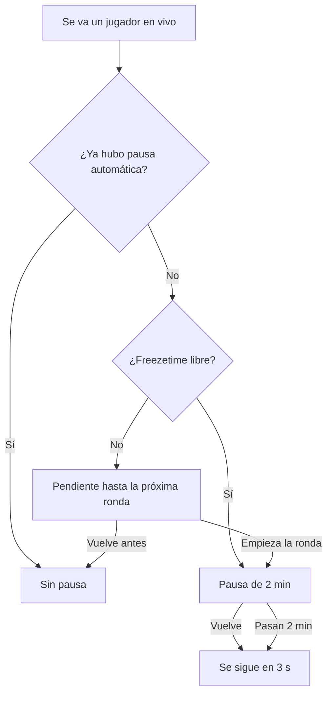

# Aviso de arranque, pausa automática y charla del medio tiempo: documentación

## Qué hace

Tres mejoras dentro de `csstv_reporter` 2.7.3 (2.8.1 en la línea con matchmaking):

- **Aviso de arranque:** una campana suena tres veces y aparece un texto en el centro al empezar la ronda de cuchillo y el LO3.
- **Pausa automática:** si un jugador se va durante la partida, hay una pausa de 2 minutos que termina antes si él vuelve. Hay una sola por partida.
- **Charla del medio tiempo:** al cambiar de lado, 10 segundos todos quietos, sin poder comprar y con alltalk. Después vuelve el chat de voz por equipo y sigue el freezetime normal.

## Reglas de la pausa automática

- Cuenta para cualquier jugador con estadísticas en la partida, sea cual sea el motivo de la salida: también si lo expulsa un admin.
- A mitad de ronda no se puede pausar: queda pendiente para el inicio de la próxima. Si el jugador vuelve antes, no hay pausa y no se gasta.
- Solo el regreso del jugador por el que se pausó la termina antes.
- No descuenta pausas tácticas. Si había una pedida para esa ronda, la automática la reemplaza.
- Si los dos equipos escriben `!unpause`, termina antes (salvo en `csstv_pause_mode 1`).

## Charla del medio tiempo

Se alarga el freezetime de la primera ronda de la nueva mitad, también en la mitad de cada prórroga. No corre al empezar una prórroga, porque ahí no se cambia de lado. El reloj sigue siendo el del juego, así que en pantalla se ve la cuenta atrás.

## ConVars

| ConVar | Valor | Qué hace |
|---|---|---|
| `csstv_autopause` | `1` | Activa la pausa automática |
| `csstv_autopause_time` | `120` | Segundos de esa pausa |
| `csstv_half_alltalk` | `10` | Segundos de la charla (0 = no hay) |

## Dónde está cada cosa

| Qué | Archivo / ubicación |
|---|---|
| Pausa, campana y charla | `server/addons/sourcemod/scripting/csstv/qol.inc` |
| Llamadas | `csstv_reporter.sp`, `csstv/knife.inc` |
| Valores | `server/cfg/sourcemod/csstv_reporter.cfg` |
| Prueba con bots | `pruebas/escenario.sh` |
