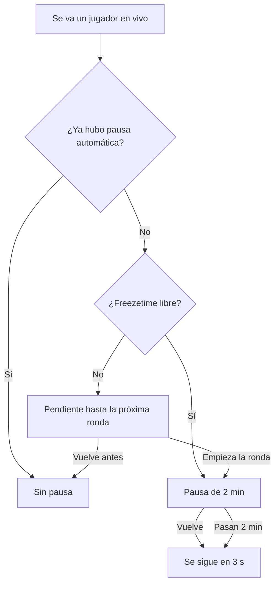

# Plan: aviso de arranque y pausa automática por desconexión

> Planeación original. Estado: **pedida por Kyan el 2026-11-02**.

## Decisiones tomadas

| Tema | Decisión |
|---|---|
| Dónde | Dentro de `csstv_reporter` (`csstv/qol.inc`), que ya tiene las pausas y la reconexión. |
| Duración | 2 minutos, o hasta que vuelva el jugador que se fue. |
| Tope | **Una sola por partida.** Si él u otro se vuelve a ir, no hay otra pausa. |
| Si vuelve antes de la pausa | No se gasta: todavía no hubo pausa. |
| A mitad de ronda | La pausa solo existe en el freezetime: empieza al inicio de la próxima ronda. |
| Pausas tácticas | No descuenta ninguna. Si había una pedida, la automática la reemplaza. |
| `!unpause` | Si los dos equipos lo escriben, termina antes, como las demás (salvo modo 1). |
| Aviso | Sonido y texto en el centro al empezar el cuchillo y el LO3. |

## 1. El flujo completo

## 2. Reporter

- `csstv_autopause` (1) y `csstv_autopause_time` (120), también en `csstv_reporter.cfg`.
- Versión 2.8.1, sobre la 2.8.0 de `kyan/pruebas`.

## 3. Orden de implementación

1. Implementar y compilar.
2. Probar con bots en `C:\Users\Agus\Downloads\cssds`, con `csstv_send 0`.
3. Pedir la prueba con jugadores: sonido y reconexión real.
4. Decidir el despliegue: lo desplegado es 2.7.2 y la 2.8.0 trae matchmaking sin desplegar.
