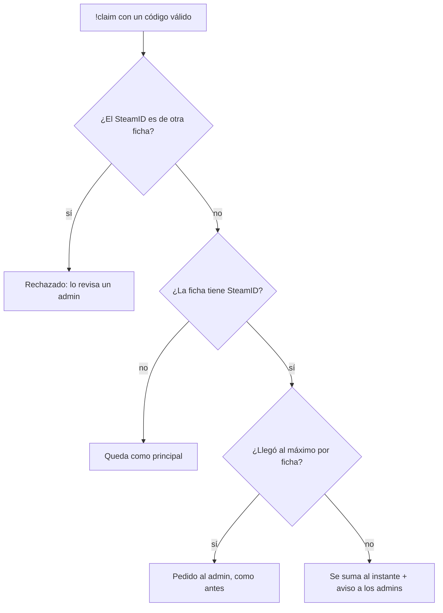

# `!claim` en la primera partida y varios SteamID: documentación

## Qué hace

- **El `!claim` se hace en la primera partida.** Ya no se puede entrar al servidor cuando uno quiere: los textos de la bienvenida, Mi perfil, el registro, la landing y la sala dicen "busca partida en Jugar y escribe el código en el chat de tu primera partida".
- **Un SteamID nuevo se suma al instante (opción A, Daniel).** Quien ya tiene un SteamID vinculado y entra desde otra PC (en v34 el SteamID cambia con el emulador) escribe `!claim <código>` y el SteamID nuevo queda en su ficha en el acto, si no es de otra ficha y no pasó el máximo por ficha. A los admins les llega un aviso para revisarlo después.
- **El plantel del matchmaking usa todos los SteamID de la ficha.** Antes solo usaba el principal: con un segundo SteamID, el servidor dejaba al jugador de espectador.

## En el servidor (reporter 2.9.1)

- Quien está de espectador en una sala del matchmaking o en una reserva de torneo o PCW sin ser de ningún plantel recibe cada 20 s un recordatorio. Si falta alguien de la sala por vincular: "Si sos de esta sala y todavía no vinculaste tu SteamID, escribí !claim <código>…". Si no: "Si sos de esta partida y entraste con otra cuenta de Steam, escribí !claim <código>. El código está en la web, en Mi perfil › Vinculación."
- Después de un `!claim` que vinculó, el poll se adelanta y el jugador pasa a su equipo.

## En la web

- En la sala del matchmaking, mientras se espera el servidor: "¿Juegas desde otra PC? Genera un código en Mi perfil › Vinculación y escribe !claim en el chat de la partida."
- Aviso `admin_steam_linked` para los admins: "<jugador> sumó un SteamID con !claim", con el link a Administración › Jugadores.

## Datos

- Los SteamID adicionales siguen en `player_extra_steam_ids` (el principal, en `players.steam_id`). `steam_attach` decide dónde va.
- El máximo por ficha es `claim_config.max_steam_ids`. Al llegar, el `!claim` responde "Llegaste al máximo de SteamID: pedíselo a un admin".
- Los pedidos pendientes de antes (`steam_requests`) quedan como estaban.

## Dónde está cada cosa

| Qué | Archivo / ubicación |
|---|---|
| Base | `supabase/replanteo/58_claim_varios_steamid.sql` y su inversa (rama `feat/mm-claim-en-sala`) |
| Plugin | `server/addons/sourcemod/scripting/csstv/mm.inc` (`Mm_WaitingClaim`, `Mm_ClaimHint`, `Mm_ClaimNag`) |
| Textos | `web/frontend/src/features/onboarding/components/ClaimStep.tsx`, `onboarding/pages/WelcomeFlow.tsx`, `profile/pages/LinkSection.tsx`, `auth/components/register/CheckEmailStep.tsx`, `landing/components/HowItWorks.tsx`, `matchmaking/room/RoomOverview.tsx` |
| Aviso | `web/frontend/src/features/shell/notifications/lib/model.ts` |
