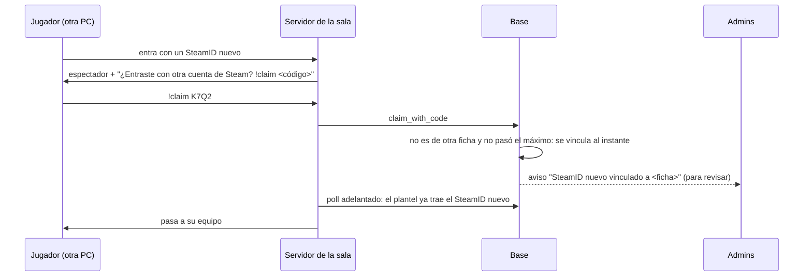

# Plan: `!claim` en la primera partida y varios SteamID sin esperar al admin

> Planeación original. Estado: **aprobado por Daniel el 2026-11-02**: opción A para los varios SteamID y los textos de abajo.

Con el matchmaking como única forma de jugar, ya no se puede "entrar al servidor" cuando uno quiere: el `!claim` se hace en la primera partida. Y quien juega desde otra PC (en v34 el SteamID cambia con el emulador) hoy queda trabado: su SteamID nuevo queda pendiente de un admin y, en una sala del matchmaking, el servidor lo deja de espectador y la sala se cancela con sanción.

## Decisiones tomadas

| Tema | Decisión | Por qué |
|---|---|---|
| SteamID nuevo de una ficha que ya tiene uno | **Opción A:** con un código válido, si no es de otra ficha y no pasó el máximo por ficha, **se vincula al instante**. A los admins les llega un aviso para revisarlo después | El código ya prueba que la cuenta es suya. Contra quien evade un baneo alcanza con que el baneo valga para todos los SteamID de la ficha y con las IP |
| Al llegar al máximo por ficha | Sigue como hoy: "Llegaste al máximo de SteamID: pedíselo a un admin" | El tope sigue siendo del admin |
| Pedidos pendientes de antes | Quedan como están; los resuelve un admin | No se aprueban solos hacia atrás |
| Plantel del matchmaking | Con **todos** los SteamID de la ficha, como ya lo hacen las reservas de torneo y PCW | Hoy solo va el principal: un segundo SteamID aprobado tampoco puede jugar |
| Aviso en el servidor | El recordatorio del `!claim` también para quien está de espectador en una sala aunque todos sus jugadores estén vinculados ("¿entraste con otra cuenta de Steam?") | Hoy solo aparece si alguien de la sala no tiene SteamID |
| Textos | Los de la sección 4 | Ya no se puede entrar al servidor fuera de una partida |

## 1. El flujo

## 2. Base (replanteo `58`)

- **`claim_with_code`:** en la rama que hoy crea un `steam_requests` pendiente (ficha con SteamID, por debajo del máximo), en su lugar lo agrega a `player_extra_steam_ids` y responde "Listo: sumamos este SteamID a tu ficha". Avisa a los admins (`admin_steam_linked`, categoría `admin`, con la ficha y el SteamID) y a la cuenta (`steam_claimed`).
- **`csstv_mm_poll`** (salas del matchmaking): `t1` y `t2` con todos los SteamID de cada jugador (`player_steam_all`).
- **`csstv_mm_report`:** `connected`, `left` y `back` reconocen cualquier SteamID de la ficha.
- Inversa y pruebas SQL.

## 3. Plugin (reporter 2.9.1)

- `Mm_ClaimNag` y el aviso al entrar: también con `unlinked = 0`, para quien está en una sala del matchmaking o en una reserva y no es de ningún plantel: "Si sos de esta partida y entraste con otra cuenta de Steam, escribí !claim <código>. El código está en Mi perfil › Vinculación."
- Después de un `!claim` que vinculó (al instante), se adelanta el poll también en una reserva, para pasarlo a su equipo enseguida.

## 4. Web

| Dónde | Texto nuevo |
|---|---|
| Bienvenida, paso del `!claim` | "Busca partida en **Jugar**. En tu primera partida, escribe en el chat:" + `!claim <código>` (sin el `connect`) |
| Bienvenida | "Escríbelo en el chat de tu primera partida." |
| Mi perfil › Vinculación | "Juega una partida con la cuenta que quieres sumar y escribe el código en el chat. Se suma al instante." |
| Registro | "Juega tu primera partida y vincula tu SteamID con !claim" |
| Landing | "…en tu primera partida vinculas tu SteamID escribiendo !claim y un código." |
| Sala del matchmaking (jugador sin vincular) | "tiene que escribir !claim en el chat de la partida" |
| Sala del matchmaking (todos) | Una línea chica: "¿Juegas desde otra PC? Genera un código en Mi perfil › Vinculación y escribe !claim en la partida." |

- El aviso nuevo `admin_steam_linked` en las notificaciones (para los admins, con el link a la ficha en Administración › Jugadores).

## 5. Orden de implementación

1. Replanteo `58` con su inversa y pruebas.
2. Plugin 2.9.1 (compilar; probar con bots en local con un bot que entra con un SteamID nuevo).
3. Web: textos, línea de la sala y el aviso.
4. Staging (base, API si hace falta y web) y el plugin en el #1. El resto de los servidores, con el corte.
