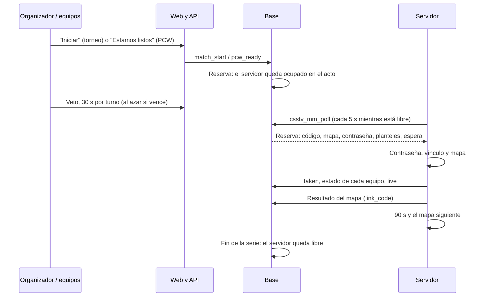
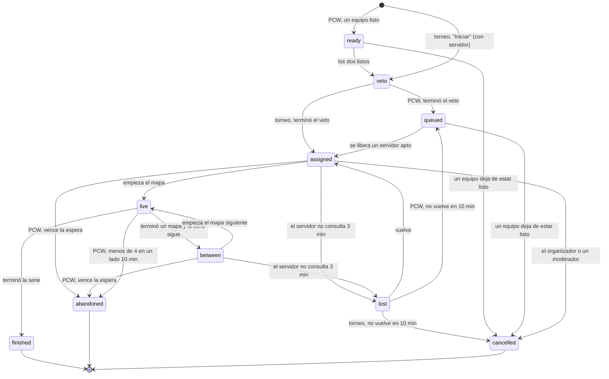

# Iniciar partidas de torneo y PCW en un servidor libre: documentación

## Qué hace

Una partida de torneo o PCW ya no depende de que alguien entre a un servidor y escriba `!match`. La web reserva un servidor libre para toda la serie y el servidor se vincula solo:

- **Torneo:** el organizador, un moderador del torneo o un admin toca **"Iniciar la partida"** en la página de la serie, elige uno de los servidores libres y aptos para torneos y la espera a los equipos (de 1 a 20 minutos). El servidor queda ocupado en ese momento. Si falta el veto, arranca con su reloj.
- **PCW:** un jugador de cada equipo marca **"Estamos listos"**. Con los dos, se hace el veto (si falta) y la PCW entra a la **fila de servidores**: toma el primero libre y apto para PCW, en orden de llegada.

El servidor recibe la reserva por el mismo poll que usa el matchmaking (`csstv_mm_poll`). Pone la contraseña, se vincula sin que nadie escriba ni confirme el código, carga el mapa del veto y, entre mapas, espera 90 segundos (por SourceTV) y carga el siguiente. La serie entera se juega en el mismo servidor.

## Servidores: aptitud y "libre"

Cada servidor tiene tres marcas, en Administración › Servidores › **Usos del servidor**: **Torneos** (`official_enabled`), **PCW** (`pcw_enabled`) y **Matchmaking** (`mm_enabled`). Son solo de la web. El plugin tiene que tener `csstv_mm "1"` para consultar; con eso la contraseña la maneja la web y el servidor deja de servir para mixes públicos.

Un servidor está **libre** para un uso (`server_is_free`) si tiene esa marca, está activo y con licencia, consultó en los últimos 30 segundos, no está marcado como no disponible y no tiene una sala del matchmaking ni una reserva abiertas. El plugin solo consulta cuando está libre: con un mix o un `!match` manual en curso deja de consultar y a los 30 segundos ya no cuenta.

**Ocupado desde que se elige.** Elegir un servidor y ocuparlo es una sola operación. Todos los que eligen (las salas del matchmaking en `mm_tick`, "Iniciar" y la fila de PCW) toman el mismo candado (`server_alloc_lock`). Así, dos partidas encontradas a la vez con un solo servidor libre no pueden quedar en el mismo servidor: la segunda no se arma y sus jugadores siguen en la cola. Además, cada tabla tiene un índice único por servidor. El orden es el de llegada, sin prioridades.

## Estados de la reserva

Al pasar a `finished`, `abandoned` o `cancelled`, el servidor queda libre en la misma operación. El W.O. del organizador (`event_set_result`) y la cancelación de la partida también cierran la reserva.

## El veto con reloj

- **Torneo:** el reloj corre desde "Iniciar". Cada torneo elige los segundos por turno (de 15 a 120; 30 por defecto) en Administración › Torneos › Configuración. El veto se puede hacer antes, sin reloj: si ya está hecho al iniciar, se pasa directo al servidor.
- **PCW:** 30 segundos fijos desde que los dos equipos están listos.
- **Turno vencido:** la base hace la acción que tocaba (ban o pick, con la primera versión del mapa) con un mapa al azar de los que quedan (`veto_auto`). Veta el capitán, como siempre: si no está, vence su turno.
- **Mapas de la serie** (`match_series_maps`): los picks en orden y el decisivo, con la versión que fijó el torneo (`decider_versions`).

## La espera a los equipos

Cuenta desde que terminó el veto y hay servidor, y otra vez en cada mapa siguiente (desde que el plugin lo carga, 90 segundos después del anterior).

| | Primer mapa | Mapas siguientes | Cuando vence |
|---|---|---|---|
| **Torneo** | La que eligió el organizador (máximo 20 min) | La misma | **No se cancela solo.** Se le avisa al organizador, que puede dejar empezar con 4 a un equipo, esperar más (sin pasar de 20 minutos desde que empezó la espera), dar W.O. desde Administración › Torneos o cancelar el inicio |
| **PCW** | 15 minutos | 5 minutos | Si los dos equipos están en regla, el mapa arranca solo. Si falta un equipo, **abandono** |

"En regla" es la regla del `!match` con al menos 4 en su lado: en una PCW, 3 del plantel como mínimo, 2 stand-ins como máximo y 5 en total como máximo. El plugin lo informa en cada poll (`p_state`).

## Abandono de una PCW y sanción

- **Cuándo:** vence la espera de un mapa con un equipo fuera de regla (no se presentó, o se fue después del primer mapa), o un equipo queda con **menos de 4 jugadores en su lado durante 10 minutos seguidos** con el mapa en juego. Con 4 se puede seguir jugando. Sin datos frescos del servidor no se sanciona: eso lo cubre el plazo de servidor caído. Si el servidor nunca tomó la reserva, la PCW vuelve primera a la fila, sin sanción.
- **Qué pasa:** la PCW queda cancelada con motivo `abandoned` y **no cuenta para nadie**; el servidor queda libre y se avisa a los dos equipos (`pcw_abandoned`).
- **Sanción** (`pcw_bans`): no poder crear ni aceptar PCW durante **3 días**, o **7** si ya tuvo una sanción en los 30 días anteriores. Se sanciona al equipo oficial con el que jugaba el bando y a cada jugador de su plantel, para que no se pueda esquivar armando un bando suelto. La vigente se ve en la página del equipo y en la de la serie. Un moderador la puede levantar en Administración › Equipos › Sanciones de PCW.
- **Bajarse antes:** mientras no hay servidor asignado (listos, veto o fila), cualquiera de los dos equipos puede dejar de estar listo, sin sanción.

## Servidor caído

Nunca se corta un mapa en vivo y nadie recibe una sanción por esto.

| Situación | Qué pasa |
|---|---|
| El servidor no consulta durante 3 minutos (antes del veto, esperando o entre mapas) | `lost` y aviso (`booking_attention`) |
| Vuelve dentro de los 10 minutos siguientes | Sigue donde estaba |
| No vuelve | Se libera. El torneo vuelve a "por iniciar" con el marcador de la serie como estaba; la PCW vuelve primera a la fila |
| Tope total: `best_of × 90 + 30` minutos | Sin un mapa en vivo, se cancela; con uno, se avisa a los admins |
| Torneo entre mapas más de 30 minutos | Aviso al organizador; lo libera él o un moderador |

## Quién ve la conexión

`match_booking` devuelve la dirección y la contraseña solo a los planteles de los dos equipos, a los streamers (`hud_streamers` vigente), al organizador y los moderadores del torneo, y a los moderadores y admins. El stand-in de una PCW la recibe de su equipo. Los demás ven "en el servidor X" sin la contraseña.

## Plugin (reporter 2.9.0)

- **Poll:** `csstv_mm_poll(p_token, p_version, p_state)`. Con una reserva, la respuesta trae `kind=official|pcw` y los mismos datos que `csstv_match_lookup` (planteles, BO, marcador, stand-ins), más `lobby` (id de la reserva), `status`, `map`, `map_no`, `password`, `min1`, `min2`, `wait_seconds` y `auto_start`. `p_state` es `ok1,ok2,n1,n2`.
- **Avisos** (`csstv_mm_report`): `taken`, `live` y `mapover` (el mapa terminó sin sumar a la serie: cancelado, reinicio del servidor o resultado rechazado; se vuelve a jugar). `abort` si el servidor no puede (le falta el mapa, por ejemplo).
- **Entre mapas:** al terminar un mapa el servidor no se suelta. Cuando la base suma el mapa (`map_no` sube) y pasaron `csstv_series_next_delay` segundos (90, de 60 a 120), carga el siguiente. Si en 5 minutos el resultado no llegó, avisa `mapover`.
- **Mínimo por equipo:** `min1` y `min2` (el organizador puede bajar uno a 4).
- **Arranque automático:** con `auto_start=1` y los dos equipos en regla, el mapa empieza sin `!ready`.
- **En el chat:** cada 30 segundos, lo que falta de la espera. `!match` en un servidor reservado responde que el vínculo lo maneja la web.

## Configuración por tipo de partida

Pedido por Daniel el 2026-11-02. Al empezar cada mapa, el reporter ejecuta `cfg/csstv/live.cfg` (lo común) y después la cfg del tipo de partida (`Match_ExecKindCfg`): `live_official.cfg` (torneo), `live_pcw.cfg`, `live_mm.cfg` (matchmaking) o `live_mix.cfg` (mix común, sin `!match`). Vale igual para una reserva y para un `!match` manual.

| Cvar | Torneo y PCW | Matchmaking | Mix |
|---|---|---|---|
| `mp_friendlyfire` | 1 | 0 | El de `live.cfg` |
| `csstv_half_alltalk` (charla con alltalk en el medio tiempo) | 0 | 10 | 10 |
| `csstv_qol_end_kick` (expulsar a todos al terminar) | 0: la serie sigue en el mismo servidor | El de `csstv_qol.cfg` | El de `csstv_qol.cfg` |
| `csstv_gg_min_diff` (`!gg`) | Torneo: 0 (sin `!gg`); PCW: 8 | 8 | 8 |
| `!coach` (`csstv_coach`) | Sí | **No**: los equipos son al azar | Sí |

Los cvars quedan hasta el cambio de mapa: lo que cambia una cfg tiene que volver a su valor en las otras. `csstv_qol_end_kick` vuelve solo, porque `csstv_qol.cfg` se ejecuta en cada mapa. El coach se pide en el calentamiento, antes de que corra la cfg del mapa: por eso lo apaga el reporter (`Match_SyncCoach`) cuando el servidor toma una sala del matchmaking, y lo repone al soltarla o en el cambio de mapa siguiente.

## `!match` manual

Sigue igual, para servidores sin poll o partidas acordadas por fuera: en el calentamiento, un jugador de un equipo escribe `!match <código>` y uno del otro equipo confirma con el mismo código (un admin vincula solo); el vínculo sigue entre mapas, pero el mapa siguiente lo eligen los jugadores; `!match` sin código desvincula. No tiene espera, abandono ni sanción. Si la serie tiene una reserva abierta, `csstv_match_lookup` rechaza el `!match` de esa serie desde cualquier otro servidor ("Esa partida está reservada desde la web para otro servidor").

## Avisos

| Tipo | A quién | Cuándo |
|---|---|---|
| `match_server_ready` | Planteles del torneo | Terminó el veto y el servidor está listo |
| `pcw_server_ready` | Planteles de la PCW | La fila le dio un servidor |
| `pcw_abandoned` | Los dos equipos (con `banned`) | La PCW se dio por abandonada |
| `booking_attention` | Organizador, quien inició y planteles; o admins | Espera vencida, servidor caído, el servidor no pudo, más de 30 min entre mapas o tope total |

## Dónde está cada cosa

| Qué | Archivo / ubicación |
|---|---|
| Base | `supabase/replanteo/56_iniciar_torneo_pcw.sql` (rama `feat/mm-claim-en-sala`) |
| Inversa | `docs/bitacora/2026-10-14-replanteo-modelo-datos/reversas/56_iniciar_torneo_pcw.sql` (misma rama) |
| Pruebas SQL | `docs/bitacora/2026-11-02-iniciar-torneo-pcw/pruebas/` |
| Plugin | `server/addons/sourcemod/scripting/csstv/mm.inc` y `match.inc` (rama `feat/mm-claim-en-sala`) |
| API | `web/backend/src/routes/bookings.ts`, `src/lib/errors.ts` (`PCW_BANNED`, `SERVER_BUSY`) y `test/unit/bookings-routes.test.ts` (misma rama) |
| Página de la serie | `web/frontend/src/features/series/components/ServerPanel.tsx`, `api/booking.ts`, `lib/booking.ts`, `types/booking.ts` |
| Usos del servidor | `web/frontend/src/features/admin/servers/components/UsesSection.tsx` y `api/flags.ts` |
| Sanciones de PCW | `web/frontend/src/features/admin/teams/components/PcwBansTab.tsx` y `features/teams/components/PcwBanNotice.tsx` |
| Segundos del veto | `web/frontend/src/features/admin/events/components/VetoTurnCard.tsx` |
| Textos de los avisos | `web/frontend/src/features/shell/notifications/lib/model.ts` |
