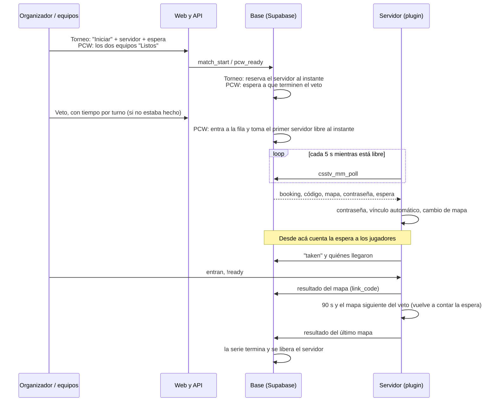
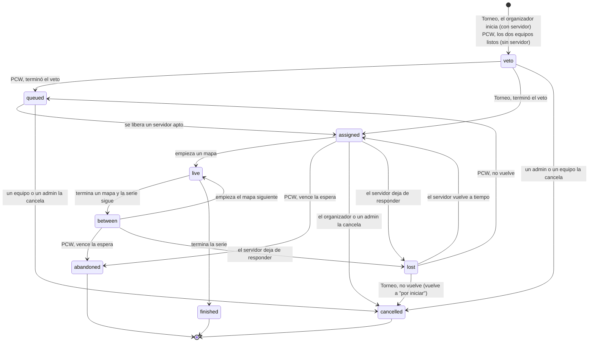

# Plan: iniciar partidas de torneo y PCW en un servidor libre

> Planeación original. Estado: **aprobado por Daniel el 2026-11-02**, sin el manual de usuario (queda para después).

Hoy una partida de torneo o PCW se juega cuando los jugadores entran a un servidor cualquiera y la vinculan a mano con `!match <código>`. Este plan suma el arranque desde la web: en un torneo, el organizador toca "Iniciar" y elige el servidor; en una PCW, los dos equipos se marcan listos y esperan el primer servidor libre. El servidor recibe la partida por el mismo poll del matchmaking (`csstv_mm_poll`) y se vincula solo.

## Decisiones tomadas

Todas decididas por Daniel el 2026-11-02.

| Tema | Decisión | Por qué |
|---|---|---|
| Qué servidores | Cada servidor tiene tres marcas que se prenden y apagan desde Administración › Servidores: **apto para torneos**, **apto para PCW** y **apto para matchmaking** (esta última es la `mm_enabled` que ya existe) | Cada servidor se usa solo para lo que se decida, sin tocar su configuración |
| Orden entre torneo, PCW y matchmaking | **El que llega primero.** Sin prioridades y sin sacar a nadie | Las marcas de aptitud ya alcanzan para apartar servidores |
| Cuándo queda ocupado un servidor | **En el mismo momento en que se elige**, con la misma operación que lo elige. En el matchmaking, cuando se encuentra la partida (no cuando la aceptan). Si la partida no se llega a jugar, vuelve a quedar libre | Si hay 20 personas buscando y un solo servidor, no se pueden armar dos partidas con el mismo servidor |
| Sin servidor libre en un torneo | El organizador **espera**: "Iniciar" solo muestra servidores libres y, si no hay, no deja iniciar | No se le quita el servidor a una partida que ya empezó |
| Veto | **Tiene que terminar antes** de que el servidor cargue el mapa. **Cada turno tiene un tiempo**, y si vence, se elige un mapa al azar entre los que quedan (como en el matchmaking) | El servidor necesita saber qué mapa cargar, y un capitán ausente no puede trabar la serie |
| Desde cuándo cuenta la espera a los jugadores | **Desde que terminó el veto y el servidor está asignado**: lo último que pase de las dos cosas | Antes de eso no hay dónde entrar |
| Espera en un torneo | **La elige el organizador al iniciar, con un máximo de 20 minutos** | Cada torneo tiene su ritmo |
| Equipo incompleto en un torneo | **El organizador puede dejar que un equipo empiece con 4** | Hoy un torneo exige el plantel completo (`players_min`, 5 por defecto) |
| Espera en una PCW | **15 minutos para el primer mapa y 5 para cada mapa siguiente.** Si vence, **hay sanción**: los dos equipos ya se marcaron listos y vetaron | Si se marcaron listos, se comprometieron a jugar |
| Abandono de una PCW | Si pasa la espera sin que empiece la serie (o el mapa siguiente, si se van después del primero), **la PCW queda abandonada, el servidor se libera y el equipo que no estaba queda sin poder crear ni aceptar PCW por unos días** | Que no se reserven servidores para no jugar |
| Quién ve la conexión (IP y contraseña) | Los planteles de los dos equipos, el streamer, el organizador, los moderadores del torneo, los moderadores y los admins. En una PCW, **el equipo le pasa la contraseña a su stand-in** | El que entra es el que juega |
| Series BO3 y BO5 | La reserva **dura toda la serie, en el mismo servidor**. Al terminar un mapa, el plugin espera **90 segundos** y carga el siguiente del veto | Le da tiempo a SourceTV (`tv_delay`) a mostrar el final |
| Cuándo se libera el servidor | Cuando termina la serie, cuando un admin la cancela, cuando una PCW se abandona y cuando el servidor deja de responder (sección 9) | Que un servidor no quede tomado para siempre |
| `!match` manual | **Sigue existiendo**, igual que hoy | Sirve para servidores sin poll y para partidas acordadas por fuera |
| Producción | Con el **corte**, junto con la `48` | Depende de las tablas del matchmaking, que solo están en staging |

## 1. El flujo completo

Estados de la reserva:

Cuando cualquiera de estos estados pasa a `finished`, `abandoned` o `cancelled`, el servidor queda libre en esa misma operación.

## 2. Aptitud de cada servidor

- **Base:** `game_servers` suma `official_enabled` y `pcw_enabled` (booleanos, en `false` por defecto). `mm_enabled` ya existe desde la `48`.
- **Web:** tres interruptores en Administración › Servidores, solo para admins.
- **¿Hace falta el plugin?** Para las marcas, no: las decide solo la web. **Pero el servidor tiene que tener el poll prendido** (`csstv_mm "1"`), porque si no consulta, la base no puede darle nada. Esto ya es así para el matchmaking.
- **Consecuencia que hay que tener presente:** con `csstv_mm "1"`, **la contraseña la maneja la web** y queda una al azar entre partidas. Un servidor con cualquiera de las tres marcas deja de servir para mixes públicos sin contraseña. Un admin puede rotar la contraseña desde Administración › Matchmaking › Servidores, como hoy.

## 3. Servidor libre y servidor ocupado

**Ocupado desde el momento en que se elige.** Elegir un servidor y marcarlo como ocupado son una sola operación, en la misma transacción. Hoy el matchmaking ya funciona así: `mm_try_match` crea la sala con su `server_id` en cuanto encuentra la partida, antes de que la acepten, y si no hay un servidor libre no la arma y los jugadores siguen en la cola. Si la sala se cancela (alguien no acepta, por ejemplo), el servidor vuelve a quedar libre. La reserva de torneos y PCW usa la misma regla.

Una sola función para las tres cosas, `server_free(kind, regions)`, que reemplaza a `mm_free_server`. Un servidor está libre si cumple todo esto:

1. Está activo, con licencia vigente, y tiene la marca de ese tipo (`mm_enabled`, `official_enabled` o `pcw_enabled`).
2. Consultó en los últimos 30 segundos (`mm_server_state.last_poll_at`). El plugin **solo consulta cuando está libre**: en el calentamiento, sin sala y sin `!match`. Un servidor con un mix en curso o con un `!match` manual deja de consultar y a los 30 s ya no cuenta como libre.
3. No está marcado como no disponible (`unavailable_until`).
4. No tiene una sala del matchmaking ni una reserva abiertas.

**Para que dos pedidos al mismo tiempo no tomen el mismo servidor.** Por ejemplo: dos grupos de 10 que reciben "Partida encontrada" casi a la vez con un solo servidor libre, o una sala del matchmaking y el "Iniciar" de un organizador.

- **Hoy, entre salas del matchmaking, ya está resuelto** (revisado el 2026-11-02). Las salas se arman solo dentro de `mm_tick`, que toma `pg_try_advisory_xact_lock(hashtext('mm_tick'))` y nunca corre dos veces a la vez. Cada sala se inserta con su `server_id` en el mismo momento de "Partida encontrada", y la sala siguiente ya ve ese servidor como ocupado. Además está el índice único `mm_lobbies_server`.
- **Lo que falta:** "Iniciar" y la fila de PCW corren fuera de `mm_tick`, y el índice único es de cada tabla por separado. Por eso **todos los que eligen servidor, incluido `mm_tick`,** toman el mismo `pg_advisory_xact_lock` por servidor, vuelven a comprobar que siga libre y lo ocupan antes de soltar el bloqueo. El índice único parcial de cada tabla queda como segunda barrera.

## 4. El veto, con tiempo por turno

Hoy el veto de torneos y PCW (`veto_act`) no tiene tiempo: espera al capitán lo que haga falta. Se suma un tiempo por turno, y si vence, la base elige un mapa al azar entre los que quedan, con la acción que tocaba (ban o pick, y la primera versión del mapa si tiene varias). Es la misma regla del matchmaking (`mm_ban_map` cuando vence `veto_deadline`).

| | Cuándo corre el reloj | Tiempo por turno |
|---|---|---|
| **Torneo** | Desde que el organizador inicia la partida. El veto se puede hacer antes, sin reloj: si ya está hecho al iniciar, se pasa directo al servidor | **30 segundos por defecto.** Cada torneo lo configura (entre 15 y 120) |
| **PCW** | Desde que los dos equipos se marcan listos. Si el veto ya estaba hecho, entran directo a la fila | 30 segundos fijos |

- **Quién veta:** el capitán, como hoy. Si no está, vence el turno y se elige al azar.
- **La web** muestra la cuenta regresiva del turno. La base revisa los vencimientos en el mismo paso periódico que ya revisa los de las salas del matchmaking.

## 5. La reserva (`match_bookings`, replanteo `56`)

| Columna | Qué es |
|---|---|
| `id` | uuid |
| `match_id` | La serie (`matches`, `kind` `official` o `pcw`). Una sola reserva abierta por serie (índice único parcial) |
| `server_id` | Nulo mientras está en la fila. Índice único parcial: un servidor, una reserva abierta |
| `status` | `veto`, `queued`, `assigned`, `live`, `between`, `lost`, `finished`, `abandoned` o `cancelled` |
| `password` | Al azar, generada por la base |
| `wait_minutes` | Espera a los jugadores en cada mapa (1 a 20 en un torneo; fija en una PCW) |
| `wait_deadline` | Hasta cuándo se espera en este mapa. Se calcula cuando terminó el veto y hay servidor, y otra vez al cargar cada mapa siguiente |
| `min_roster1`, `min_roster2` | Mínimo del plantel de cada equipo. Nulo: el de siempre. El organizador lo baja a 4 |
| `queued_at`, `assigned_at`, `ended_at`, `end_reason` | Tiempos y motivo (`series_end`, `admin`, `abandoned`, `server_lost`) |
| `abandoned_side` | En una PCW abandonada: qué equipo no estaba (1, 2, o los dos) |
| `created_by` | Quién inició, o el último que marcó listo en una PCW |

Las tablas no se leen ni se escriben directo: todo pasa por funciones `security definer`, como en la `48`.

## 6. Torneo: "Iniciar la partida"

- **Quién:** `can_manage_event(event_id)` (organizador, moderadores del torneo y admins).
- **Dónde:** en la página de la serie y en Administración › Torneos.
- **Cuándo se puede:** los dos equipos definidos, `status = 'upcoming'` y sin otra reserva abierta.
- **Qué elige:** el servidor (solo los libres y aptos para torneos; si no hay ninguno, el botón dice por qué y no deja iniciar) y la espera (por defecto 10 minutos, máximo 20).
- **`match_start(p_match, p_server, p_wait)`:** con el lock tomado, vuelve a comprobar que el servidor siga libre y **lo ocupa en ese momento**. Crea la reserva en `veto`, o en `assigned` si el veto ya estaba hecho, y guarda `server_id` y `server_ip` en la partida, como `match_schedule`.
- **El servidor no carga nada hasta que termina el veto.** Mientras tanto ya está ocupado y no lo toma nadie más.
- **Si vence la espera:** **no se cancela solo.** La base marca la reserva y le avisa al organizador, que elige qué hacer:
  - **Dejar empezar con 4** a un equipo (`min_roster1` o `min_roster2` en 4).
  - **Esperar más**, sin pasar de los 20 minutos en total.
  - **Dar W.O.**, con el `event_set_result` de siempre. La serie termina y se libera el servidor.
  - **Cancelar el inicio:** se libera el servidor y la partida vuelve a "por iniciar".

## 7. PCW: listos, veto y fila

1. **Listos:** un miembro de cada bando (`pcw_side_team`) marca "Listos" en la página de la serie. Cualquiera de los dos puede quitarlo antes de que termine el veto, y eso cancela la reserva sin sanción.
2. **Veto:** con los dos listos, la reserva arranca en `veto` y corre el reloj por turno. Si el veto ya estaba hecho, se salta este paso.
3. **Fila:** cuando termina el veto, la reserva entra en `queued`. Toma **en ese mismo momento** el primer servidor libre apto para PCW, en orden de llegada (`queued_at`). Si no hay ninguno, espera en la fila y toma el próximo que se libere. Lo revisan el paso periódico y el poll de cada servidor libre (como en el matchmaking).
4. **Aviso:** una notificación de la web a los dos planteles (`pcw_server_ready`) cuando hay servidor. Desde ahí cuenta la espera.
5. **Espera:** **15 minutos para el primer mapa y 5 minutos para cada mapa siguiente.** En un BO1 son 15 minutos para toda la partida. Los 5 minutos de cada mapa siguiente cuentan desde que el plugin lo cargó, después de los 90 segundos.

## 8. Abandono de una PCW

**Cómo se detecta:** el plugin ya sabe en cada momento quién está en cada lado (planteles y stand-ins), por la regla del `!match`. En cada poll de la espera, informa si cada lado cumple esa regla (`side1_ok`, `side2_ok`): al menos 3 del plantel en su lado, 2 stand-ins como mucho y 5 en total como mucho. Cuando vence la espera de un mapa (`wait_deadline`):

| Situación al vencer la espera | Qué pasa |
|---|---|
| **Los dos lados cumplen**, pero nadie hizo `!ready` | El plugin **arranca el mapa solo**. Los dos equipos están, así que no hay abandono |
| **Un lado no cumple** | **Abandono de ese equipo:** la PCW queda `abandoned`, el servidor se libera y ese equipo recibe la sanción |
| **Ninguno de los dos cumple** | Abandono de los dos y sanción a los dos |

- **Vale igual entre mapas:** si después del primer mapa un equipo se va y no vuelve antes de que venza la espera del mapa siguiente, es abandono. Los mapas ya jugados quedan guardados como mixes. La serie no suma un resultado.
- **Durante un mapa:** si un lado queda con **menos de 4 jugadores durante 10 minutos seguidos**, es abandono. **Con 4 se puede seguir jugando** y no cuenta como abandono. La pausa automática por desconexión del reporter 2.7.3 sigue actuando como siempre. El plugin informa cuándo empezó a faltar gente, y la base lo decide en el poll siguiente.
- **Sanción:** el equipo no puede crear ni aceptar PCW durante un tiempo: **3 días la primera vez y 7 días si vuelve a pasar dentro de los 30 días siguientes.** Va en una tabla nueva, `team_pcw_bans` (equipo, hasta cuándo, motivo y PCW). Un admin la puede quitar desde Administración › Equipos, con el historial de `team_audit` (replanteo `43`). Se le avisa al líder del equipo con una notificación (`pcw_abandoned`).
- **El equipo que sí estaba:** la PCW **no cuenta como ganada para nadie**. Así nadie gana una PCW por W.O. en el ranking de PCW.

## 9. Cuando el servidor deja de responder

Esto es distinto del abandono. Cubre lo que pasa si el servidor se cae, se reinicia o pierde la conexión con la base: sin esto, la reserva quedaría tomando un servidor que nadie puede usar. **Nunca se corta una partida en vivo**, y nadie recibe una sanción por esto, porque no es culpa de los jugadores.

| Situación | Qué pasa |
|---|---|
| El servidor no consulta durante **3 minutos** con una reserva en `assigned` o `between` | La reserva pasa a `lost` y se le avisa al organizador (en una PCW, a los dos equipos) |
| Vuelve dentro de **10 minutos más** | La reserva vuelve a `assigned` y el plugin la retoma (la guarda en `data/csstv/`, como `mm.txt`) |
| No vuelve | Se libera el servidor. El torneo vuelve a "por iniciar" con el marcador de la serie como estaba. La PCW vuelve **primera** a la fila |
| **Tope total** de una reserva: `best_of × 90 + 30` minutos (BO1: 2 h; BO3: 5 h) | Por si algo queda trabado. Si no hay un mapa en vivo, se cancela y se avisa a los admins. Si lo hay, solo se avisa |

Durante un mapa en vivo el plugin no consulta, y eso no cuenta como dejar de responder: el resultado del mapa cierra esa parte como siempre.

## 10. Quién ve la conexión

`match_connection(p_match)` devuelve la IP y la contraseña, y la vista de la serie muestra "Conectarse" con el `steam://connect/…`. Solo a:

- Los planteles de los dos equipos (miembros activos de `team_members` de cada bando).
- Las cuentas con la marca de streamer (`hud_streamers` vigente).
- El organizador y los moderadores del torneo (`can_manage_event`), los moderadores y los admins (`is_moderator()`).

Al resto, la serie le muestra "En el servidor X" sin la contraseña. El stand-in de una PCW la recibe de su equipo.

## 11. Plugin (reporter 2.9.0, sobre la línea del matchmaking)

1. **El poll trae reservas además de salas:** `booking=<id>`, `kind=official|pcw`, `code=`, `map=` (el mapa que toca según el veto y los mapas ya jugados), `password=`, `wait_seconds=`, `min1=`, `min2=` y `auto_start=1` (PCW con la espera vencida).
2. **Al tomar una reserva:** avisa `taken`, la guarda en `data/csstv/`, pone la contraseña, hace la misma consulta del `!match` (`csstv_match_lookup`: planteles, stand-ins, BO) y activa el vínculo **sin que nadie escriba ni confirme el código**, y cambia al mapa.
3. **Mientras espera:** sigue consultando (como en la etapa "conectando" del matchmaking) e informa `side1_ok` y `side2_ok`. Muestra en el chat cuánto falta.
4. **Mínimo por equipo:** hoy `g_iLinkMinRoster` es uno solo para los dos lados. Pasa a ser uno por equipo, para que el organizador pueda bajar solo el de un equipo a 4. `min1` y `min2` se actualizan en cada poll.
5. **Arranque automático:** con `auto_start=1` y los dos lados en regla, arranca el mapa sin `!ready`.
6. **Entre mapas:** al terminar un mapa de la serie, espera **90 segundos** (cvar `csstv_series_next_delay`, de 60 a 120) y carga el mapa siguiente que le da el poll. Sin votación.
7. **Al terminar la serie o al abandonarse:** contraseña al azar, como al terminar una sala del matchmaking, y vuelve a consultar como libre.
8. **`!match` manual en un servidor reservado:** se rechaza ("Este servidor está reservado para X").

## 12. `!match` manual (sigue igual)

Para recordar cómo funciona:

1. **Solo en el calentamiento.** El código de 5 caracteres lo ven en la web, en la página de la serie, los planteles y el staff.
2. **Un jugador de un equipo** escribe `!match <código>` y el servidor anuncia "Vínculo pendiente". **Un jugador del otro equipo** confirma escribiendo el mismo código. Un admin vincula solo, sin confirmación.
3. **Con el vínculo activo:** cada jugador del plantel va al lado de su equipo y no se puede pasar al rival. Los demás quedan de espectador y entran como stand-ins: hasta 2 en una PCW y ninguno en un torneo. `!ready` no arranca hasta que cada lado cumple: en un torneo, el mínimo del torneo (5); en una PCW, 3 del plantel y 5 en total como mucho.
4. **El vínculo sigue entre mapas** de una serie BO3 o BO5, pero **el mapa siguiente lo eligen los jugadores** (votación o un admin). Con la reserva, en cambio, lo carga el plugin.
5. **`!match` sin código desvincula** (cualquier jugador de los dos equipos o un admin). Si lo hacen durante el mapa, ese mapa se guarda como mix común.
6. **Al terminar,** el resultado viaja con `link_code` y la base suma el mapa a la serie.

El `!match` manual no tiene espera, abandono ni sanción. Si una serie tiene una reserva abierta, la base rechaza el `!match` manual de esa serie en otro servidor.

## 13. API y web

- **API (`feat/backend-api-fase-1`, sobre la línea del matchmaking):**
  - `POST /matches/{id}/start`: inicia una partida de torneo con `{ server_id, wait_minutes }`.
  - `POST /matches/{id}/ready` y `DELETE /matches/{id}/ready`: marcan y quitan el listo de una PCW.
  - `GET /matches/{id}/booking`: estado de la reserva, el turno del veto, la fila y la conexión según quién pregunta.
  - `POST /matches/{id}/booking/actions`: `allow_four`, `extend`, `cancel` y `release`.
  - `GET /servers/free?kind=official`: servidores libres, paginado, con filtros y orden (es obligatorio en todos los GET de listas).
  - `PATCH /admin/servers/{id}`: las tres marcas.
  - `GET /admin/pcw-bans` y `DELETE /admin/pcw-bans/{id}`: sanciones de PCW, paginadas, con filtros y orden.
  - Avisos de la reserva y del veto por el WebSocket del matchmaking, para que la página no tenga que consultar.
- **Web (`feat/frontend-fase-1`):**
  - Página de la serie: "Iniciar" (diálogo con los servidores libres y la espera), "Listos" de la PCW, el veto con la cuenta regresiva del turno, el puesto en la fila, la tarjeta "Conectarse", la cuenta regresiva de la espera y las acciones del organizador cuando vence.
  - Equipo: aviso "No pueden crear ni aceptar PCW hasta el …" cuando tiene una sanción.
  - Administración › Servidores: las tres marcas.
  - Administración › Torneos: las partidas listas para iniciar y las que están en curso, con su servidor, y el tiempo por turno del veto en la configuración del torneo.
  - Administración › Equipos: las sanciones de PCW, con la opción de quitarlas.

## 14. Requisitos antes de empezar

- Staging con la `48` a la `55` (la `53` a la `55` están desplegadas en la web; hay que confirmar si están aplicadas en la base).
- El #1 con el poll prendido para probar. Ya lo tiene: 2.8.2, `csstv_mm "1"` y apunta a staging.
- Dos clientes y bots para la prueba de una BO3.

## 15. Orden de implementación

1. **Replanteo `56`** con su inversa y sus pruebas SQL:
   - Las marcas `official_enabled` y `pcw_enabled`.
   - `server_free` con el lock, y la sala del matchmaking usándola.
   - `match_bookings`, `match_start`, `pcw_ready` y `match_connection`.
   - El reloj del veto y el mapa al azar.
   - El abandono y `team_pcw_bans`.
   - Las acciones del organizador y el servidor que deja de responder.
   - `csstv_mm_poll` con las reservas, y el rechazo del `!match` manual en otro servidor.
   - Una prueba de concurrencia: dos pedidos a la vez con un solo servidor libre, y solo uno lo toma.
2. **Plugin 2.9.0:** la reserva en `mm.inc`, el mínimo por equipo y el estado de cada lado en `match.inc`, el arranque automático y el cambio de mapa a los 90 segundos. Compilarlo y probarlo con bots en local, con `csstv_send 0` y la cola de `data/csstv/queue/` vacía.
3. **API:** rutas, contrato y pruebas de integración.
4. **Web:** página de la serie, veto con reloj, equipo, Administración › Servidores, Torneos y Equipos, con sus pruebas.
5. **Staging:** aplicar la `56`, desplegar la API y la web, y subir el plugin al #1 en el próximo cambio de mapa. Prueba de una BO3 de torneo, de una PCW con la fila y de un abandono.
6. **Plugin en todos los servidores** en la misma tanda (#1, flow con su build licenciado y #3), como pide `CLAUDE.md`, recién cuando se abra esto en producción.
7. **Producción:** con el corte, junto con la `48`.

## Preguntas abiertas

Ninguna. Las propuestas de las secciones 4, 7, 8 y 9 las confirmó Daniel el 2026-11-02.
