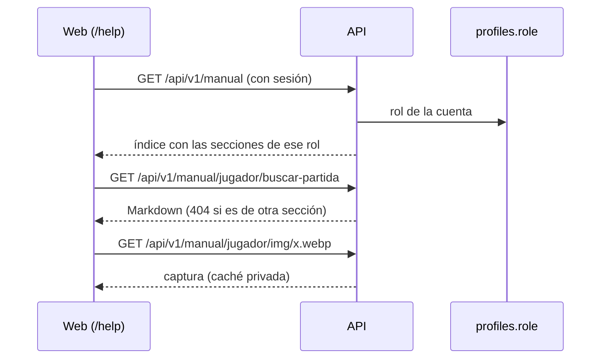

# Manual de usuario por rol: documentación

## Qué hace

La web tiene una sección **Ayuda** (`/help`) con el manual de usuario: cómo se usa CM League, por tarea y por rol. Solo se ve con sesión, y cada cuenta recibe solo las secciones de su rol: la API filtra antes de mandar, así que el texto de Administración no llega a un jugador común.

Los textos son archivos Markdown en el repo (`docs/manual/<sección>/<tarea>.md`), con sus capturas en `docs/manual/<sección>/img/`. El build de la API los valida y los copia a la versión que se despliega; la API los lee al arrancar.

## Quién ve cada sección

| Sección (carpeta) | Usuario | Organizador | Moderador | Admin |
|---|---|---|---|---|
| Jugador (`jugador`) | Sí | Sí | Sí | Sí |
| Capitán o líder de equipo (`capitan`) | Sí | Sí | Sí | Sí |
| Streamer (`streamer`) | Sí | Sí | Sí | Sí |
| Dueño de un servidor externo (`servidor-externo`) | Sí | Sí | Sí | Sí |
| Organizador de torneo (`organizador`) | | Sí | Sí | Sí |
| Moderador (`moderador`) | | | Sí | Sí |
| Admin (`admin`) | | | | Sí |

- Sin sesión no se ve nada (`/help` está dentro de `_app`, que pide sesión, y la API responde 401).
- Un rol desconocido ve lo mismo que un usuario.
- `/help` abre en la sección del rol más alto (`inicio`); si esa sección todavía no tiene páginas, en la primera que tenga.
- Una página o captura de otra sección, oculta o que no existe: el mismo 404, con el mismo mensaje.
- Las páginas con `oculta: true` no se le mandan a nadie, ni al admin.

## Validación del manual

`armarManual` (`web/backend/src/lib/manual.ts`) revisa cada archivo. El build de la API falla con cualquier error; la API, si arranca con errores, los muestra en el log y sirve las páginas que están bien.

| Qué revisa | Error |
|---|---|
| Carpeta | Tiene que ser una de las siete secciones |
| Nombre | Minúsculas y guiones (`buscar-partida.md`); capturas `.webp`, `.png` o `.jpg` en `img/` |
| Archivos de más | Solo `<sección>/<tarea>.md` y `<sección>/img/<captura>` (más el `README.md` de la raíz, que no se publica) |
| Encabezado | `titulo`, `resumen` y `orden` (número) obligatorios; `oculta` es `true` o `false`; ningún otro campo |
| Links a `/help/<sección>/<tarea>` | La página existe, no está oculta (salvo desde otra oculta) y la ve todo el que ve la página que enlaza |
| Capturas | `img/<archivo>` de la misma sección, y el archivo existe |

## La API

| Ruta | Qué devuelve |
|---|---|
| `GET /api/v1/manual` | `{ inicio, secciones: [{ id, titulo, paginas: [{ tarea, titulo, resumen }] }] }`, en orden y sin secciones vacías. `Cache-Control: private, max-age=300` |
| `GET /api/v1/manual/{seccion}/{tarea}` | `{ seccion, tarea, titulo, resumen, markdown }`. 404 `NOT_FOUND` si no la puede ver |
| `GET /api/v1/manual/{seccion}/img/{archivo}` | La imagen, con su tipo y `Cache-Control: private, max-age=3600` |

Las tres piden sesión (`requireUser`). El rol se lee de `profiles.role` con el token de la cuenta (`userRole`, ahora exportada en `lib/auth.ts`).

**De dónde lee el manual** (`carpetaDelManual`, en `lib/manual-node.ts`): `MANUAL_DIR`; si no, `manual/` al lado de `server.mjs` (en el VPS, `dist/manual` de la versión); si no, `docs/manual` del repo (`pnpm dev:node`). El Worker de Cloudflare no lee archivos: queda con el manual vacío.

## La web

- **Ayuda** en el menú (grupo Comunidad, debajo de Ranking) y en el buscador (Ctrl+K), para todas las cuentas.
- **`/help`:** el índice de la sección elegida (`?seccion=`), con filtros por sección si la cuenta ve más de una, y un buscador por título y resumen en todas sus secciones (sin tildes ni mayúsculas).
- **`/help/<sección>/<tarea>`:** el título, el resumen y el texto, con las demás páginas de la sección al costado y "Volver". Los breadcrumbs dicen Ayuda › sección › página.
- **El texto** se dibuja con `react-markdown` y `remark-gfm`, sin HTML crudo:
  - Los links a rutas de la web van con el router; los de afuera (`https:`, `mailto:`) abren en otra pestaña; cualquier otro (`javascript:`, `//otro.sitio`, anclas) queda como texto.
  - Las citas se ven como aviso (`> **Ojo:** …`).
  - Las capturas se piden con la sesión (`authFetch`) y se muestran como `blob:`, porque un `` común no manda el token.

## Qué cambia para cada rol

| Rol | Qué cambia | Página del manual |
|---|---|---|
| Todos | Nueva sección **Ayuda** en el menú, con el manual de su rol | (el manual en sí) |
| Jugador | La sección completa: crear la cuenta, vincular el SteamID, buscar partida, jugar en el servidor, el ELO, clips y demos, equipos, notificaciones, baneos y sanciones | [`docs/manual/jugador/`](../../manual/jugador/) |
| Capitán | Armar el plantel, inscribir el equipo y jugar una partida de torneo (PCW, oculta) | [`docs/manual/capitan/`](../../manual/capitan/) |
| Organizador | Crear el torneo, inscripciones y fixture, iniciar una partida, la espera y el W.O., resultados y la llave | [`docs/manual/organizador/`](../../manual/organizador/) |
| Moderador | Banear, moderar equipos, sanciones del matchmaking (PCW, oculta) | [`docs/manual/moderador/`](../../manual/moderador/) |
| Admin | Servidores, ELO y mixes, matchmaking y sus reportes, temporadas, mapas y ranking, usuarios y fichas, clips, equipos | [`docs/manual/admin/`](../../manual/admin/) |
| Streamer | El HUD en OBS y su panel | [`docs/manual/streamer/`](../../manual/streamer/) |
| Dueño de un servidor externo | Sumar el servidor, la configuración obligatoria, demos y clips | [`docs/manual/servidor-externo/`](../../manual/servidor-externo/) |

## Dónde está cada cosa

| Qué | Archivo |
|---|---|
| Textos y capturas | `docs/manual/<sección>/` (rama `feat/frontend-fase-1`) |
| Estilo y formato del manual | `docs/manual/README.md` |
| La regla de la bitácora | `docs/bitacora/PLANTILLA.md` (sección "Qué cambia para cada rol") y `CLAUDE.md` (Convenciones) |
| Reglas de visibilidad y validación | `web/backend/src/lib/manual.ts` (rama `feat/mm-claim-en-sala`) |
| Lectura del disco | `web/backend/src/lib/manual-node.ts` y `src/node.ts` |
| Rutas | `web/backend/src/routes/manual.ts` |
| Build y despliegue | `web/backend/scripts/build.mjs` y `deploy/vps/desplegar.sh` (en las dos ramas) |
| Pruebas de la API | `web/backend/test/unit/manual.test.ts` |
| Web | `web/frontend/src/features/help/` y `src/routes/_app/help.index.tsx`, `help.$seccion.$tarea.tsx` |
| Menú y breadcrumbs | `web/frontend/src/features/shell/lib/nav.ts` y `api/queries.ts` (`useCrumbData`) |
