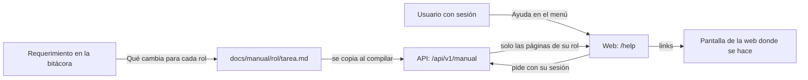

# Plan: manual de usuario por rol

> Planeación original. Estado: **propuesta**, pendiente de aprobación.

Hoy las reglas que afectan a los jugadores (la espera de una partida, las sanciones de PCW, quién ve la contraseña del servidor, el `!claim`) solo quedan en la bitácora, que está escrita para quien programa. El manual las cuenta para quien usa la web, organizado por tareas y por rol, y queda fijo: el changelog de Discord cuenta las novedades, y el manual, cómo funciona hoy.

## Decisiones tomadas

| Tema | Decisión | Por qué |
|---|---|---|
| Dónde vive el texto | `docs/manual/`, en el repo, un `.md` por tarea | Se revisa en el mismo commit que el cambio que lo vuelve necesario |
| Dónde se lee | Una página de documentación dentro de la web: `/help` y `/help/<rol>/<tarea>`, con "Ayuda" en el menú. **Solo con sesión** | Llega con la web nueva y no hace falta otro sitio (Daniel, 2026-11-02) |
| Cómo llega a la web | **La API sirve el manual**, filtrado por el rol de la cuenta: el navegador solo recibe las páginas y las capturas de su rol. Los `.md` y las capturas van dentro de la versión de la API (`dist/manual/`) | Lo de Administración, la moderación y la organización de torneos no llega a quien no tiene ese rol (Daniel, 2026-11-02). Sin base: el manual se despliega con la API |
| Cómo se dibuja | `react-markdown` con `remark-gfm` (tablas) en la web, con los componentes de la web para links, imágenes y avisos | Los links internos van con el router y las capturas se ven como el resto de la web. Es una dependencia nueva (ver sección 8) |
| Organización | Por rol y, dentro, por tarea: "Cómo inicio una partida de torneo", no una lista de reglas | Es lo que busca quien entra a la ayuda |
| Estilo | Tuteo, corto, sin términos técnicos (nada de tablas, funciones ni versiones del plugin), con capturas | Igual que el changelog de Discord |
| Quién ve cada rol | Ver la sección 3 | |
| Contenido sensible | Igual no lleva contraseñas, claves ni datos de jugadores: cualquier admin o moderador lo puede copiar | El filtro por rol protege de los demás usuarios, no de quien tiene el rol |
| Fuente de verdad | Cada regla se comprueba contra el código y la base, no solo contra la bitácora | Varias bitácoras quedaron con detalles que cambiaron después |
| Reglamento de torneos | Queda afuera (es el PDF de la organización). El manual puede enlazarlo | Son reglas de la competencia, no del uso de la web |
| Mantenerlo al día | Regla nueva en la bitácora: sección "Qué cambia para cada rol" en cada `DOCUMENTACION.md` y la página del manual actualizada al terminar | Ver la sección 7 |
| Cuándo | Antes del corte, con la web nueva, el matchmaking, los torneos y las PCW | Es lo que más reglas tiene |

## 1. El flujo completo

## 2. Contenido: páginas por rol

Primera versión. Cada línea es una página (`docs/manual/<rol>/<tarea>.md`). Las que dependen de algo apagado (PCW mientras esté en "Pronto") se escriben, pero quedan ocultas con `oculta: true` hasta que se prenda.

### Jugador (`jugador/`)

| Página | Qué cuenta |
|---|---|
| Crear tu cuenta y tu perfil | Registro, tag, foto, país, privacidad, preferencias |
| Vincular tu SteamID (`!claim`) | El código de la web, el `!claim` en el servidor, qué pasa con las partidas que jugaste antes de vincular, una SteamID ya usada por otra cuenta |
| Buscar partida en el matchmaking | Requisitos, solo o en grupo, aceptar, el veto, conectarse al servidor y la contraseña, qué pasa si no aceptas o no te conectas |
| Jugar un mix en el servidor | Cómo se arma, cuchillo y lados, pausas, comandos del chat (`!pw`, `!as`, `!tech`, `!gg`, `!calladmin`…) |
| Tu ELO, nivel y estadísticas | Cómo sube y baja el ELO, niveles, ranking, temporadas |
| Clips, demos y lo más destacado | Dónde se ven, cuánto tardan, clips extra de los VIP |
| Unirte a un equipo o crear uno | Buscar equipo, reclutar, solicitudes, salir |
| Notificaciones | Qué avisos llegan y cómo se configuran |
| Baneos y sanciones | Qué significa un baneo, cuánto dura, a quién reclamar |

### Capitán o líder de equipo (`capitan/`)

| Página | Qué cuenta |
|---|---|
| Armar el plantel | Invitar, aceptar, roles (titular, suplente, coach), ceder el liderazgo |
| Inscribir el equipo en un torneo | Cuándo se puede, cupo, cancelar |
| Jugar una partida de torneo | Veto con reloj, quién ve la contraseña, la espera, jugar con 4, entre mapas de una serie |
| Jugar una PCW | Publicar, aceptar, listos, la fila de servidores, el arranque automático (oculta hasta que se prenda PCW) |
| Sanciones de PCW | Abandono, no presentarse, 3 y 7 días, a quién alcanza (oculta hasta que se prenda PCW) |

### Organizador de torneo (`organizador/`)

| Página | Qué cuenta |
|---|---|
| Crear y configurar un torneo | Formato, fases, pool de mapas, segundos por turno del veto, inscripciones |
| Iniciar una partida | Cuándo se puede, servidor libre, qué ven los equipos |
| La espera, W.O. y jugar con 4 | Extender la espera, dar W.O., dejar arrancar con 4 |
| Resultados y la llave | Corregir un resultado, avanzar de fase |

### Moderador (`moderador/`)

| Página | Qué cuenta |
|---|---|
| Banear a un jugador | Tipos, duración, cambiar y levantar (los permanentes, solo admin) |
| Moderar equipos | Qué se puede cambiar de un equipo y por qué |
| Sanciones de PCW | La lista, levantar una sanción (oculta hasta que se prenda PCW) |

### Admin (`admin/`)

| Página | Qué cuenta |
|---|---|
| Servidores y sus usos | Alta, marcas (matchmaking, torneos, PCW), contraseñas, HUD |
| Matchmaking | General (imagen del MVP, mínimos), mapas, colas |
| Temporadas, ranking y mapas | Abrir y cerrar una temporada, reinicio, ranking de equipos, catálogo de mapas |
| Usuarios, roles y fichas | Dar roles, VIP, streamer, fichas y vínculos |
| Clips | Revisar y reprocesar |

### Streamer (`streamer/`)

| Página | Qué cuenta |
|---|---|
| Poner el HUD en OBS | El link, la fuente de navegador, cambiar de servidor |
| El retraso del HUD | `/control`, por servidor |

### Dueño de un servidor externo (`servidor-externo/`)

| Página | Qué cuenta |
|---|---|
| Sumar tu servidor a CMLeague | Qué pedir, la licencia, qué se instala |
| Configuración obligatoria | Lo que tiene que ser igual en todos los servidores y lo que es propio de cada uno |
| Demos y clips | Qué se sube, por dónde |

Antes de escribir cada página se repasa la bitácora del tema y se comprueba la regla en el código o en la base (sección "Decisiones": fuente de verdad).

## 3. Quién ve qué

Sin sesión no se ve nada: `/help` pide iniciar sesión, como el resto de las páginas de la cuenta. Con sesión, el rol de cuenta (`profiles.role`) decide qué secciones manda la API. Capitán es un rol por equipo, así que se le muestra a cualquiera con sesión.

| Sección | Usuario | Organizador | Moderador | Admin |
|---|---|---|---|---|
| Jugador | Sí | Sí | Sí | Sí |
| Capitán | Sí | Sí | Sí | Sí |
| Streamer | Sí | Sí | Sí | Sí |
| Servidor externo | Sí | Sí | Sí | Sí |
| Organizador | | Sí | Sí | Sí |
| Moderador | | | Sí | Sí |
| Admin | | | | Sí |

- La regla vive en la API (`lib/manual.ts`), que es la que filtra. La web solo arma el menú con lo que recibe.
- `/help` abre con la sección del rol más alto que tenga la cuenta y deja cambiar de sección arriba.
- Una página o una captura de otro rol responde 404, igual que una que no existe, para no revelar qué hay.
- Las páginas ocultas (`oculta: true`, por ejemplo PCW mientras esté en "Pronto") no las manda a nadie, ni al admin.

## 4. Los archivos del manual

| Pieza | Detalle |
|---|---|
| `docs/manual/<rol>/<tarea>.md` | Encabezado con `titulo`, `orden`, `resumen` y, si hace falta, `oculta: true` |
| `docs/manual/<rol>/img/` | Capturas en `.webp`, de 1280 px de ancho como máximo. Dentro de la carpeta del rol, para que el filtro de la API también las alcance |

## 5. La API

| Pieza | Detalle |
|---|---|
| `scripts/build.mjs` | Copia `docs/manual/` a `dist/manual/`. Falla si un encabezado está mal, si un link interno apunta a una página que no existe o si falta una captura |
| `deploy/vps/desplegar.sh api` | Sube también `dist/manual/` |
| `src/lib/manual.ts` | Lee el manual al arrancar (son unos cientos de KB) y guarda en memoria el índice con el rol de cada página. Regla de visibilidad por rol |
| `GET /api/v1/manual` | Con sesión. El índice de lo que ve la cuenta: secciones y, en cada una, las páginas con `titulo`, `resumen` y `orden` |
| `GET /api/v1/manual/{rol}/{tarea}` | Con sesión. El texto en Markdown. 404 si no existe, si es de otro rol o si está oculta |
| `GET /api/v1/manual/{rol}/img/{archivo}` | Con sesión. La captura, con `Cache-Control: private` |
| Pruebas | Visibilidad por cada rol, 401 sin sesión, 404 sin pistas, el armado del índice y que no se pueda salir de la carpeta (`../`) |

## 6. La web

| Pieza | Detalle |
|---|---|
| `features/help/api.ts` | Pide el índice y las páginas con la sesión (`authFetch`), con TanStack Query |
| `features/help/components/ManualMarkdown.tsx` | `react-markdown` + `remark-gfm`. Links internos con `Link`. Las capturas se piden con la sesión y se muestran como `blob:`, porque un `` común no lleva la sesión. Los avisos (`> **Ojo:**`) como `Alert` |
| `routes/_app/help.index.tsx` y `help.$rol.$tarea.tsx` | El índice (secciones del rol, tareas con su resumen, buscador por título) y la página. Sin sesión, al login |
| `shell/lib/nav.ts` | "Ayuda" al final del menú, solo con sesión, y en el buscador (Ctrl+K) las páginas que mandó la API |
| Pruebas | El índice según lo que manda la API, la página, los links internos y las capturas |

Además, un enlace "¿Cómo funciona?" en las pantallas con más reglas (Jugar, la página de una serie, Administración › Torneos) que lleva a su página del manual.

## 7. La regla en la bitácora

- **`docs/bitacora/PLANTILLA.md`:** `DOCUMENTACION.md` suma la sección `## Qué cambia para cada rol`, con una tabla `| Rol | Qué cambia | Página del manual |`. Si no cambia nada para nadie (un arreglo interno), se escribe "Nada para los usuarios".
- **Al terminar un requerimiento**, se actualiza (o se crea) la página del manual que nombra esa tabla, en el mismo commit que la web.
- **`CLAUDE.md`:** una línea en Convenciones con la regla y el link a `docs/manual/README.md`.
- **`docs/manual/README.md`:** el estilo (tuteo, por tareas, corto, sin detalles técnicos, nada sensible), el formato del encabezado y cómo sacar las capturas.

## 8. Requisitos antes de empezar

- **Dependencias nuevas en `web/frontend`:** `react-markdown` y `remark-gfm`, con `pnpm add` y la política de 7 días del `pnpm-workspace.yaml`. Ninguna corre scripts de instalación. No hay que instalar nada en la máquina. La API no suma dependencias: el encabezado se lee a mano.
- **Capturas:** desde staging, con las cuentas de prueba (`daniloev` y `kyan`) y datos de prueba, nunca con datos de jugadores reales a la vista. Para las de Administración, la cuenta `adminprueba` (rol admin en staging, creada el 2026-11-02; credenciales en el `.env`, `STAGING_TEST_ADMIN_*`).
- **Ramas:**
  - Manual, web y bitácora: `feat/frontend-fase-1`.
  - API: la línea del matchmaking (`feat/mm-claim-en-sala`), que es la que se despliega en staging. El build lee `docs/manual/` de su propia rama, así que el manual se copia ahí también al desplegar, hasta que las ramas se junten.

## 9. Orden de implementación

1. La regla en `PLANTILLA.md`, `CLAUDE.md` y `docs/manual/README.md`.
2. La API: `lib/manual.ts`, las tres rutas, el build, el despliegue y las pruebas.
3. La web: `/help`, `ManualMarkdown`, el menú y las pruebas, con dos páginas de ejemplo.
4. Jugador (la más leída), con sus capturas.
5. Capitán y organizador (torneos y PCW, lo que trae más reglas nuevas).
6. Moderador y admin.
7. Streamer y servidor externo.
8. Enlaces "¿Cómo funciona?" en las pantallas.
9. Repaso de Daniel página por página y despliegue en staging.
