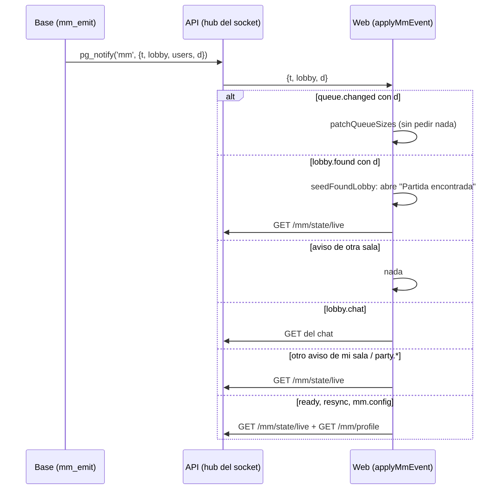

# Matchmaking con avisos que traen el dato y un estado liviano: documentación

## Qué hace

Antes, cada aviso del socket hacía que la web volviera a pedir **todo** el estado del matchmaking (`GET /api/v1/mm/state`). Además, `queue.changed` va a todos los que tienen abierta la pantalla de Jugar, así que con cada entrada o salida de la cola todos pedían el estado completo. Eso explica la medición del 2026-11-02: socket en 177 ms de mediana y `GET /api/v1/mm/state` con p90 de 13,9 s.

Ahora:

1. **Los avisos traen el dato** (`{ t, lobby, d }`). `queue.changed` trae los tamaños de la cola y la web actualiza el contador **sin pedir nada**.
2. **"Partida encontrada" en lo que tarda el socket:** con `lobby.found` y su `d` (modo, tamaño y plazo), la web arma una sala mínima y abre la ventana al instante. El detalle llega después con el estado liviano.
3. **Estado liviano y estado pesado separados:** `GET /api/v1/mm/state/live` (cola, grupo, invitaciones, sanción, sala sin estadísticas…) y `GET /api/v1/mm/profile` (mi ELO, últimas partidas, modos, amigos, sonidos…). Las estadísticas de una partida terminada salen de `GET /api/v1/mm/lobbies/{id}/match`, una sola vez por sala.
4. **Cada aviso pide solo lo suyo:** un aviso de otra sala no hace nada, el chat pide solo el chat y el panel de Administración › Matchmaking deja de recargarse con los avisos de los jugadores.

## Reglas

| Regla | Dónde |
|---|---|
| Ningún `d` lleva contraseñas, IP ni datos que el destinatario no ve hoy (los `NOTIFY` no son privados dentro de la base) | `59_mm_avisos_livianos.sql`; probado en `pruebas/59_mm_avisos_livianos.sql` |
| `mm_my_state()` sigue existiendo y es `mm_my_profile() \|\| mm_my_live(true)`: la web vieja y `GET /api/v1/mm/state` no cambian | `mm_my_state()` |
| `mm_my_live()` saca `match.stats` de la sala salvo con `p_full = true` | `mm_my_live(p_full)` |
| `mm_lobby_match(id)` solo para los de la sala o un admin (si no, 42501) | `mm_lobby_match()` |
| `mm_emit` y `mm_queue_sizes` no son de `authenticated` | grants de la `59` |
| Red de seguridad: en la cola o en una sala, el estado liviano se vuelve a pedir cada 30 s con el socket arriba y cada 5 s sin él; el perfil cada 2 min | `MM_LIVE_REFRESH_MS`, `MM_PROFILE_MS` en `queries.ts` |
| Si la respuesta de una acción propia es más nueva que el aviso, no se vuelve a pedir (como antes) | `useMmSocket` |

### Avisos con `d`

| Aviso | `d` | La web |
|---|---|---|
| `queue.changed` | `{ size, by_mode }` | Actualiza el contador y lo que falta por modo, sin pedir |
| `lobby.found` | `{ mode, size, accept_deadline }` | Abre la ventana al instante y pide el estado liviano |
| `lobby.accept` | `{ user_id, accepted, total }` | Pide el estado liviano |
| `lobby.veto` | `{ map, side, turn, deadline, done }` | Pide el estado liviano |
| Los demás | sin `d` | Según la tabla del diagrama |

**Diferencia con el plan:** `lobby.accept` y `lobby.veto` ya traen su `d`, pero la web todavía pide el estado liviano en lugar de aplicarlo a mano (ya es una consulta chica y solo la piden los diez de la sala; aplicar el `d` queda como mejora si la medición lo pide). `lobby.player` no trae `d`. Las estadísticas de la partida terminada se piden una vez al llegar la sala terminada (y quedan en caché), no al abrir la pestaña.

## Qué cambia para cada rol

| Rol | Qué cambia |
|---|---|
| Jugador | Nada que hacer distinto. "Partida encontrada" aparece más rápido y la pantalla de Jugar responde mejor cuando hay mucha gente |
| Moderador / Admin | El panel de Administración › Matchmaking ya no se recarga con cada aviso de los jugadores: se refresca con sus intervalos |
| Organizador / Streamer | Nada |

No cambia ninguna página del manual (`docs/manual/`): no hay pasos nuevos.

## API

| Ruta | Qué |
|---|---|
| `GET /api/v1/mm/state/live` | `mm_my_live()` + `server_now` |
| `GET /api/v1/mm/profile` | `mm_my_profile()` + `server_now` |
| `GET /api/v1/mm/lobbies/{id}/match` | `mm_lobby_match(id)` con el juego |
| `GET /api/v1/mm/state` | Igual que antes (compatibilidad) |

El socket (`mm/socket.ts`) reenvía `d` cuando el aviso lo trae.

## Dónde está cada cosa

| Qué | Archivo |
|---|---|
| Base | `supabase/replanteo/59_mm_avisos_livianos.sql` y su inversa (rama `feat/mm-claim-en-sala`) |
| API | `web/backend/src/mm/socket.ts`, `web/backend/src/routes/mm.ts` |
| Web | `web/frontend/src/features/matchmaking/queries.ts` (`applyMmEvent`, `patchQueueSizes`, `seedFoundLobby`, `mmStateOptions`, `mmProfileOptions`, `lobbyMatchOptions`), `source.ts`, `demo.ts`, `types.ts`, `PlayPage.tsx`, `ReconnectBanner.tsx` |
