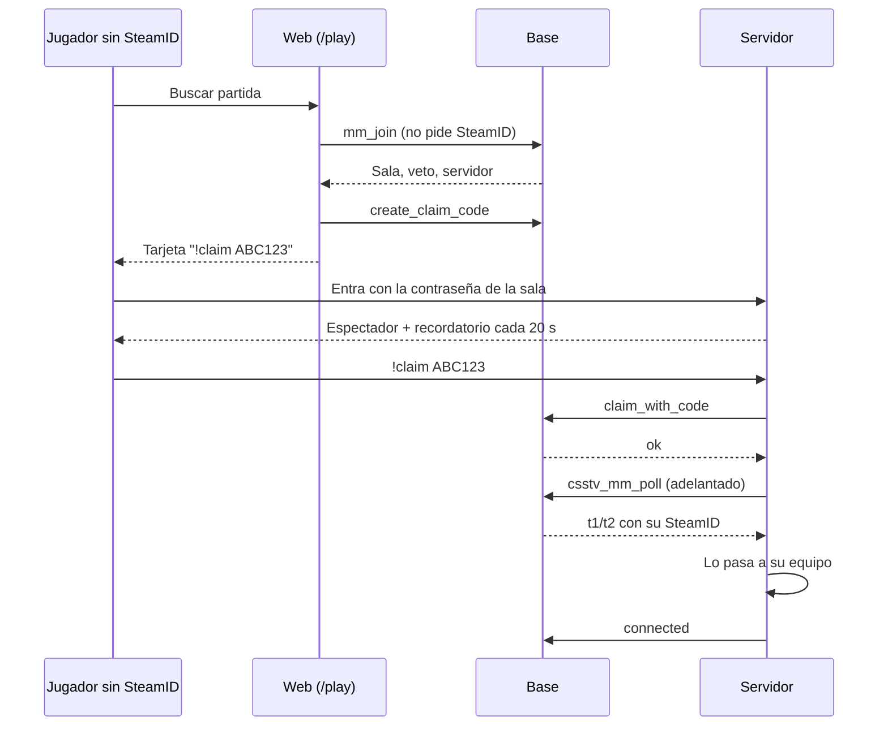

# Matchmaking sin SteamID vinculado: documentación

## Qué hace

Se puede buscar partida en el matchmaking sin tener el SteamID vinculado. El SteamID se vincula con `!claim` dentro del servidor de la primera sala. Con el matchmaking abierto, el servidor solo se usa desde la web, así que esa es la única forma de que un jugador nuevo llegue a vincularlo.

Mientras no se vincula, el plugin no sabe de qué equipo es y lo deja de espectador. La web le muestra en la sala el comando `!claim CÓDIGO` y el servidor se lo recuerda en el chat. Cuando lo escribe, la base vincula el SteamID a su ficha, el plugin lo reconoce en el siguiente poll y lo pasa a su equipo. Desde ahí juega, suma ELO y estadísticas como cualquiera, y no tiene que repetirlo en las próximas salas.

Si no lo hace antes de que venza el tiempo para entrar (`connect_minutes`), pasa lo mismo que con quien no se conecta: queda sancionado y la sala se cancela.

## Reglas

| Caso | Qué pasa |
|---|---|
| Ficha sin SteamID | Entra a la cola. Las demás condiciones siguen: correo confirmado, sin sanción ni exclusión, días de cuenta, anticheat si se exige y `min_mixes` |
| `min_mixes` mayor que 0 | Una ficha sin partidas no puede entrar, tenga o no SteamID. Es configuración de Administración › Matchmaking |
| En la sala, sin vincular | Espectador. No puede elegir equipo (es una sala del matchmaking: sin stand-ins) |
| Hace `!claim` y sale bien | Es el primer SteamID de la ficha: queda vinculado al instante. El plugin adelanta el poll, actualiza el plantel y lo pasa a su equipo |
| El SteamID ya es de otra ficha | `claim_with_code` lo rechaza y él lo ve en el chat. Con ese SteamID no puede jugar esa sala |
| `!ready` | No arranca hasta que estén todos los de la sala en su lado (`n1` y `n2`, con o sin SteamID). No hay 4v5 por alguien sin vincular |
| Baneo por SteamID | El chequeo de la cola no lo ve sin SteamID, pero el plugin chequea el baneo al conectarse (`csstv_ban_check`) |
| Se acaba el tiempo para entrar | Sanción y sala cancelada, como hoy |

## Base de datos (replanteo `49_mm_claim_en_sala.sql`)

| Función | Cambio |
|---|---|
| `mm_block_reason(usuario)` | Ya no devuelve "Tu ficha no tiene un SteamID principal" |
| `csstv_mm_poll(token, versión)` | Suma `n1=` y `n2=` (todos los de cada equipo) y `unlinked=` (cuántos de la sala no tienen SteamID). `t1` y `t2` siguen con los SteamID conocidos |
| `mm_player_card(...)` | Suma `linked` (la ficha tiene SteamID principal). Llega a la web en `lobby.players[]` y en `me` |

Se usa `create or replace`, así que quedan los permisos de la `48`. La inversa deja las tres funciones como en la `48`.

## Plugin (2.8.2)

| Pieza | Qué hace |
|---|---|
| `Mm_RosterSizes` | Lee `n1`, `n2` y `unlinked`. Sin esos campos (base sin la `49`), cuenta los SteamID de `t1` y `t2`, como antes |
| `Mm_UpdateRoster` | En cada poll del calentamiento con la sala tomada, si `t1` o `t2` cambiaron, actualiza el plantel, acomoda a todos (`Link_AdoptSides`, `Link_Arrange`) y avisa "connected" de los que se reconocieron recién |
| `Mm_ClaimNag` | Con `unlinked > 0`, cada 20 s (`MM_CLAIM_EVERY`) recuerda el `!claim` a los que están en el servidor y no están en el plantel |
| `Timer_LinkGreet` | Al entrar, el que no está en el plantel ve el aviso del `!claim` en vez del de los stand-ins |
| `Mm_OnClaimLinked` | Lo llama `!claim` cuando vincula: adelanta el poll |

Para un servidor sin matchmaking (`csstv_mm 0`) no cambia nada.

## Web

- **`ClaimCard`** (`features/matchmaking/room/ClaimCard.tsx`): aparece en el centro de la sala para quien no está vinculado, desde el veto hasta que arranca la partida. Reutiliza el código vigente (`GET /api/v1/me/claim-code`) o pide uno (`POST`). Tiene botón para copiar el comando y cuenta regresiva, y deja pedir otro si vence. El código queda fijo al montar la tarjeta, para que al vencer se ofrezca otro en vez de quedar esperando.
- **Marca "Sin vincular"** en la tarjeta de cada jugador de la sala que todavía no lo hizo, para que el resto sepa por qué no arranca.
- **`MmPlayer.linked`** es opcional: la demo y una API sin la `49` no lo traen, y se toma como vinculado.

## Dónde está cada cosa

| Qué | Archivo / ubicación |
|---|---|
| Replanteo | `supabase/replanteo/49_mm_claim_en_sala.sql` (rama `feat/mm-claim-en-sala`) |
| Inversa | `docs/bitacora/2026-10-14-replanteo-modelo-datos/reversas/49_mm_claim_en_sala.sql` (misma rama) |
| Pruebas SQL | `pruebas/49_mm_claim_en_sala.sql` y `pruebas/correr_local.sh` (esta carpeta) |
| Plugin | `server/addons/sourcemod/scripting/csstv/mm.inc`, `match.inc`, `claim.inc` y `csstv_reporter.sp` (rama `feat/mm-claim-en-sala`) |
| Web | `web/frontend/src/features/matchmaking/room/ClaimCard.tsx` y `ClaimCard.test.tsx`, `RoomOverview.tsx` y `types.ts` (rama `feat/frontend-fase-1`) |
