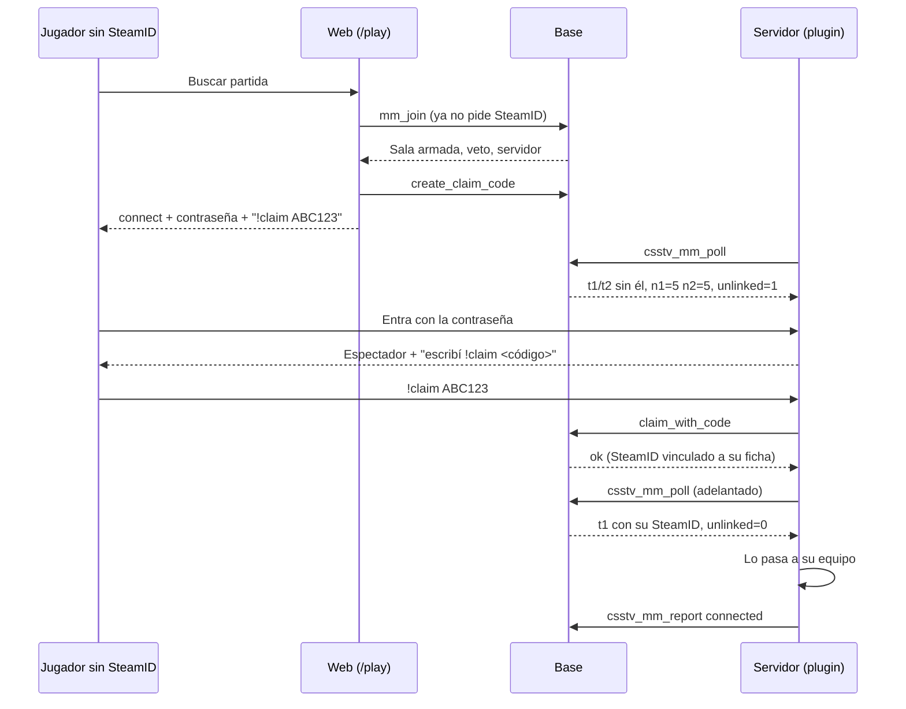

# Plan: matchmaking sin SteamID vinculado (`!claim` en la primera sala)

> Planeación original. Estado: **aprobado por Daniel (2026-11-02, opción A)**.

## El problema

Para entrar a la cola del matchmaking, la ficha tiene que tener un SteamID principal (`mm_block_reason`, replanteo `48`). Cuando se abra el matchmaking, el servidor solo se va a poder usar desde la web, así que quien nunca hizo `!claim` no va a tener dónde hacerlo: nunca va a poder jugar.

Sacar esa validación no alcanza, porque todo el matchmaking reconoce a los jugadores por el SteamID:

- **El plantel:** `csstv_mm_poll` le manda al plugin la lista de SteamIDs de cada equipo (`t1`, `t2`). Alguien sin SteamID no aparece y el plugin no lo reconoce.
- **La sala:** sin "connected", la sala se cae al vencer `connect_deadline`, él queda sancionado y los otros 9 pierden la partida.
- **ELO y stats:** se guardan por SteamID, así que la partida no le contaría.

## Decisiones tomadas

| Tema | Decisión |
|---|---|
| Opción | **A** (Daniel, 2026-11-02): se puede entrar a la cola sin SteamID y el `!claim` se hace dentro de la primera sala. No hace falta el tope de "5 partidas sin vincular" que se había pensado: o se vincula en la primera sala, o no juega |
| Descartadas | **B**, vincular por descarte sin código: quien consiga la contraseña de la sala se queda con la ficha de otro. **C**, iniciar sesión con Steam: en v34 muchos juegan sin Steam y el SteamID del juego no es el de su cuenta de Steam |
| Código | El mismo `!claim` de siempre (`create_claim_code` y `claim_with_code`). La sala de la web pide el código sola, como el paso de bienvenida (`ClaimStep`) |
| Mientras no se vincula | Queda de espectador (ya pasa hoy con quien no está en el plantel: `max_standins = 0`) y el plugin le recuerda el `!claim` cada 20 segundos |
| Inicio de la partida | El `!ready` cuenta el total de la sala (`n1` y `n2` nuevos en el poll), no solo los SteamIDs conocidos. Así no arranca un 4v5 por esperar a alguien sin vincular |
| Plantel después del `!claim` | La base ya lo tiene: el siguiente `csstv_mm_poll` trae el SteamID nuevo en `t1` o `t2`. El plugin vuelve a leer el plantel en cada poll del calentamiento (hoy solo lo lee al tomar la sala) y adelanta el poll cuando un `!claim` sale bien |
| Si no lo hace a tiempo | Igual que hoy: no se conectó, sanción y la sala se cancela |
| SteamID de otra ficha | `claim_with_code` lo rechaza como siempre y el jugador lo ve en el chat. No puede jugar con ese SteamID |
| Baneos | El chequeo de `bans` por SteamID de la cola no aplica sin SteamID. El plugin igual chequea el baneo al conectarse (`csstv_ban_check`) |
| `min_mixes` | Si es mayor que 0, una ficha sin partidas sigue sin poder entrar. Es configuración de Administración › Matchmaking y no se toca acá. Se avisa a Daniel |
| Base | Replanteo nuevo `49_mm_claim_en_sala.sql` (la `48` ya está aplicada en staging), con inversa y pruebas |
| Plugin | `2.8.2`. Sin despliegue en este pedido: Daniel decidió el 2026-11-01 no tocar el plugin de ningún servidor por ahora. Cuando se despliegue, va a #1, #2 y #3 en la misma tanda |
| Rama | Base y plugin en `feat/mm-claim-en-sala` (sale de `origin/kyan/pruebas`, donde vive el matchmaking). Web en `feat/frontend-fase-1` |

## 1. El flujo completo

## 2. Base de datos (`supabase/replanteo/49_mm_claim_en_sala.sql`)

- `mm_block_reason`: sin la línea `if p.steam_id is null`. El resto queda igual.
- `csstv_mm_poll`: suma `n1=` y `n2=` (jugadores de cada equipo, con o sin SteamID) y `unlinked=` (cuántos de la sala todavía no tienen SteamID). Un plugin viejo ignora los campos que no conoce.
- `mm_player_card`: suma `linked` (si la ficha tiene SteamID principal), para que la web sepa a quién mostrarle el `!claim`.
- Inversa en `docs/bitacora/2026-10-14-replanteo-modelo-datos/reversas/49_mm_claim_en_sala.sql`, con las funciones como están en la `48`.
- Pruebas SQL en `pruebas/`: entrar a la cola sin SteamID, los campos nuevos del poll antes y después de vincular, y `linked` en la tarjeta.

## 3. Plugin (`csstv/mm.inc`, `csstv/claim.inc`, 2.8.2)

- `Mm_Take` y el poll del calentamiento leen `n1`, `n2` y `unlinked`. Si no vienen (base vieja), se usa la cuenta de `t1` y `t2`, como hoy.
- En cada poll con la sala ya tomada y en calentamiento, si `t1` o `t2` cambiaron, se actualiza el plantel, se acomoda a todos (`Link_AdoptSides` y `Link_Arrange`) y se avisa "connected" de los que se reconocieron.
- Con `unlinked > 0`, cada 20 segundos se le recuerda el `!claim` a los que están en el servidor y no están en el plantel. Cuando entran, ven el mismo aviso en vez del de los stand-ins.
- `!claim` que sale bien con una sala tomada: se adelanta el poll (`Mm_OnClaimLinked`).
- Compila con `spcomp` 1.10 como siempre. Sin despliegue (ver decisiones).

## 4. Web (`feat/frontend-fase-1`)

- `MmPlayer.linked?: boolean` (opcional: la demo y una API vieja no lo traen, y se toma como vinculado).
- En la sala, desde el veto hasta que la partida está en vivo, si el jugador no está vinculado aparece una tarjeta **"Vincula tu SteamID para jugar"**. La tarjeta pide el código sola, muestra `!claim CÓDIGO` con botón para copiar y la cuenta regresiva, y deja pedir otro si vence.
- En la lista de jugadores, una marca "sin vincular" para los que todavía no hicieron el `!claim`, así el resto sabe por qué no arranca.
- Pruebas con Vitest para la tarjeta.

## 5. Requisitos antes de empezar

- Nada nuevo: la base local de pruebas del backend, `spcomp` y pnpm, como siempre.

## 6. Orden de implementación

1. Replanteo `49`, su inversa y sus pruebas, en la base local.
2. Plugin 2.8.2 y compilarlo.
3. Web: tipo, tarjeta, marca y pruebas.
4. `DOCUMENTACION.md`, `GUIA_IMPLEMENTACION.md`, `CHANGELOG_DISCORD.txt`, la fila del `README.md` de la bitácora y `docs/PENDIENTES.md`.
5. Aplicar la `49` en staging y desplegar la web en staging solo si Daniel lo pide. El plugin no se despliega en este pedido.
