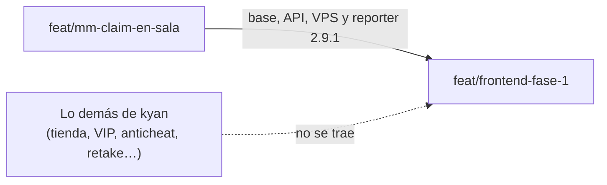

# El matchmaking de staging en la rama del frontend: documentación

## Qué hace

Hasta el 2026-11-02 el matchmaking estaba partido en dos ramas. La web (Jugar, la sala, el veto, Administración › Matchmaking) estaba en `feat/frontend-fase-1`. La base, la API, el VPS y el reporter estaban en `feat/mm-claim-en-sala`, que sale de `kyan/pruebas` y por eso trae también 127 commits de kyan que todavía no se quieren implementar (tienda, VIP, misiones, widget, anticheat, retake, 2v2, DM…).

Desde este cambio, `feat/frontend-fase-1` tiene el matchmaking completo, como está en staging, y nada más de kyan. Se trajeron solo los archivos del matchmaking, mezclados a tres bandas contra la base común `714ec78a`.

## La regla desde ahora

Todo cambio del matchmaking (base, API, VPS o plugin) se commitea en las dos ramas: `feat/frontend-fase-1` y `feat/mm-claim-en-sala`. La web sigue yendo solo en `feat/frontend-fase-1`, como antes.

## Qué entró

| Parte | Qué |
|---|---|
| Base | Replanteos `45` a `62` y sus filas en `supabase/replanteo/README.md`. Los `45` a `47` (anticheat) entran solo porque el `48` los exige: falla sin `ac_devices`, y la cola consulta esa tabla mientras `require_anticheat` esté prendido. |
| API | `routes/mm.ts`, `routes/bookings.ts` (reservar un servidor para torneo o PCW), `mm/socket.ts` (socket con `LISTEN`), `scripts/mm-worker.mts` (worker de `mm_tick`), los cambios en `app.ts`, `node.ts`, `env.ts`, `db/types.ts`, `lib/errors.ts`, `lib/uploads.ts`, `routes/clips.ts`, `routes/matches.ts` (chat solo para tu equipo), `routes/admin-servers.ts` y `schemas/*`, las dependencias `@hono/node-ws` y `postgres`, y 5 pruebas unitarias. |
| VPS | `cmleague-mm.service` y los cambios en `Caddyfile`, `api.env.example` (`MM_LISTEN_URL`), `cmleague-api.service`, `desplegar.sh` (sube `mm-worker.mjs`), `preparar.sh` y `sudoers-deploy`. |
| Plugin | Reporter 2.9.1 (`csstv_reporter.sp`, `csstv/*.inc` con `mm.inc`, `csstv_reporter.cfg`), las cfg por tipo de partida (`live_official`, `live_pcw`, `live_mm` y `live_mix`) y `csstv_password.sp` 1.1.0 (con `csstv_mm 1`, la contraseña la maneja la web). |

## Qué no entró

- Del anticheat: la API (`routes/anticheat*.ts`, `schemas/anticheat.ts`, `jobs/anticheat-retention.ts`, `scripts/anticheat-*.mts`, sus límites en `lib/ratelimit.ts` y `AC_API_SECRET`), la app `agent/`, el panel web y `cml_ac_mix` en `warmup.cfg`, `live.cfg` y `end.cfg`.
- Los plugins aparte de kyan: `csstv_qol` (y su `csstv_qol.cfg`), `csstv_coach`, `csstv_pedir`, retake, 2v2, DM y el Bridge del anticheat.
- Las migraciones de kyan (tienda, VIP, fondos de miniperfil, widget) y sus features de la web.
- El `.smx`: el del repo sigue siendo el 2.7.3. El de la otra rama era un 2.7.x viejo, y el despliegue compila el suyo.

## El reporter: 2.7.3 contra 2.9.1

La rama del frontend tenía el reporter 2.7.3 (aviso de arranque, pausa automática y charla del medio tiempo). El 2.9.1 ya trae esas tres cosas, reescritas en la línea 2.8.x de kyan (el alltalk del medio tiempo entre rondas y la pausa técnica). Por eso no se mezcló: entró el 2.9.1 tal cual. Mezclarlo duplicaba funciones del 2.7.3.

## Qué cambia para cada rol

Nada para los usuarios. Es un cambio de ramas: lo que corre en staging no cambia.

## Dónde está cada cosa

| Qué | Archivo / ubicación |
|---|---|
| Rama con todo | `feat/frontend-fase-1` |
| Rama del matchmaking (con lo de kyan) | `feat/mm-claim-en-sala` (worktree `E:\Css V34 Web\v34frag-mmclaim`) |
| Base común de las dos | `714ec78a` |
| Worker del matchmaking | `web/backend/scripts/mm-worker.mts`, `deploy/vps/cmleague-mm.service` |
| Reporter 2.9.1 | `server/addons/sourcemod/scripting/csstv_reporter.sp`, `csstv/mm.inc` |
