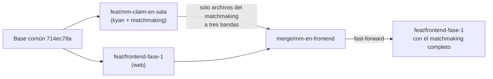

# Plan: el matchmaking de staging en la rama del frontend

> Planeación original. Estado: **aprobado por Daniel (2026-11-02)**.

## Decisiones tomadas

| Tema | Decisión | Por qué |
|---|---|---|
| Qué se trae | Solo el matchmaking que ya está en staging: base, API, VPS y reporter. | `feat/mm-claim-en-sala` sale de `kyan/pruebas` y trae 127 commits de kyan (tienda, VIP, misiones, widget, anticheat, retake, 2v2, DM…) que todavía no se quieren implementar o están en una fase temprana. |
| Cómo | No se hace merge de la rama. Se aplican, archivo por archivo, los cambios de `feat/mm-claim-en-sala` desde la base común (`714ec78a`). Cuando las dos ramas cambiaron un archivo, se mezcla a tres bandas. | Un merge arrastraría todo lo de kyan. Mezclar a tres bandas conserva lo que la rama del frontend cambió después de la base (stats por mapa, reporter 2.7.3). |
| Anticheat | Entran solo los replanteos `45` a `47`, como dependencia. Sin la API, la app `agent/` ni el panel web. | El `48` falla sin `ac_devices` ("aplicar antes 45_anticheat.sql"), y la cola consulta esa tabla. En staging ya están aplicados. |
| Plugin | Entra el reporter 2.9.1 (`csstv_reporter.sp`, `csstv/*.inc`, `csstv_reporter.cfg`, las cfg de `cfg/csstv/` y `csstv_password.sp` 1.1.0, que respeta `csstv_mm`). Sin retake, 2v2, DM, coach, `!pedir`, `csstv_qol` ni el Bridge del anticheat (`cml_ac_mix` fuera de las cfg). | El 2.9.1 lleva el `mm.inc` y los QOL de kyan que están dentro del reporter (`qol.inc`). Los plugins aparte no hacen falta para compilarlo. |
| `.smx` | No se cambia el `.smx` del repo. | El de `feat/mm-claim-en-sala` es un 2.7.x viejo; el despliegue compila el suyo (`build_licenciado.sh`). |
| Web | No se toca `web/frontend`. | La rama del frontend ya tiene la versión más nueva del matchmaking. |
| De acá en adelante | Todo cambio del matchmaking (base, API, VPS o plugin) se commitea en las dos ramas: `feat/frontend-fase-1` y `feat/mm-claim-en-sala`. | Pedido de Daniel (2026-11-02): que la rama del frontend tenga el matchmaking completo sin traer lo de kyan. |

## 1. El flujo completo

Se trabaja en un worktree aparte (`v34frag-mmfront`, rama `merge/mm-en-frontend`) para no tocar los cambios sin commit de la rama del frontend. Cuando el build y las pruebas pasan, `feat/frontend-fase-1` avanza a esa rama.

## 2. Base de datos

- `supabase/replanteo/45` a `62` y sus filas en `supabase/replanteo/README.md`.
- Sin las migraciones de kyan (`tienda`, `vip_progresion`, `fondo_miniperfil`, `widget_streamers`).

## 3. API (`web/backend`)

- Nuevos: `routes/mm.ts`, `routes/bookings.ts`, `mm/socket.ts`, `scripts/mm-worker.mts` y las pruebas `mm-*` y `bookings-routes`.
- Mezclados: `app.ts` (sin las rutas del anticheat), `node.ts` (socket), `env.ts` (sin `AC_API_SECRET`), `package.json` y `pnpm-lock.yaml` (`@hono/node-ws`, `postgres` y `mm:worker`), `scripts/build.mjs`, `db/types.ts`, `lib/errors.ts`, `lib/uploads.ts`, `routes/clips.ts`, `routes/matches.ts`, `routes/admin-servers.ts`, `schemas/*`.
- Fuera: `routes/anticheat*.ts`, `schemas/anticheat.ts`, `jobs/anticheat-retention.ts`, `scripts/anticheat-*.mts`, la prueba del anticheat y sus límites en `lib/ratelimit.ts`.

## 4. VPS (`deploy/vps`)

`cmleague-mm.service` (worker de `mm_tick`), y los cambios en `Caddyfile`, `api.env.example`, `cmleague-api.service`, `desplegar.sh`, `preparar.sh` y `sudoers-deploy`.

## 5. Plugin

Lo del punto "Plugin" de las decisiones. Se compila con `spcomp` para comprobar que el 2.9.1 queda completo; el `.smx` no se versiona en este cambio.

## 6. Requisitos antes de empezar

- Las ramas `feat/frontend-fase-1` y `feat/mm-claim-en-sala` locales al día.
- `pnpm` para instalar y probar `web/backend`, y `spcomp` del servidor local.

## 7. Orden de implementación

1. Worktree `v34frag-mmfront` con la rama `merge/mm-en-frontend` desde `feat/frontend-fase-1`.
2. Aplicar los archivos de las secciones 2 a 5 (mezcla a tres bandas donde cambiaron las dos ramas) y sacar lo del anticheat.
3. `pnpm install --frozen-lockfile`, `typecheck` y pruebas unitarias de `web/backend`; compilar el reporter.
4. Comparar `web/backend`, `supabase/replanteo`, `deploy/vps` y el reporter contra `feat/mm-claim-en-sala`: las únicas diferencias tienen que ser el anticheat y lo que la rama del frontend tenía de antes.
5. Commit, `DOCUMENTACION.md`, `GUIA_IMPLEMENTACION.md`, fila en el índice y la regla de las dos ramas en `CLAUDE.md` y `docs/PENDIENTES.md`.
6. Fast-forward de `feat/frontend-fase-1`.
