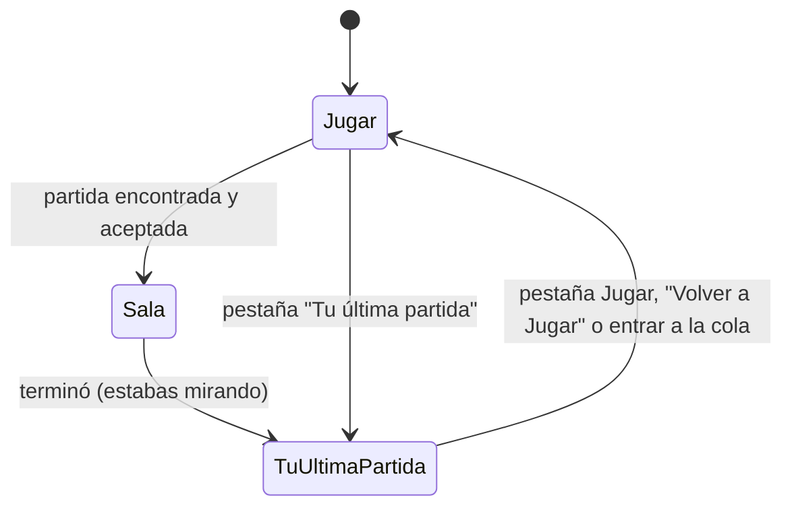

# El flujo de la sala del matchmaking: documentación

## Qué hace

Arregla cuatro cosas que se vieron en las salas de staging del 2026-11-02:

1. **Aceptar sin carreras.** Un "Aceptar" que llegaba justo al vencer el plazo quedaba guardado mientras el tick cancelaba la sala y sancionaba a ese mismo jugador. Ahora aceptar, rechazar y el tick bloquean la sala: o el "Aceptar" entra antes y cuenta, o llega tarde y la web muestra "Se terminó el tiempo para aceptar".
2. **Cuando se cancela una sala y sale otra.** Los que aceptaron vuelven a la cola en el acto, con su lugar, pero **durante 3 s no se los mete en otra sala**. La web avisa "La partida se canceló: Un jugador no aceptó a tiempo · Si aceptaste, volviste a la cola con tu lugar.", y la ventana de "Partida encontrada" es una ventana nueva por cada sala.
3. **"Tu última partida".** La pantalla principal es Jugar. La última partida terminada tiene su pestaña al lado. Solo se pasa sola a esa pestaña si estabas en la sala cuando terminó; entrar a la cola o a otra sala vuelve a Jugar. Las estadísticas se piden al abrir la pestaña, una sola vez.
4. **Que la pantalla no quede vieja.** Si llega un aviso de otro **mientras** haces algo (aceptar, banear), al terminar la acción se vuelve a pedir el estado. Antes se suponía que la respuesta ya lo traía, y no siempre era así.

```mermaid
sequenceDiagram
    participant J as Jugador (aceptó)
    participant W as Web
    participant B as Base
    B->>B: mm_tick: pasó el plazo y falta uno
    B->>B: cancela la sala; quien aceptó vuelve a la cola con ready_at = ahora + 3 s
    B-->>W: lobby.cancelled {reason, requeue: true}
    W->>J: "La partida se canceló: Un jugador no aceptó a tiempo"
    Note over B: 3 s: mm_try_build no lo toma
    B-->>W: lobby.found (sala nueva)
    W->>J: ventana nueva de "Partida encontrada" (con su sonido)
```



## Reglas

| Regla | Dónde |
|---|---|
| Aceptar y rechazar toman la sala con `for update` y rechazan si pasó `accept_deadline` | `mm_accept()`, `mm_decline()` |
| El tick toma las salas abiertas con `for update`, en orden de creación | `mm_tick()` |
| Quien vuelve a la cola por una cancelación conserva `joined_at` y no entra en otra sala hasta `ready_at` (3 s) | `mm_cancel_lobby()`, `mm_try_build()` |
| `lobby.cancelled` lleva `{ reason, requeue }` | `mm_cancel_lobby()` |
| `mm_my_live()`: `lobby` es solo la sala abierta y `last_lobby` la última terminada (sin límite de tiempo y sin estadísticas) | `mm_my_live(p_full)` |
| Con `p_full` (`mm_my_state()`, las respuestas de las acciones y la web ya desplegada), `lobby` sigue como antes: la abierta o la terminada en la última hora | `mm_my_live(true)`; la web lo pasa a `last_lobby` con `normalizeState()` |
| Una sala terminada no cuenta como "algo que seguir": no se repite el pedido cada 30 s | `isActive()` en la web, con `normalizeState()` |
| Un aviso que llegó antes de empezar una acción propia no se vuelve a pedir; uno que llegó durante la acción, sí | `lastOwnAction` en `queries.ts` |

**Cambio de comportamiento:** una sala cancelada después de aceptar (sin servidor libre o porque no se conectaron todos) ya no queda en pantalla con el motivo: vuelve a Jugar y el motivo sale en el aviso.

## Qué cambia para cada rol

| Rol | Qué cambia |
|---|---|
| Jugador | Al entrar a Jugar se ve Jugar, con la pestaña "Tu última partida" al lado. Si una partida se cancela porque alguien no aceptó, aparece un aviso y, si aceptaste, vuelves a la cola con tu lugar: la próxima partida sale al menos 3 s después. Un "Aceptar" en el último instante cuenta o dice que se terminó el tiempo, sin sanción sorpresa |
| Moderador / Admin | Nada nuevo |
| Organizador / Streamer | Nada |

Página del manual a revisar cuando exista la de jugar matchmaking: `docs/manual/jugador/buscar-partida.md` (la escribe la sesión del manual de usuario; no se tocó acá).

## Datos

- **`mm_queue.ready_at`** (`timestamptz`, puede ser nulo): desde cuándo se lo puede meter en una sala.

## Dónde está cada cosa

| Qué | Archivo |
|---|---|
| Base | `supabase/replanteo/60_mm_flujo_sala.sql` y su inversa (rama `feat/mm-claim-en-sala`) |
| Web | `web/frontend/src/features/matchmaking/queries.ts` (`normalizeState`, `lastOwnAction`), `PlayPage.tsx` (pestañas, `LastMatch`, aviso de cancelación, ventana por sala), `types.ts` (`last_lobby`), `demo.ts` |
| API | Sin cambios: `GET /api/v1/mm/state/live` ya pasa `last_lobby` tal cual y las estadísticas salen de `GET /api/v1/mm/lobbies/{id}/match` |
