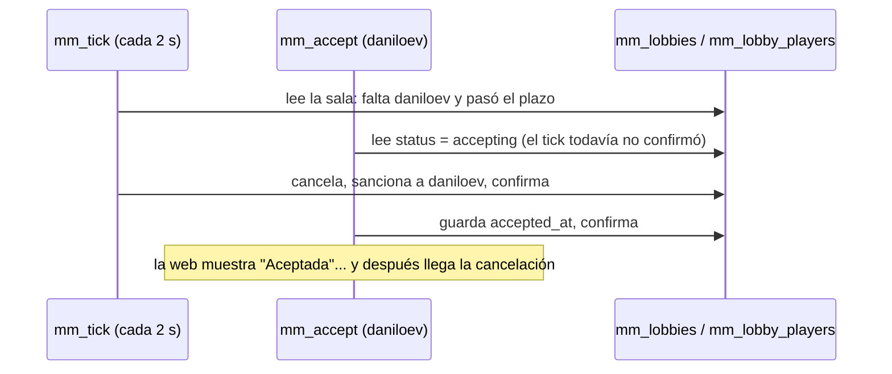

# Plan: el flujo de la sala del matchmaking (aceptar, cancelar, volver a encontrar y el resumen)

> Planeación original. Estado: **aprobado por Daniel el 2026-11-02**, con las respuestas de abajo.

## Por qué

Daniel, 2026-11-02: después de una partida cancelada porque alguien no aceptó, al volver a salir "Partida encontrada" tocaba Aceptar, veía "esperando al resto" y al instante volvía a ver "Aceptar". Al entrar a Jugar se queda el resumen de la última partida en lugar de mostrar Jugar. A veces lo que hace uno no le llega a los demás.

## Lo que se encontró (salas de staging del 2026-11-02, hora de Colombia)

| Sala | Qué pasó | Problema |
|---|---|---|
| `365e18f0` (20:18:35) | Plazo 20:18:50.5. El tick la cancela a las 20:18:51.3 ("no aceptó a tiempo") y sanciona a `daniloev`. Pero el "Aceptar" de `daniloev` quedó guardado a las 20:18:51.7, **después** del plazo y de la cancelación | **Carrera en la base:** `mm_accept()` no mira el plazo ni bloquea la sala, y `mm_tick()` tampoco. Las dos transacciones se cruzan: la web le dice "Aceptada" y después llega la cancelación con sanción |
| `ec62b1c5` → `a0f0bdd7` (20:24:53 → 20:25:09) | `daniloev` aceptó y `kyan` no. **En el mismo tick** se cancela la sala, `daniloev` vuelve a la cola con su lugar y se arma otra sala con `kyantares` | **Es lo que vio Daniel:** la ventana de la sala nueva es la misma ventana (no cambia nada visible) y pasa de "esperando al resto" a "Aceptar" sin aviso de que la anterior se canceló |
| Resumen | `mm_my_live()` devuelve la última sala **terminada durante una hora**, aunque ya estés en la cola. La web la muestra hasta tocar "Volver", pero eso se guarda solo en la pantalla: al entrar de nuevo a Jugar vuelve a aparecer | El resumen no se puede cerrar de verdad. Además, con esa sala la web cree que "hay algo que seguir" y repite el pedido cada 30 s durante esa hora |
| Avisos a los demás | Antes del despliegue de los avisos livianos, cada aviso hacía que todos pidieran el estado completo: p90 de **13,6 s** y máximo de 42 s (logs de 20:00 a 20:43). Aceptar llegó a tardar 12,4 s | La causa principal de "no le actualiza al resto" ya está corregida en staging desde las 20:43 (`2026-11-02-mm-avisos-livianos`), pero falta medirlo con jugadores |
| Acción propia | Si llega un aviso de otro **mientras** uno hace algo (aceptar, banear), la web no vuelve a pedir el estado porque supone que la respuesta ya lo trae. No siempre: la respuesta pudo leerse antes de ese cambio | La pantalla de quien actuó puede quedar vieja hasta el refresco de 30 s |

## Propuesta

### 1. Aceptar sin carreras (base)

- `mm_accept()` y `mm_decline()` toman la sala con `for update` y rechazan si pasó `accept_deadline` ("Se terminó el tiempo para aceptar").
- `mm_tick()` toma cada sala en `accepting` con `for update` antes de decidir. Así, o el "Aceptar" entra antes y cuenta, o llega tarde y la web lo dice. Nadie queda sancionado habiendo visto "Aceptada".

### 2. Cuando una sala se cancela y sale otra

- **Web:** al cancelarse la sala, un aviso claro en la ventana o en un toast: "La partida se canceló: un jugador no aceptó. Volviste a la cola con tu lugar." (o "…rechazó"). La ventana de "Partida encontrada" se arma de nuevo por cada sala (con su sonido), así se nota que es otra.
- **Base (a decidir):** una pausa corta (3 s) antes de volver a armar sala con quienes volvieron a la cola, para que el aviso se alcance a leer. Hoy la sala nueva sale en el mismo tick.

### 3. El resumen de la última partida

- La sala terminada se muestra **solo a quien estaba en la pantalla cuando terminó** (la web vio el cambio de "en vivo" a "terminada"). Al entrar después a Jugar, se ve Jugar con una tarjeta chica "Tu última partida · Ver resumen" que abre `/match/$id`.
- Al entrar a la cola o al aparecer una sala nueva, el resumen se cierra solo.
- `mm_my_live()` deja de devolver la sala terminada si ya estás en la cola o en otra sala.
- Una sala terminada no cuenta como "algo que seguir": sin el refresco de 30 s.

### 4. Que la pantalla no quede vieja

- Un aviso que llega mientras uno hace algo **sí** vuelve a pedir el estado liviano al terminar la acción. Solo se saltea el pedido si el aviso llegó antes de empezar la acción.
- Un aviso de una sala que no es la mía se sigue ignorando, salvo `lobby.found`.

### 5. Medir con jugadores

La próxima vez que haya gente en Jugar: pedidos a `/api/v1/mm/state*` y sus percentiles en los logs, y cuánto tardan aceptar y banear. Desde el despliegue de las 20:43 solo hubo pedidos de prueba (`/mm/state/live` mediana de 98 ms y p90 de 232 ms), sin carga.

## Decisiones de Daniel (2026-11-02)

| Tema | Decisión | Cómo se hace |
|---|---|---|
| Pausa al volver a la cola | **3 s** antes de volver a meter en una sala a los que vuelven a la cola por una cancelación | Vuelven a la cola en el acto (siguen viendo "Buscando" y conservan su lugar), con `mm_queue.ready_at = now() + 3 s`; `mm_try_build` no los toma hasta esa hora |
| El resumen | **La principal es Jugar**, y existe la pestaña **"Tu última partida"** | Jugar tiene dos pestañas: Jugar (la de siempre) y "Tu última partida" (el resumen de la última sala terminada, sin límite de una hora). Solo se pasa sola a "Tu última partida" si estabas en la pantalla cuando terminó |
| Sanción de `daniloev` por la carrera | No se toca (staging, ya venció) | — |

Con eso, el punto 3 queda así: `mm_my_live()` devuelve en `lobby` solo la sala abierta, y la última terminada va aparte en `last_lobby` (sin estadísticas). Las estadísticas se piden con `GET /api/v1/mm/lobbies/{id}/match` al abrir la pestaña. `mm_my_state()` mantiene `lobby` como antes (abierta o terminada en la última hora) para no romper la web ya desplegada.

## Pruebas

- **Base:** dos sesiones en paralelo (`dblink` o dos `psql`): aceptar justo en el plazo con el tick corriendo; aceptar después del plazo da el error; nadie queda sancionado con `accepted_at`.
- **Web:** aviso de cancelación y ventana nueva con otra sala; el resumen solo después de verlo terminar; un aviso durante una acción vuelve a pedir; una sala terminada no repite pedidos.

## Orden

1. Replanteo `60` (aceptar y el tick con bloqueo y plazo; `mm_my_live` sin la sala terminada si estás en la cola o en otra sala). Inversa y pruebas.
2. Web (puntos 2, 3 y 4). Pruebas.
3. Staging: la `60` y la web (la API no cambia).
4. Producción, con el corte.
