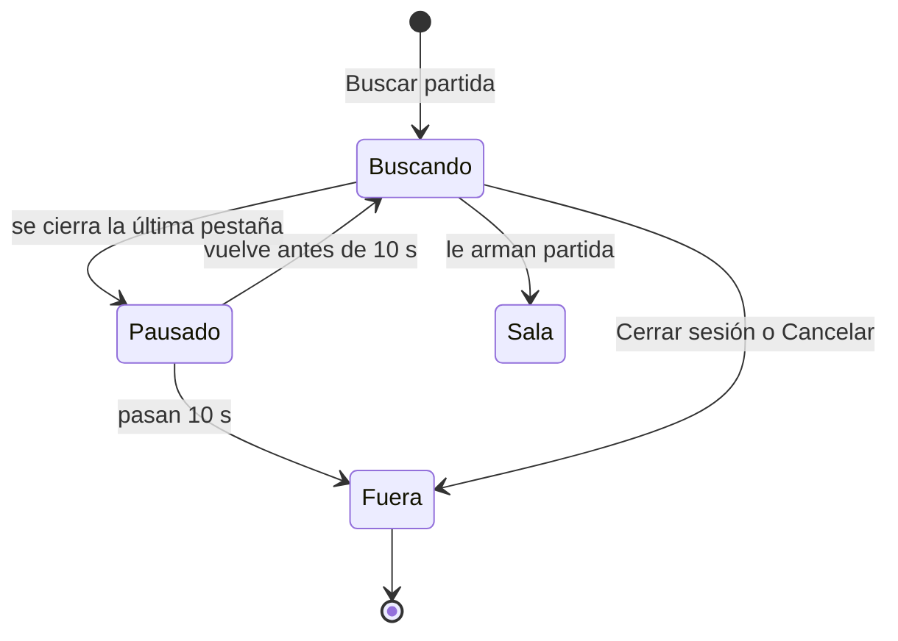
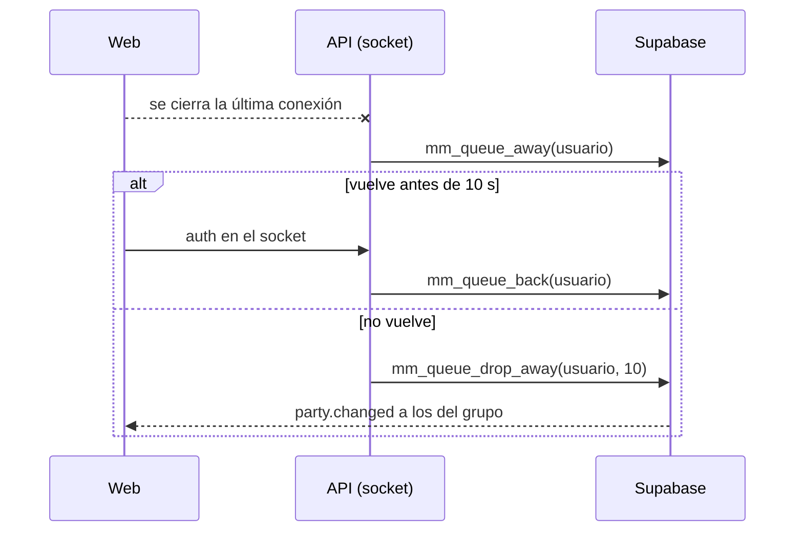

# Salir de la cola del matchmaking al cerrar la web o la sesión: documentación

## Qué hace

Antes, quien cerraba la web mientras buscaba seguía en la cola. Le salía partida, no aceptaba, la sala se cancelaba para los demás y a él le caía una sanción.

Ahora la API usa el socket del matchmaking para saber quién sigue con la web abierta. Cuando una cuenta se queda sin ninguna conexión, queda **en pausa** al instante: sigue en la cola, pero no se la usa para armar salas. Si vuelve dentro de **10 s** (una recarga, un corte corto), sigue buscando con su lugar. Si no vuelve, sale de la cola **sin sanción**, y su grupo con ella. **Cerrar sesión** la saca en el acto. Al volver, Jugar avisa: "Te sacamos de la cola porque cerraste la web".

## Reglas

- **Conectado** es tener al menos una conexión del socket del matchmaking. La web lo abre en todas las páginas con sesión, así que navegar por la web no saca a nadie. Con dos pestañas, cerrar una no cuenta.
- **Sin socket** (por ejemplo, si el navegador o la red no lo dejan), la web pide el estado liviano cada 5 s. Cada pedido cuenta como conectado durante 15 s.
- **Pausa:** `mm_try_build` no usa una unidad (un jugador solo o un grupo) si alguien de ella está en pausa. Así no se arma sala con un compañero sin el otro.
- **Gracia:** 10 s (`MM_GRACE_S`). Al salir, el que se fue queda en `mm_queue_log` con `outcome = 'disconnected'` y sus compañeros con `left`. A los compañeros se les manda `party.changed` para que dejen de ver "Buscando". Nadie recibe sanción.
- **Cerrar sesión:** `POST /auth/logout` llama a `mm_logout()` antes de cerrar la sesión. Si falla, la sesión se cierra igual. A diferencia de **Cancelar** (`mm_leave`), nunca rechaza una sala: a quien está aceptando no lo sanciona.
- **Ya en una sala:** nada de esto aplica. Sigue la regla de aceptar, conectarse y reconectar.
- **Despliegues:** los cortes del `shutdown()` de la API no pausan a nadie. Al arrancar, la red de seguridad espera 30 s a que todos se reconecten.
- **Red de seguridad:** cada 15 s, `mm_queue_presence_sweep` con la lista de conectados. Los conectados vuelven, los demás quedan en pausa y los que pasaron la gracia salen. Cubre lo que el aviso de cierre no ve: un cierre durante un reinicio, o una conexión que la API no vio cerrarse.
- **Reconexión de la web:** con el evento `online` del navegador, el socket reconecta en el acto. Si no, la espera entre intentos crece (1, 2, 4… s) y podría pasarse de los 10 s después de un corte.
- **Aviso en Jugar:** `mm_my_live().queue_dropped_at` trae la hora si la última salida de la cola fue `disconnected`, en los últimos 10 min, y ahora no está buscando. El aviso se cierra con **Entendido**.

## Base de datos (replanteo `63`)

| Qué | Detalle |
|---|---|
| `mm_queue.away_since` | Desde cuándo no tiene conexión. `null` es conectado |
| `mm_queue_log.outcome` | Suma `disconnected` |
| `mm_unit_away(unidad)` | Si alguien del jugador o del grupo está en pausa. Lo usa `mm_try_build` |
| `mm_queue_away`, `mm_queue_back` | Pausa y vuelta |
| `mm_queue_drop_away(usuario, gracia)` | Lo saca si sigue en pausa hace más de la gracia, con su grupo. Devuelve cuántos salieron |
| `mm_queue_presence_sweep(conectados, gracia)` | La red de seguridad |
| `mm_logout()` | Sale de la cola (él y su grupo) sin tocar una sala. Para `authenticated` |
| `mm_my_live` | Suma `queue_dropped_at` |

Las cuatro de presencia son solo para `mm_listener` (el rol de `MM_LISTEN_URL`) y `service_role`. Los jugadores no las pueden llamar.

## API

| Qué | Dónde |
|---|---|
| Pausa al cerrar la última conexión, salida a los 10 s, vuelta al reconectar | `createMmHub(verify, presence)` en `web/backend/src/mm/socket.ts` |
| Llamadas a la base | `sqlPresence(sql)`, con la misma conexión del LISTEN (`mmSql`) |
| Pedidos del estado liviano como presencia | `GET /api/v1/mm/state/live` llama a `c.var.mmPolled` (lo pasa `node.ts` a `createApp`) |
| Red de seguridad | `node.ts`: `hub.sweep()` cada 15 s, desde los 30 s del arranque |
| Cerrar sesión | `POST /auth/logout` llama a `mm_logout` |

Sin `MM_LISTEN_URL` (local o pruebas) no hay presencia: todo sigue como antes.

## Web

- `socket.ts`: reconexión inmediata con `online` (`onOnline` en las dependencias, para las pruebas).
- `PlayPage.tsx`: el aviso "Te sacamos de la cola porque cerraste la web".
- Demo: el botón "Cerrar la web buscando".

## Qué cambia para cada rol

| Rol | Qué cambia | Página del manual |
|---|---|---|
| Jugador | Si cierras la web o la sesión mientras buscas, sales de la cola sin sanción. Una recarga o un corte corto no te sacan. Jugar te avisa al volver | [`jugador/buscar-partida.md`](../../manual/jugador/buscar-partida.md) (sección "1. Buscar") |
| Capitán | Si alguien de tu grupo cierra la web, el grupo sale de la cola | La misma |

## Dónde está cada cosa

| Qué | Archivo / ubicación |
|---|---|
| Replanteo e inversa | `supabase/replanteo/63_mm_salir_cola_al_cerrar.sql` y `docs/bitacora/2026-10-14-replanteo-modelo-datos/reversas/63_mm_salir_cola_al_cerrar.sql` |
| Pruebas SQL | `pruebas/63_mm_salir_cola_al_cerrar.sql` y `pruebas/correr_local.sh` |
| API | `web/backend/src/mm/socket.ts`, `src/node.ts`, `src/app.ts`, `src/lib/types.ts`, `src/routes/mm.ts` y `src/routes/auth.ts` |
| Pruebas de la API | `web/backend/test/unit/mm-presence.test.ts` y `test/unit/auth-routes.test.ts` |
| Web | `web/frontend/src/features/matchmaking/socket.ts`, `PlayPage.tsx`, `demo.ts`, `types.ts` y `src/routes/demo.matchmaking.tsx` |
| Pruebas de la web | `socket.test.ts` y `PlayPage.test.tsx` |
