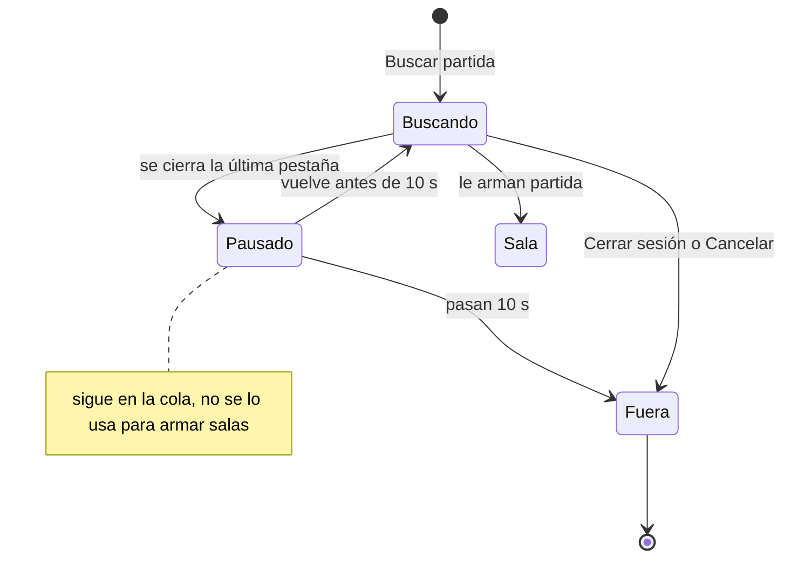
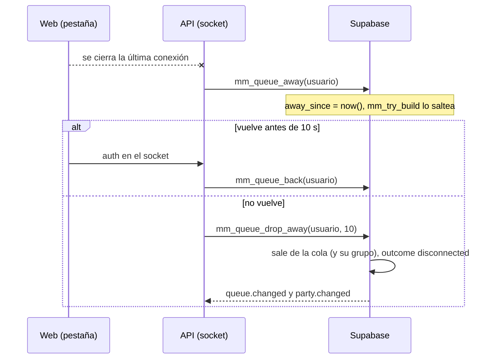

# Plan: salir de la cola del matchmaking al cerrar la web o la sesión

> Planeación original. Estado: **aprobado por Daniel el 2026-11-02** (pausa inmediata y 10 s de gracia).

## Hoy

Quien está en la cola y cierra la pestaña sigue en la cola sin límite. Cuando le sale partida no acepta: la sala se cancela para los demás y a él le cae una sanción de la cola. Cerrar sesión tampoco lo saca.

`mm_queue` no sabe si el jugador está conectado. La API sí lo sabe: el socket del matchmaking (`web/backend/src/mm/socket.ts`) guarda las conexiones abiertas de cada cuenta (`byUser`). La web lo abre en todas las páginas con sesión, porque `ReconnectBanner` está en el layout `_app` y usa `useMmSocket`. Cuando el socket no conecta, la web pide el estado liviano cada 5 s (`MM_FALLBACK_MS`).

## Decisiones tomadas

| Tema | Decisión | Por qué |
|---|---|---|
| Señal de presencia | El socket del matchmaking y, si no conecta, los pedidos de `GET /api/v1/mm/state/live` | El socket ya existe, está en todas las páginas con sesión y cuenta las pestañas por cuenta. Un aviso del navegador al cerrar (`pagehide`, `sendBeacon`) no siempre llega y no sabe si quedan otras pestañas |
| Al cerrarse la última conexión | **Pausa inmediata:** sigue en la cola, pero `mm_try_build` no lo usa (`mm_queue.away_since`) | Así no le puede salir partida mientras no está, dure lo que dure la gracia (Daniel, 2026-11-02) |
| Gracia | **10 s.** Si vuelve antes, sigue con su lugar y su tiempo de espera. Si no vuelve, sale de la cola | Cubre una recarga y un corte corto, y saca rápido al que se fue |
| Al salir | Sin sanción. Si iba en grupo, sale el grupo, como con **Cancelar**. Queda en `mm_queue_log` con el resultado nuevo `disconnected` | Irse mientras se busca no perjudica a nadie si no le arman sala |
| Cerrar sesión | Sale de la cola en el acto (`mm_leave` antes de cerrar la sesión) | Lo pidió Daniel. Es explícito, no hace falta gracia |
| Ya en una sala | No cambia nada: sigue la regla de aceptar, conectarse y reconectar | La pausa y la gracia son solo para la cola |
| Reinicio de la API | Los cortes por `shutdown()` (despliegue) no cuentan. Después de arrancar, 30 s sin revisar a nadie, para que todos se reconecten | Un despliegue no tiene que vaciar la cola |
| Red de seguridad | Una revisión cada 15 s con la lista de conectados saca a los que pasaron la gracia y pausa a los que no tienen conexión | Cubre lo que el aviso de cierre no ve: alguien que cerró justo durante un reinicio, o un corte que la API no notó |
| Aviso al volver | Si en los últimos 10 min salió por esto, Jugar muestra "Te sacamos de la cola porque cerraste la web" | Que entienda por qué no está buscando |

## 1. El flujo completo

## 2. Base de datos (replanteo `63`, o el siguiente libre)

- `mm_queue.away_since timestamptz`: desde cuándo no tiene ninguna conexión. `null` es conectado.
- `mm_queue_log.outcome` acepta `disconnected`.
- `mm_try_build`: además de `ready_at`, solo toma filas con `away_since is null`, y no toma un grupo si algún integrante está en pausa.
- Funciones nuevas, `security definer` y solo para el rol con el que se conecta la API (ver la sección 6):

| Función | Qué hace |
|---|---|
| `mm_queue_away(p_user)` | `away_since = now()` si está en la cola y no estaba en pausa |
| `mm_queue_back(p_user)` | `away_since = null` |
| `mm_queue_drop_away(p_user, p_grace_s)` | Si sigue en pausa hace más de `p_grace_s`, lo saca con `mm_queue_remove(…, 'disconnected')`, a él y a su grupo. Avisa `queue.changed` y `party.changed` a los del grupo |
| `mm_queue_presence_sweep(p_online uuid[], p_grace_s)` | La red de seguridad: los de la cola que están en `p_online` vuelven; los que no están, quedan en pausa; los que pasaron la gracia, salen. Devuelve cuántos sacó |

- `mm_my_live` suma `queue_dropped_at`: la hora de la última salida `disconnected` de los últimos 10 min, si ahora no está en la cola.
- Pruebas SQL en `pruebas/`:
  - un jugador en pausa no entra en una sala;
  - un grupo con uno en pausa tampoco;
  - si vuelve, conserva su `joined_at`;
  - a los 10 s sale con `disconnected`, él y su grupo;
  - sin sanción;
  - la red de seguridad hace las tres cosas;
  - a uno que ya está en una sala no lo toca.

## 3. API

- `socket.ts` (`createMmHub`):
  - Cuando una cuenta se queda sin conexiones, llama a `mm_queue_away` y programa `mm_queue_drop_away` a los 10 s. Si en ese tiempo vuelve a autenticarse, cancela el timer y llama a `mm_queue_back`.
  - `shutdown()` marca que la API está cerrando: esos cortes no pausan ni sacan a nadie.
  - Lleva en memoria la última vez que cada cuenta pidió `GET /mm/state/live`. Esos pedidos cuentan como presencia durante 15 s (la web, sin socket, pide cada 5 s).
- `node.ts`: la red de seguridad cada 15 s, después de 30 s desde el arranque. Llama a `mm_queue_presence_sweep` con las cuentas conectadas (socket o pedidos recientes).
- Llama a la base con la conexión de `MM_LISTEN_URL`, que ya existe, o con `SUPABASE_SERVICE_KEY`. Se decide en la sección 6.
- `POST /auth/logout`: antes de cerrar la sesión, `mm_leave()` como el usuario. Si falla, se cierra la sesión igual.
- Si `MM_LISTEN_URL` no está configurado, como en las pruebas o en local sin el matchmaking, no hace nada de esto.
- Pruebas del hub con timers falsos:
  - pausa al cerrar la última conexión y no al cerrar una de dos;
  - vuelve si se reconecta a tiempo;
  - sale a los 10 s;
  - el `shutdown` no pausa a nadie;
  - el polling cuenta como presencia;
  - el logout llama a `mm_leave`.

## 4. Web

- `socket.ts`: con el evento `online` del navegador, reconecta en el acto y reinicia la espera entre intentos. Hoy la espera crece a 1, 2, 4… s y podría pasarse de los 10 s después de un corte corto.
- Jugar: con `queue_dropped_at`, un aviso liviano "Te sacamos de la cola porque cerraste la web. Vuelve a buscar cuando quieras.". Se puede cerrar.
- La demo hace lo mismo con un control "Cerrar la web".
- Nada cambia mientras estás buscando con la web abierta.

## 5. Manual y changelog

- `docs/manual/jugador/buscar-partida.md`, en "1. Buscar": si cierras la web o la sesión mientras buscas, sales de la cola sin sanción. Una recarga no te saca.
- `CHANGELOG_DISCORD.txt` para jugadores.

## 6. Requisitos antes de empezar

- Confirmar con qué rol se conecta `MM_LISTEN_URL` en el VPS. Darle `execute` solo a las cuatro funciones nuevas, o usar `SUPABASE_SERVICE_KEY` si ya está en el entorno de la API. Se elige lo que dé menos permisos.
- **Ramas:** la base y la API se commitean en `feat/frontend-fase-1` y en `feat/mm-claim-en-sala`. La web, solo en `feat/frontend-fase-1` (regla del `CLAUDE.md`).
- **Un riesgo a probar:** en el celular, minimizar el navegador puede cortar el socket. Si dura más de 10 s, sale de la cola (sin sanción). Se mide en la prueba con jugadores.

## 7. Orden de implementación

1. Replanteo `63` y sus pruebas SQL en local.
2. API: hub, red de seguridad, logout y sus pruebas.
3. Web: reconexión con `online`, el aviso en Jugar y la demo.
4. Manual y changelog.
5. Staging, sin nadie en la cola: base, API y web. Probar:
   - cerrar la pestaña y ver que a los 10 s sale de la cola;
   - recargar y ver que sigue buscando;
   - con dos pestañas, cerrar una;
   - cerrar sesión;
   - un despliegue de la API con alguien buscando.
6. `DOCUMENTACION.md`, `GUIA_IMPLEMENTACION.md` y la fila del README.
