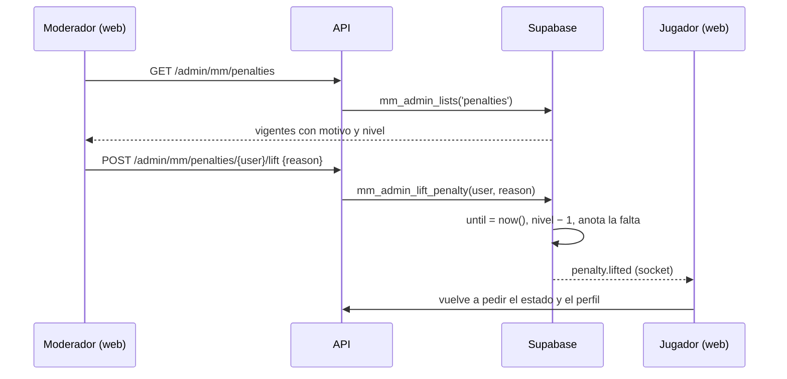

# Ver y levantar las sanciones automáticas del matchmaking: documentación

## Qué hace

El matchmaking sanciona solo a quien no acepta una partida, la rechaza, no se conecta o la abandona (`mm_penalize`). Cada falta sube un nivel de la escalera (`mm_config.penalty_ladder`, por defecto 5, 15, 60 y 1440 min) y, mientras dura, el jugador no puede entrar a la cola. Hasta ahora esas sanciones no se veían en ninguna pantalla de administración y no había forma de levantarlas.

Ahora Administración › Matchmaking › Reportes tiene la tarjeta **Sanciones de la cola**, con las vigentes. Un moderador o un admin puede levantar una con un motivo. Levantar corta la espera y **baja un nivel de la escalera** (decisión de Daniel, 2026-11-02), como si esa falta no hubiera pasado. La falta queda anotada con quién la levantó y por qué. El jugador recibe el aviso `penalty.lifted` por el socket y su pantalla de Jugar se actualiza sola.

## Los tres tipos de sanción

| Qué es | Tabla | Dónde se ve | Quién la levanta |
|---|---|---|---|
| Baneo de los servidores | `bans` | Administración › Baneos | Moderador, con motivo |
| Exclusión del matchmaking (desde un reporte) | `mm_bans` | Matchmaking › Reportes › Excluidos del matchmaking | Admin, sin motivo |
| Sanción automática de la cola | `mm_penalties` y `mm_penalty_log` | Matchmaking › Reportes › **Sanciones de la cola** | Moderador, con motivo |

## Reglas

- **Qué se lista:** solo las vigentes (`until > now()`), de la que vence antes a la que vence después. El motivo y la fecha son los de la última falta del registro.
- **Levantar:**
  - Corta la espera (`until = now()`).
  - Baja el nivel en uno, nunca por debajo de 0. La próxima falta sube desde ese nivel.
  - Anota la última falta sin levantar de `mm_penalty_log`.
  - Pide un motivo de 3 a 300 caracteres. El diálogo de la web corta en 200.
- **Sin sanción vigente:** 404 ("No tiene una sanción vigente").
- **Permisos:** moderadores y admins, para listar y para levantar. Un jugador común recibe 403.
- **Concurrencia:** la fila de `mm_penalties` se bloquea (`for update`). Si al mismo tiempo le cae otra falta, una espera a la otra.

## Base de datos (replanteo `61`)

| Qué | Detalle |
|---|---|
| `mm_penalty_log.lifted_at`, `lifted_by`, `lift_reason` | Cuándo, quién y por qué se levantó esa falta |
| `mm_admin_lists('penalties')` | `user_id`, `player_id`, `nick`, `level`, `max_level` (largo de la escalera), `reason`, `since` y `until` |
| `mm_admin_lift_penalty(p_user, p_reason)` | Levanta la sanción. `security definer`, `authenticated` y no `anon` |
| Aviso `penalty.lifted` | `mm_emit` solo al jugador sancionado |

## API

| Ruta | Permiso | Qué hace |
|---|---|---|
| `GET /api/v1/admin/mm/penalties` | Moderador | Las vigentes |
| `POST /api/v1/admin/mm/penalties/{id}/lift` con `{ reason }` | Moderador | Levanta la del usuario `{id}`. `reason` sin espacios en los bordes, de 3 a 300 caracteres |

## Web

- La tarjeta **Sanciones de la cola** (`PenaltiesCard` en `ReportsPanel.tsx`) muestra en cada fila el nick, el motivo, "Nivel N de M", hasta cuándo dura y el botón **Levantar**. Ese botón abre un `ConfirmDialog` con el motivo obligatorio. El diálogo avisa a qué nivel queda el jugador.
- `applyMmEvent` trata `penalty.lifted` como un cambio del estado y del perfil, que es donde está el nivel de la escalera.
- La demo (`/demo/matchmaking`) trae una sanción de ejemplo y la propia, si te sancionaste.

## Qué cambia para cada rol

| Rol | Qué cambia | Página del manual |
|---|---|---|
| Jugador | Un moderador puede levantar una sanción injusta. Si la levanta, puede volver a buscar enseguida y su contador baja un escalón | [`jugador/buscar-partida.md`](../../manual/jugador/buscar-partida.md) (sección "Sanciones") |
| Moderador | Ve las sanciones de la cola y las puede levantar con motivo | [`moderador/sanciones-matchmaking.md`](../../manual/moderador/sanciones-matchmaking.md) (nueva) |
| Admin | Lo mismo que el moderador | La misma (los admins ven la sección Moderador) |

## Dónde está cada cosa

| Qué | Archivo / ubicación |
|---|---|
| Replanteo | `supabase/replanteo/61_mm_sanciones_admin.sql` (rama `feat/mm-claim-en-sala`) |
| Inversa | `docs/bitacora/2026-10-14-replanteo-modelo-datos/reversas/61_mm_sanciones_admin.sql` (misma rama) |
| Pruebas SQL | `pruebas/61_mm_sanciones_admin.sql` y `pruebas/correr_local.sh` |
| Rutas de la API | `web/backend/src/routes/mm.ts` y `web/backend/test/unit/mm-penalties.test.ts` (rama `feat/mm-claim-en-sala`) |
| Web | `web/frontend/src/features/matchmaking/admin/ReportsPanel.tsx`, `source.ts`, `demo.ts`, `queries.ts` y `types.ts` |
| Manual | `docs/manual/moderador/sanciones-matchmaking.md` y `docs/manual/jugador/buscar-partida.md` |
