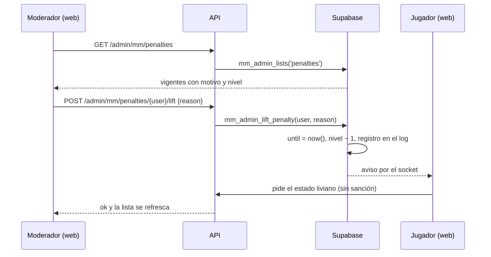

# Plan: ver y levantar las sanciones automáticas del matchmaking

> Planeación original. Estado: **propuesta**, pendiente de aprobación.

Pedido por Daniel el 2026-11-02: las sanciones que pone el matchmaking solo (por no aceptar, rechazar, no conectarse o abandonar) no aparecen en ninguna pantalla de administración. Por eso no se pueden revisar ni levantar.

## Hoy

Hay tres tipos de sanción, cada uno en su tabla:

| Qué es | Tabla | Dónde se ve | Se puede levantar |
|---|---|---|---|
| Baneo de los servidores | `bans` (replanteo `31`) | Administración › Baneos | Sí, con motivo (moderador) |
| Exclusión del matchmaking (un moderador desde un reporte) | `mm_bans` (replanteo `48`) | Administración › Matchmaking › Reportes, tarjeta "Excluidos del matchmaking" | Sí, sin motivo (`mm_admin_unban`, solo admin) |
| **Sanción automática de la cola** | `mm_penalties` (vigente y nivel) y `mm_penalty_log` (cada falta, con el motivo) | **En ninguna** | **No** |

`mm_penalize(p_user, p_reason)` sube el nivel de la escalera (`mm_config.penalty_ladder`, por defecto 5, 15, 60 y 1440 min) y fija `until`. También guarda la falta en `mm_penalty_log` con el motivo ("No aceptaste una partida", "Rechazaste una partida", "No te conectaste a la partida" o "Abandonaste una partida"). El nivel baja uno cada 7 días sin faltas. Mientras `until > now()`, `mm_can_queue` no deja entrar a la cola ("Tenés una sanción vigente").

El motivo ya existe en `mm_penalty_log`, así que **no hace falta una columna nueva en `mm_penalties`**. En la respuesta anterior se dijo que sí: era un error.

## Decisiones tomadas

| Tema | Decisión | Por qué |
|---|---|---|
| Dónde se muestran | En Administración › Matchmaking › Reportes, en una tarjeta nueva "Sanciones de la cola" junto a "Excluidos del matchmaking". No en Administración › Baneos | Son por cuenta, duran minutos u horas y no afectan a los servidores. Baneos lista los de los servidores por SteamID, con otro modelo y otra API |
| Qué se lista | Las vigentes (`until > now()`): jugador, motivo de la última falta, nivel (1 a N de la escalera), desde y hasta | Es lo que se quiere revisar o levantar. El historial de faltas de cada uno ya lo ve el jugador en su feed |
| **Qué hace "Levantar"** | **A confirmar por Daniel.** Propuesta: corta la espera (`until = now()`) y **baja el nivel en uno**, como si esa falta no hubiera pasado | Si se levanta es porque la falta no correspondía (por ejemplo, se cayó Steam). Dejar el nivel haría que su próxima falta real pegue más fuerte. La alternativa es cortar solo la espera y dejar el nivel |
| Motivo al levantar | Obligatorio, igual que en Administración › Baneos | Queda registro de quién y por qué |
| Quién puede | Moderadores y admins | Igual que listar reportes y exclusiones, y que levantar baneos de servidores |
| Registro | `mm_penalty_log` suma `lifted_at`, `lifted_by` y `lift_reason` en la falta que dio la sanción vigente | Para saber después qué se levantó. Sin tabla nueva |
| Aviso al jugador | Al levantarla, el socket le manda un aviso que pide el estado liviano, y el cartel "Sanción de la cola" desaparece sin recargar | Que pueda volver a la cola enseguida |

## 1. El flujo completo

## 2. Base de datos (replanteo `61`, o el siguiente libre)

En la rama `feat/mm-claim-en-sala`, como los replanteos `48` a `60`.

- `alter table mm_penalty_log add lifted_at timestamptz, add lifted_by uuid references auth.users(id) on delete set null, add lift_reason text check (char_length(lift_reason) between 3 and 300)`.
- `mm_admin_lists`: rama nueva `'penalties'` (con `is_moderator()`, como `'reports'` y `'bans'`). Devuelve por cada fila de `mm_penalties` con `until > now()`:
  - `user_id`, `nick` y `player_id` (de `players`).
  - `level` y `max_level` (largo de la escalera).
  - `until` y `since` (el `created_at` de la última falta).
  - `reason` (la última falta de `mm_penalty_log`).
  - Ordenada por `until`, la que vence antes primero.
- `mm_admin_lift_penalty(p_user uuid, p_reason text) returns void`, `security definer`:
  - Exige `is_moderator()` y un motivo de 3 a 300 caracteres.
  - Falla si no hay sanción vigente (`P0002`, "No tiene una sanción vigente").
  - `update mm_penalties set until = now(), level = greatest(0, level - 1)`. Si Daniel decide no bajar el nivel, esta parte no va.
  - Marca la última falta del log con `lifted_at`, `lifted_by` y `lift_reason`.
  - `mm_emit` al jugador con el tipo de aviso que hoy hace que la web pida el estado liviano. Se elige al implementar mirando `applyMmEvent`. Si ninguno sirve, se agrega `penalty.lifted`.
- `grant execute` como el resto de las funciones de administración del matchmaking.
- Pruebas SQL en `pruebas/61_mm_sanciones_admin.sql`:
  - Lista solo las vigentes.
  - Un jugador común no puede listar ni levantar.
  - Levantar sin motivo falla.
  - Levantar corta la espera y baja el nivel.
  - `mm_can_queue` deja entrar después.
  - Queda el registro en el log.

## 3. API (`web/backend/src/routes/mm.ts`)

- `GET /api/v1/admin/mm/penalties` (`requireModerator`) → `lists('penalties')`.
- `POST /api/v1/admin/mm/penalties/{id}/lift` (`requireModerator`, cuerpo `{ reason }` validado con zod) → `mm_admin_lift_penalty`.
- Esquemas en la OpenAPI y pruebas de las dos rutas (permisos, motivo, 404 si no hay sanción).

## 4. Web (`web/frontend`)

- `types.ts`: `MmAdminPenalty`.
- `source.ts` (API y demo): `adminPenalties` y `liftPenalty`.
- `queries.ts`: `adminPenaltiesOptions`.
- `ReportsPanel.tsx`: tarjeta "Sanciones de la cola", con una fila por jugador: nick, motivo, "Nivel 2 de 4", hasta cuándo y el botón "Levantar".
  - "Levantar" abre un `ConfirmDialog` con motivo. Si "Levantar" baja el nivel, el diálogo lo avisa.
  - Si no hay ninguna: "Nadie sancionado".
  - La lista se refresca al levantar y cada vez que se abre la pestaña. No hace falta el socket.
- Pruebas de la tarjeta y de la demo.
- Fuera del alcance: "Levantar" de "Excluidos del matchmaking" sigue igual (solo admin y sin motivo). Se anota como posible ajuste para igualarlo.

## 5. Manual

- `docs/manual/moderador/sanciones-matchmaking.md`: dónde ver las sanciones de la cola, qué significa el nivel y cómo levantar una.
- `docs/manual/jugador/buscar-partida.md`: una línea que diga que un moderador puede levantar una sanción injusta (si ya habla de sanciones).

## 6. Requisitos antes de empezar

- Decisión de Daniel sobre el nivel al levantar (ver la tabla).
- La rama `feat/mm-claim-en-sala` al día (worktree `v34frag-mmclaim`) y acceso a la Supabase de staging.

## 7. Orden de implementación

1. Replanteo `61` y sus pruebas SQL en local.
2. Rutas de la API y sus pruebas.
3. `pnpm gen:api` y la tarjeta en la web, con sus pruebas.
4. Manual del moderador.
5. Despliegue en staging (base, API y web) y prueba: sancionar una cuenta de prueba no aceptando, verla en la tarjeta, levantarla y entrar a la cola.
6. `DOCUMENTACION.md`, `GUIA_IMPLEMENTACION.md`, `CHANGELOG_DISCORD.txt` y la fila del README.
