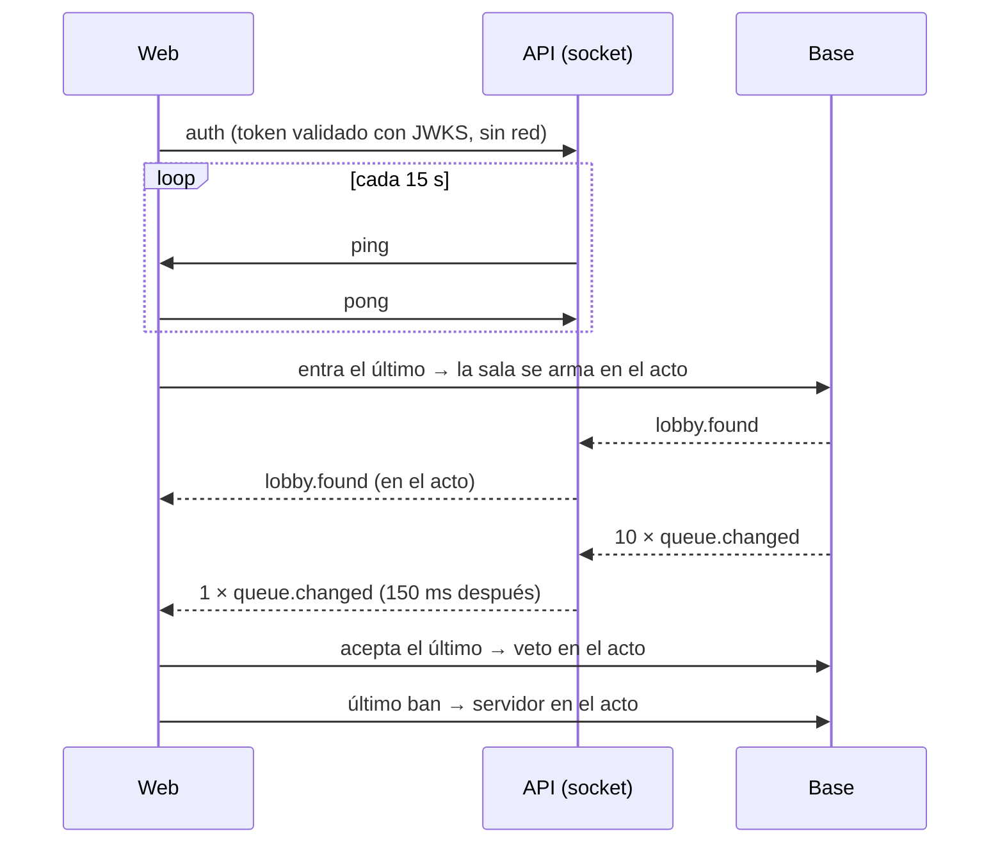

# Socket del matchmaking sin errores y sin esperas de más: documentación

## Qué hace

Corrige cuatro errores del flujo de buscar partida y saca esperas que no hacían falta. Para el jugador no cambia cómo se usa: la partida aparece, el veto arranca y el servidor se asigna antes, y una conexión que se cae deja de contar como conectada.

## Errores corregidos

| # | Antes | Ahora |
|---|---|---|
| 1 | Si se cerraba la pestaña dentro de los 15 s siguientes a un pedido del estado (la web lo pide cada 30 s), no había pausa: te podían armar sala y salías de la cola recién a los 30 a 45 s | Con el socket abierto, los pedidos del estado no cuentan como presencia (`polled` no hace nada si la cuenta tiene socket). Al conectarse el socket se olvidan los pedidos anteriores |
| 2 | Una conexión medio muerta (wifi caído, suspensión, celular) seguía "conectada": sin pausa, y la web sin pasar al respaldo | La API manda `{t:"ping"}` cada 15 s y corta el socket que no mandó nada en 35 s (`heartbeat()`), y esa cuenta queda en pausa. La web contesta `pong`, no reenvía el `ping` y, si no recibe nada en 40 s, descarta la conexión y abre otra |
| 3 | Dos sockets por pestaña en Jugar (el aviso de reconexión del layout y la página): avisos dobles, pedidos dobles y el límite de 5 por cuenta con 3 pestañas | Todos los `useMmSocket` de la pestaña comparten una suscripción y un solo `flush` (`acquireSocket` / `releaseSocket` en `queries.ts`) |
| 4 | Quien cancelaba en el mismo instante en que se armaba la sala quedaba adentro y, al no aceptar, recibía una sanción | `mm_try_build` bloquea las filas de la cola (`for update`) y, si falta alguien, no arma esa combinación |

## Mejoras

| | Antes | Ahora |
|---|---|---|
| A | Tres esperas del tick (cada 2 s): armar la sala, empezar el veto y asignar el servidor | `mm_join` llama a `mm_try_build_now`; `mm_accept` arranca el veto si fue el último; `mm_ban_map` llama a `mm_assign_server` con el último mapa. El tick sigue con los plazos y lo que no se pudo hacer en el acto |
| B | Buscar, cancelar, aceptar, rechazar y las acciones del grupo devolvían `mm_my_state`, lo más lento del matchmaking | Devuelven `mm_my_live`. La web lo combina con el estado que ya tiene y solo actualiza el perfil si la respuesta lo trae (`"me" in state`). Las acciones sociales siguen con el completo |
| C | Al armarse una sala, 10 `queue.changed` a cada conectado | El hub manda uno solo, el último, 150 ms después del primero. Los avisos a cuentas concretas salen en el acto |
| D | Cada conexión del socket llamaba a Supabase Auth (`getUser`) | `claimsVerifier`: `getClaims` con las claves públicas en caché, igual que los pedidos normales. La clave anon no sirve |

Además, el hub envía protegido: un socket que falla al enviar no corta el reparto a los demás.

## Sin bloqueos entre las acciones y el tick

Las acciones usan candados no bloqueantes (`pg_try_advisory_xact_lock`) con `mm_tick` y `server_alloc`. Si el tick los tiene, la acción no espera y el tick lo hace a los 2 s.

Esto importa en `mm_ban_map`: la acción tiene la sala bloqueada. Si esperara el candado del servidor mientras el tick lo tiene, y el tick esperara la sala, se trabarían. `mm_accept` no necesita candado: el tick espera la sala bloqueada y después la ve en veto.

## Constantes

| Qué | Valor | Dónde |
|---|---|---|
| Ping | 15 s | `MM_PING_MS` (API) |
| Corte por silencio en la API | 35 s | `MM_DEAD_MS` |
| Reconexión por silencio en la web | 40 s | `MM_SILENCE_MS` (`socket.ts` de la web) |
| Agrupado de `queue.changed` | 150 ms | `MM_QUEUE_COALESCE_MS` |

## Qué cambia para cada rol

Nada en cómo se usa, para ningún rol. La partida encontrada, el veto y el servidor llegan antes. Una conexión caída ya no te deja expuesto a una sanción por una partida que no viste. No cambia ninguna página del manual.

## Dónde está cada cosa

| Qué | Archivo / ubicación |
|---|---|
| Replanteo e inversa | `supabase/replanteo/64_mm_pasos_en_el_acto.sql` y `docs/bitacora/2026-10-14-replanteo-modelo-datos/reversas/64_mm_pasos_en_el_acto.sql` |
| Pruebas SQL | `pruebas/64_mm_pasos_en_el_acto.sql` y `pruebas/correr_local.sh` |
| Hub (presencia, latido, agrupado, envío protegido, validación) | `web/backend/src/mm/socket.ts` |
| Latido y validación en el arranque | `web/backend/src/node.ts` |
| Respuesta liviana de las acciones | `web/backend/src/routes/mm.ts` (`action(fn, args, 'live')`) |
| Pruebas de la API | `web/backend/test/unit/mm-presence.test.ts` y `mm-live-state.test.ts` |
| Socket de la web (pong, silencio) | `web/frontend/src/features/matchmaking/socket.ts` y `socket.test.ts` |
| Socket compartido y respuesta liviana | `web/frontend/src/features/matchmaking/queries.ts` y `queries.test.tsx` |
