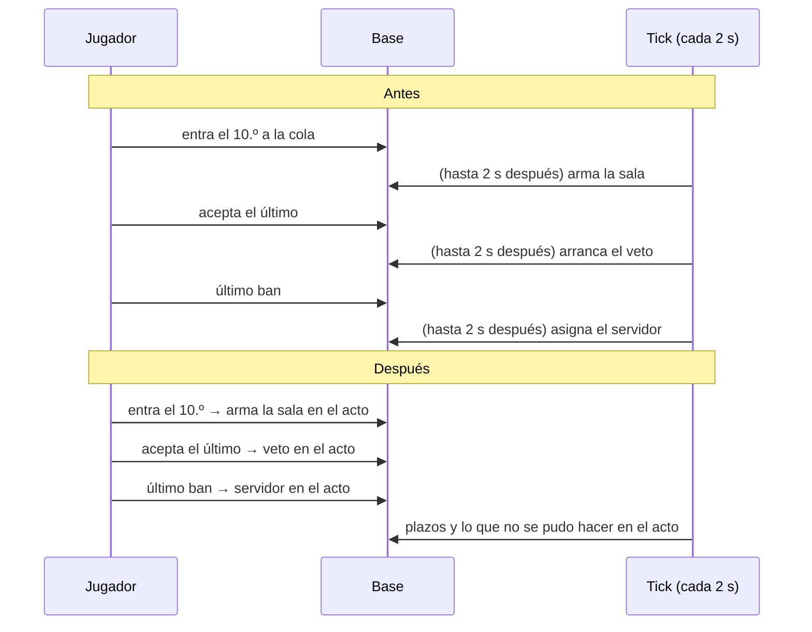

# Plan: socket del matchmaking sin errores y sin esperas de más

> Planeación original. Estado: **aprobado por Daniel el 2026-11-02** ("hazlo en el orden que propusiste"): primero los errores 1 a 4, después las mejoras A a D.

## Contexto

La revisión del 2026-11-02 del flujo de buscar partida (base, API y web) y las mediciones en staging encontraron lo siguiente:

| Medición | Tiempo |
|---|---|
| Solo la red, de la PC de Daniel a la API (`/api/health`) | 112 ms |
| Aviso `queue.changed` por el socket desde "Buscar" | 169 ms (mediana) |
| `GET /mm/state/live` | 197 ms (mediana), 295 ms (p90) |
| `POST /mm/queue` y `DELETE /mm/queue` | 267 y 293 ms (mediana) |
| `mm_my_state` en `pg_stat_statements` | 860 ms de media, 7,9 s de máximo |
| `mm_my_live` en la base, caliente | 24 ms (17 ms son "Tu última partida") |

El socket es rápido. Lo que se pierde está en los errores y en las esperas del tick.

## Decisiones tomadas

| # | Tema | Decisión | Por qué |
|---|---|---|---|
| 1 | Pausa al cerrar | Un pedido de `GET /mm/state/live` cuenta como presencia solo si esa cuenta **no** tiene socket. Al conectarse el socket se olvidan los pedidos anteriores | La web pide el estado cada 30 s aunque el socket ande. Con la regla de hoy, si se cierra la pestaña dentro de los 15 s siguientes a un pedido, no hay pausa: te pueden armar sala, y sales recién a los 30 a 45 s |
| 2 | Latido | La API manda `{t:"ping"}` cada 15 s a cada socket y corta el que no dio señales (ningún mensaje) en 35 s. La web contesta `{t:"pong"}` y reconecta si no recibió nada en 40 s. El `ping` no llega a `applyMmEvent` | Sin esto, una conexión medio muerta (wifi caído, suspensión, celular) sigue "conectada": no hay pausa, la web no pasa al respaldo y no se entera de "Partida encontrada" |
| 3 | Un solo socket por pestaña | Un controlador por fuente y `QueryClient` (`queries.ts`): una sola suscripción y un solo `flush`, compartidos por todos los `useMmSocket`. Cada hook recibe el estado y su `onEvent` | Hoy `ReconnectBanner` y Jugar abren dos sockets: los avisos llegan dos veces, se pide el estado dos veces (el segundo pedido cancela al primero) y con 3 pestañas se pasa del máximo de 5 por cuenta |
| 4 | Cancelar mientras se arma la sala | `mm_try_build` bloquea las filas de la cola de los 10 (`for update`) antes de crear la sala. Si alguna ya no está, prueba con el siguiente | Hoy, quien cancela en el mismo instante queda en la sala igual y, como no acepta, recibe una sanción |
| A | Esperas del tick | Cada paso pasa en el acto, y el tick queda para los plazos y como red de seguridad: `mm_join` intenta armar la sala; `mm_accept`, si fue el último, arranca el veto; `mm_ban_map`, si queda un mapa, asigna el servidor | Hoy son tres esperas de hasta 2 s cada una (1 s en promedio) |
| A | Sin bloqueos entre acciones y tick | Las acciones usan candados no bloqueantes (`pg_try_advisory_xact_lock`) con `mm_tick` y `server_alloc`. Si están tomados, la acción no espera: el tick lo hace a los 2 s | Una acción que tiene la sala bloqueada y espera el candado del servidor, mientras el tick tiene ese candado y espera la sala, se trabaría |
| B | Respuesta de las acciones | Buscar, cancelar, aceptar, rechazar, el veto y las del grupo devuelven el estado liviano (`mm_my_live`). La web lo combina con el perfil que ya tiene. Las sociales (bloquear, amigos, sonido, felicitar, reportar) siguen con el estado completo | `mm_my_state` es la función más lenta, y mientras la acción no responde la web retiene los avisos del socket |
| C | `queue.changed` | El hub agrupa los `queue.changed` que van a todos: manda uno solo, el último, 150 ms después del primero | Al armarse una sala de 10, cada conectado recibe hoy 10 avisos seguidos |
| D | Validación del socket | El token del socket se valida en la API con la misma verificación de los pedidos normales (JWKS, sin red), en lugar de `auth.getUser` | Es una llamada a Supabase Auth por conexión (unos 100 ms), y después de un despliegue llegan todas a la vez |
| — | Fuera de alcance | Lo de la revisión marcado como E (repartir los pedidos después de un corte, limpiezas del tick cada hora, "Tu última partida" aparte) | Queda para después |

## 1. El flujo, antes y después

## 2. Base de datos (replanteo `64`)

- `mm_try_build`: antes de elegir servidor, `select … from mm_queue where user_id = any(v_users) for update`. Si no están los 10, `continue`.
- `mm_try_build_now(p_mode)`: si consigue `pg_try_advisory_xact_lock(hashtext('mm_tick'))` y `server_alloc`, y la cola está abierta (`open`, temporada y modo habilitado), arma todas las salas que pueda. Si no, no hace nada.
- `mm_join`: al final, `perform mm_try_build_now(modo)`.
- `mm_accept`: si no queda nadie por aceptar, `perform mm_start_veto(sala)` (la sala ya está bloqueada).
- `mm_assign_server(p_lobby)`: la rama `waiting_server` del tick, sin el plazo, y con candado no bloqueante de `server_alloc`. La llaman `mm_ban_map` (último mapa) y el tick.
- Pruebas SQL:
  - buscar con 2 jugadores en 1v1 arma la sala sin tick;
  - con el candado del tick tomado, `mm_join` no arma ni espera;
  - el último en aceptar deja la sala en veto;
  - el último ban deja la sala con servidor;
  - una fila que desaparece antes del armado no entra en la sala;
  - la inversa.

## 3. API

- `socket.ts`:
  - presencia: el error 1;
  - latido: `heartbeat()` del hub, llamado cada 15 s desde `node.ts`;
  - agrupar `queue.changed`.
- `node.ts`: el token del socket se valida con la verificación de `lib/auth.ts` (JWKS).
- `mm.ts`: `action(fn, args, 'live' | 'full')`. Las de la cola, la sala, el veto y el grupo devuelven `mm_my_live` con `server_now`.
- Pruebas: presencia con el socket abierto, latido (ping, corte por silencio y que un `pong` cuenta), agrupado de `queue.changed`, que las acciones devuelvan el estado liviano, y la validación local del token.

## 4. Web

- `socket.ts`: contesta el `ping` y reconecta si no recibe nada en 40 s.
- `queries.ts`: el controlador compartido (un socket por pestaña) y, en las mutaciones, combinar la respuesta liviana con el perfil en caché.
- Pruebas: un solo `subscribe` con dos `useMmSocket`, un solo pedido del estado por aviso, el `ping` no pide nada, y la reconexión por silencio.

## 5. Ramas y despliegue

- La base y la API se commitean en `feat/frontend-fase-1` y en `feat/mm-claim-en-sala`; la web, solo en la primera.
- En staging, en este orden: base, API y web. La API nueva con la web vieja funciona: los `ping` que la web vieja no conoce le hacen pedir el estado cada 15 s hasta que se actualice.
- La web nueva con la API vieja también funciona: no recibe `ping`, pero sí otros avisos. Una espera de 40 s sin ningún aviso la hace reconectar, sin perder nada. Por eso se despliegan juntas.

## 6. Orden de implementación

1. Error 1 (presencia) y sus pruebas.
2. Error 2 (latido): API y web.
3. Error 3 (un socket por pestaña).
4. Error 4 y mejora A (replanteo `64`).
5. Mejora B (respuesta liviana).
6. Mejora C (agrupar `queue.changed`).
7. Mejora D (validación local del token).
8. Manual (si cambia algo para el jugador), bitácora, `CHANGELOG_DISCORD.txt` y medición en staging antes y después.
