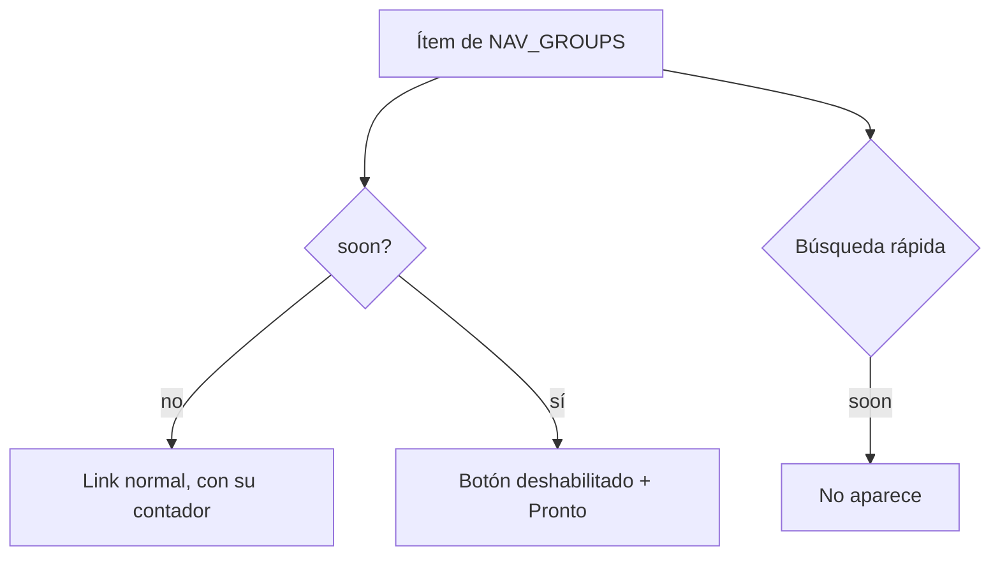

# Quitar Palmarés y desactivar PCW en el menú: documentación

## Qué hace

El menú lateral deja de mostrar **Palmarés**, que era una página de "Próximamente". **PCW** sigue a la vista pero desactivado: gris, sin link y con el badge "Pronto", hasta que la sección esté lista. Ninguno de los dos aparece en la búsqueda rápida (Ctrl+K).

El palmarés de cada jugador, en su perfil (pestaña Bio), sigue igual.

## Reglas

| Caso | Qué pasa |
|---|---|
| Ítem con `soon: true` | Se dibuja sin link (`aria-disabled`), gris y con "Pronto". Sin contador. El tooltip del menú plegado dice "PCW (pronto)" |
| `/pcw` por la URL | Sigue la página de "Próximamente" |
| `/hall-of-fame` por la URL | Ya no existe: va a la página de no encontrado |
| Partidas › PCW sin partidas | El vacío ya no ofrece "Ir a PCW" |
| Página de una serie PCW | El "← PCW" lleva a Partidas filtrado por PCW (`/matches?kind=pcw`) |

## Para reactivar PCW

En `web/frontend/src/features/shell/lib/nav.ts`, sacarle `soon: true` al ítem `pcw` y devolverle `badge: "pcw"`. Ajustar la prueba de `nav.test.ts`. Si se quiere, volver a poner "Ir a PCW" en el vacío de Partidas y el "← PCW" de la serie a `/pcw`.

## Dónde está cada cosa

| Qué | Archivo |
|---|---|
| Ítems del menú y `soon` | `web/frontend/src/features/shell/lib/nav.ts` |
| Dibujo del ítem desactivado | `web/frontend/src/features/shell/components/AppSidebar.tsx` |
| Búsqueda rápida | `web/frontend/src/features/shell/components/CommandMenu.tsx` |
| Vacío de Partidas › PCW | `web/frontend/src/features/matches/components/MatchesTable.tsx` |
| Vuelta de una serie PCW | `web/frontend/src/features/series/pages/SeriesRoom.tsx` |
| Pruebas | `web/frontend/src/features/shell/lib/nav.test.ts`, `web/frontend/src/features/matches/pages/MatchesList.test.tsx` |
