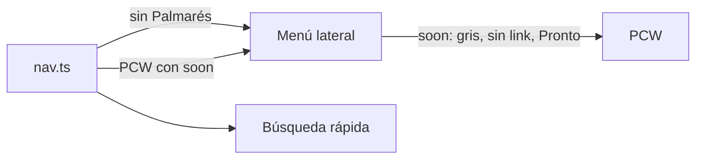

# Plan: quitar Palmarés y desactivar PCW en el menú

> Planeación original. Estado: **pedido por Daniel (2026-11-02)**.

## Decisiones tomadas

| Tema | Decisión |
|---|---|
| Qué "Palmarés" | El ítem del menú lateral (`/hall-of-fame`), que hoy es solo una página de "Próximamente". El palmarés del perfil de cada jugador (pestaña Bio) funciona con datos y no se toca |
| Palmarés | Fuera del menú y de la búsqueda rápida (Ctrl+K). Se borra su ruta: era un `Placeholder` |
| PCW | Sigue en el menú, gris, sin link y con "Pronto", sin el contador de solicitudes. Tampoco aparece en la búsqueda rápida. La ruta `/pcw` queda (muestra "Próximamente" si alguien entra por la URL) |
| Links sueltos a `/pcw` | "Ir a PCW" del vacío de Partidas › PCW: se saca. "← PCW" de la página de una serie PCW: va a Partidas filtrado por PCW |
| Reactivar | Cuando PCW esté listo: sacar `soon: true` del ítem en `nav.ts` y devolverle `badge: "pcw"` |

## 1. Cambios

- `features/shell/lib/nav.ts`: sin el ítem `hall-of-fame`; `NavItem.soon?` y PCW con `soon: true`.
- `features/shell/components/AppSidebar.tsx`: un ítem `soon` se dibuja como botón deshabilitado con el badge "Pronto".
- `features/shell/components/CommandMenu.tsx`: no lista los ítems `soon`.
- `features/matches/components/MatchesTable.tsx` y `features/series/pages/SeriesRoom.tsx`: los links a `/pcw`.
- `routes/_app/hall-of-fame.tsx`: se borra (y se regenera `routeTree.gen.ts`).
- Pruebas: `nav.test.ts` y `MatchesList.test.tsx`.

## 2. Orden de implementación

1. Cambios y pruebas.
2. Typecheck, lint y Vitest.
3. Documentación y fila en el `README.md` de la bitácora. Sin commit ni despliegue hasta que Daniel lo pida.
