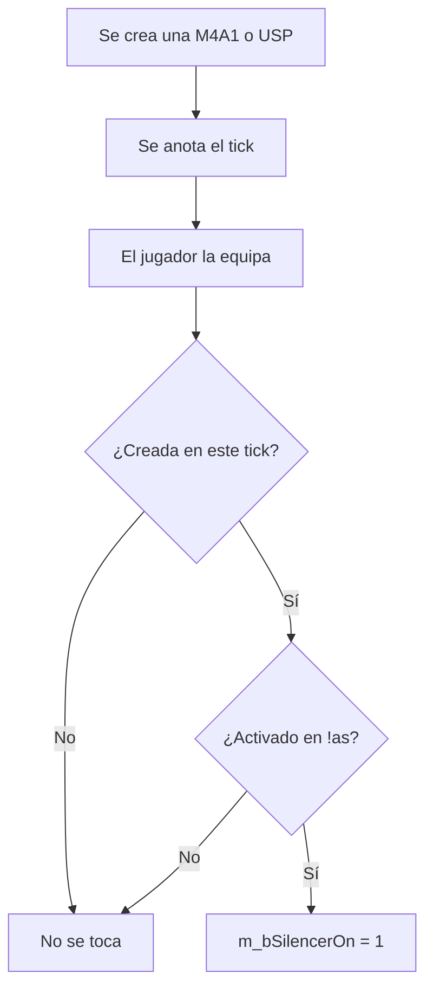

# Silenciador automático en la M4A1 y la USP: documentación

## Qué hace

`csstv_silencer` hace que la M4A1 y la USP aparezcan con el silenciador puesto, sin la animación ni la espera del clic derecho. Cada jugador elige con `!as` si lo quiere en cada arma.

Solo actúa sobre armas recién creadas por el juego. Un arma levantada del piso conserva el estado que tenía, y el jugador puede sacar o poner el silenciador a mano como siempre.

## Qué armas lo reciben

| Origen del arma | ¿Recibe el silenciador? |
|---|---|
| Compra | Sí |
| USP inicial de los CT | Sí |
| USP que se conserva de la ronda anterior | No, sigue como la dejó el jugador |
| Entregada por otro plugin (`!guns` de retake, deathmatch) | Sí |
| Levantada del piso | No |

## Comandos y configuración

| Qué | Detalle |
|---|---|
| `!as` o `/as` (`sm_as`) | Abre el menú con M4A1 y USP. Elegir una opción cambia entre Activado y Desactivado, y el menú sigue abierto. |
| `csstv_silencer` | ConVar: 1 activado (por defecto), 0 desactivado. |
| `silencer_m4a1`, `silencer_usp` | Cookies de `clientprefs` con la preferencia. Sin valor guardado, queda activado. |

## Dónde está cada cosa

| Qué | Archivo / ubicación |
|---|---|
| Fuente | `server/addons/sourcemod/scripting/csstv_silencer.sp` |
| Compilado | `server/addons/sourcemod/plugins/csstv_silencer.smx` |
| Prueba con bots | `docs/bitacora/2026-11-02-plugin-silenciador/pruebas/silencer_prueba.sp` |
