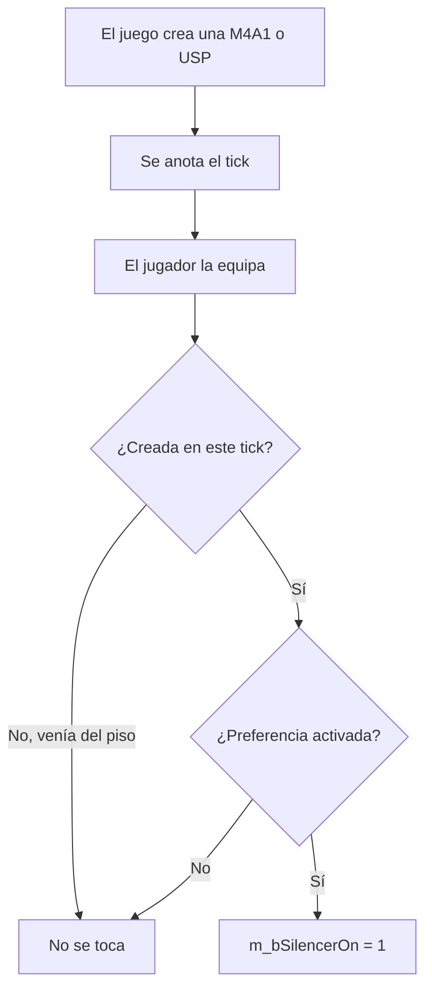

# Plan: silenciador automático en la M4A1 y la USP (`!as`)

> Planeación original. Estado: **propuesta**, pedida por Kyan el 2026-11-02.

## Decisiones tomadas

| Tema | Decisión |
|---|---|
| Plugin | Aparte: `csstv_silencer`, independiente de `csstv_reporter` y sin licencia, como `csstv_sell`. |
| Qué armas reciben el silenciador | Solo las recién creadas por el juego: compra, USP inicial y armas entregadas por otro plugin. Un arma levantada del piso queda como estaba. |
| Cómo se detecta | `OnEntityCreated` anota el tick de creación y `SDKHook_WeaponEquip` (antes del `Deploy`) compara. Así el arma se saca ya con su animación correcta, sin la espera de poner el silenciador. |
| Preferencia | `!as` abre un menú con M4A1 y USP. Cada una se activa por separado y se guarda con `clientprefs`. |
| Valor inicial | Activado en las dos: es lo pedido y se puede apagar con `!as`. |
| Quitar el silenciador a mano | Sigue funcionando con el clic derecho normal; el plugin no vuelve a tocar esa arma. |

## 1. El flujo completo

## 2. Plugin

- Archivo: `server/addons/sourcemod/scripting/csstv_silencer.sp`, con su `.smx` en `server/addons/sourcemod/plugins/`.
- Comando: `sm_as`, que en el chat es `!as` y `/as`.
- ConVar: `csstv_silencer` (1 activado, 0 desactivado).
- Cookies: `silencer_m4a1` y `silencer_usp`.

## 3. Requisitos antes de empezar

Ninguno: `sdkhooks` y `clientprefs` ya están en los servidores (`docs/PLUGINS_EXTERNOS.md`).

## 4. Orden de implementación

1. Escribir y compilar el plugin.
2. Probar con bots en `C:\Users\Agus\Downloads\cssds`: arma nueva con silenciador y arma levantada sin cambios.
3. Pedir a un admin la prueba con jugador: menú, guardado, animación y sonido.
4. Con ese resultado, desplegar a todos los servidores en la misma tanda, en el próximo cambio de mapa.
