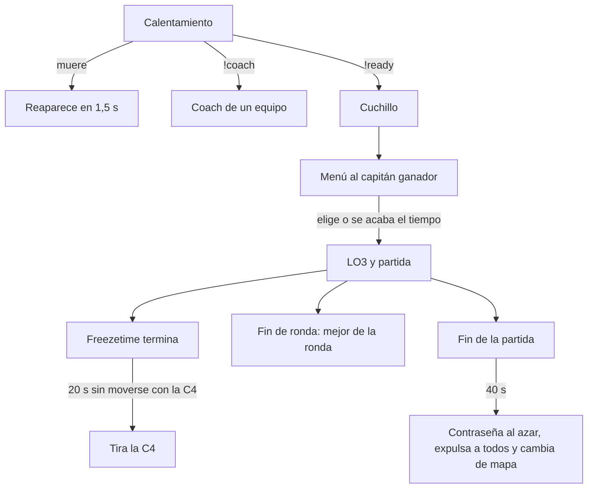

# QOL, segunda tanda: documentación

## Qué hace

| Mejora | Dónde | Qué ve el jugador |
|---|---|---|
| Reaparecer en el calentamiento | `csstv_qol` 1.0.0 | Si muere en el calentamiento, reaparece a los 1,5 s con la plata de `mp_startmoney` |
| Mejor de la ronda | `csstv_qol` | Con la partida en vivo, al terminar cada ronda: "Mejor de la ronda: más daño X (134) · más kills Y (2)", o "X, 2 kills y 245 de daño" si es el mismo |
| C4 de un jugador quieto | `csstv_qol` | Si quien tiene la C4 no se movió en los primeros 20 s después del freezetime, la tira al piso. Su equipo recibe un aviso |
| Fin de la partida | `csstv_qol` | A los 40 s de terminar: contraseña nueva al azar, todos expulsados ("La partida terminó. ¡Gracias por jugar!") y cambio al mapa siguiente. **Por ahora solo en MVZG** |
| Capitán elige lado | Reporter 2.7.5 / 2.8.5 | Tras ganar el cuchillo, el capitán del equipo ve un menú (quedarse o cambiar). `!stay` y `!switch` siguen andando, pero solo para él |
| Coach | `csstv_coach` 1.0.0 | `!coach` en el calentamiento: un espectador por equipo que solo mira, habla y escribe con su equipo |

## El capitán

- Es el jugador que el reporter ya elegía al azar para nombrar al equipo ("Equipo Bert"): humanos primero.
- Si se fue o cambió de equipo, puede elegir cualquiera del equipo ganador, como antes.
- Si nadie elige en `csstv_knife_time` (60 s), el equipo se queda en su lado.
- Si el equipo tiene nombre de la web (partida vinculada), el capitán sigue siendo ese jugador al azar.
- Arreglo de paso: al cambiar de lado con jugadores vivos, el juego cerraba la ronda y salía "La ronda de cuchillo terminó empatada". Ahora no aparece (`g_bKnifeChoosing` se apaga después de `SwapTeams`).

## `csstv_qol`

- Lee el estado del reporter con `sm_csstv_status` una vez por segundo (`calentamiento`, `en vivo`, `terminada`…), como hace `v34_retake`. Funciona con cualquier versión del reporter.
- Con retake, wingman o deathmatch prendidos (`sm_retake`, `sm_2v2` o `sm_dm` dicen "prendido") no reaparece a nadie ni toca la C4.
- El daño es el real: no pasa de la vida que tenía la víctima. Solo cuenta daño y kills a enemigos.
- **Fin de la partida:** usa `sm_rpw` de `csstv_password` para que la contraseña se guarde entre mapas. Con `csstv_mm 1` (matchmaking) `csstv_password` no la toca, porque la maneja la web, pero igual expulsa y cambia el mapa. A los bots no los expulsa. El mapa es el siguiente del ciclo (`GetNextMap`), o el mismo si no hay. Son 40 s (desde la 1.0.1; antes 15) para que la SourceTV, que va atrasada, llegue a mostrar el final. Si para entonces ya empezó otra partida, no hace nada.
- `sm_qol_status` (admins): qué lee del reporter, si hay otro modo y el último "mejor de la ronda".

| ConVar | Valor | Qué hace |
|---|---|---|
| `csstv_qol_warmup_respawn` | `1` | Reaparecer en el calentamiento |
| `csstv_qol_round_best` | `1` | Mejor de la ronda |
| `csstv_qol_c4_afk` | `20` | Segundos sin moverse con la C4 (0 = no) |
| `csstv_qol_end_kick` | `40` (`0` en flow y `aurav34`) | Segundos después del fin de la partida para la contraseña, la expulsión y el cambio de mapa (0 = no) |

## `csstv_coach`

- `!coach` abre el menú (CT o T), y también se puede usar `!coach ct`, `!coach t` y `!coach off`. Hay un coach por equipo, y solo se elige en el calentamiento (o si el reporter no está).
- **Cámara:** cada 0,1 s y en cada muerte se corrige para que mire a un vivo de su equipo, en primera persona o de cerca. `spec_next` y `spec_prev` pasan entre los de su equipo, y `spec_mode` alterna entre esos dos modos, nunca la cámara libre.
- **Voz:** `SetListenOverride` en los dos sentidos con su equipo.
- **Chat:** su `say_team` llega a su equipo como "(Coach)". El `say_team` del equipo le llega como "(Equipo)".
- **Cambio de lado:** en cada ronda, su lado es donde está la mayoría de los jugadores que había en el equipo cuando se anotó.
- Durante la partida no puede entrar a un equipo. En el calentamiento, si entra, deja de ser coach.
- ConVar `csstv_coach "1"`.

## Dónde está cada cosa

| Qué | Dónde |
|---|---|
| `csstv_qol` | `server/addons/sourcemod/scripting/csstv_qol.sp` |
| `csstv_coach` | `server/addons/sourcemod/scripting/csstv_coach.sp` |
| Capitán | `csstv/knife.inc` y `PickTeamNames` en `csstv_reporter.sp` |
| Reporter de producción 2.7.5 | `pruebas/reporter-2.7.5.patch` sobre `6898c05` |
| Reporter de `aurav34` 2.8.5 | `pruebas/reporter-2.8.5-aurav34.patch` sobre `7338f86` |
| Pruebas | `pruebas/qol.sh` y `pruebas/qol_prueba.sp` |
