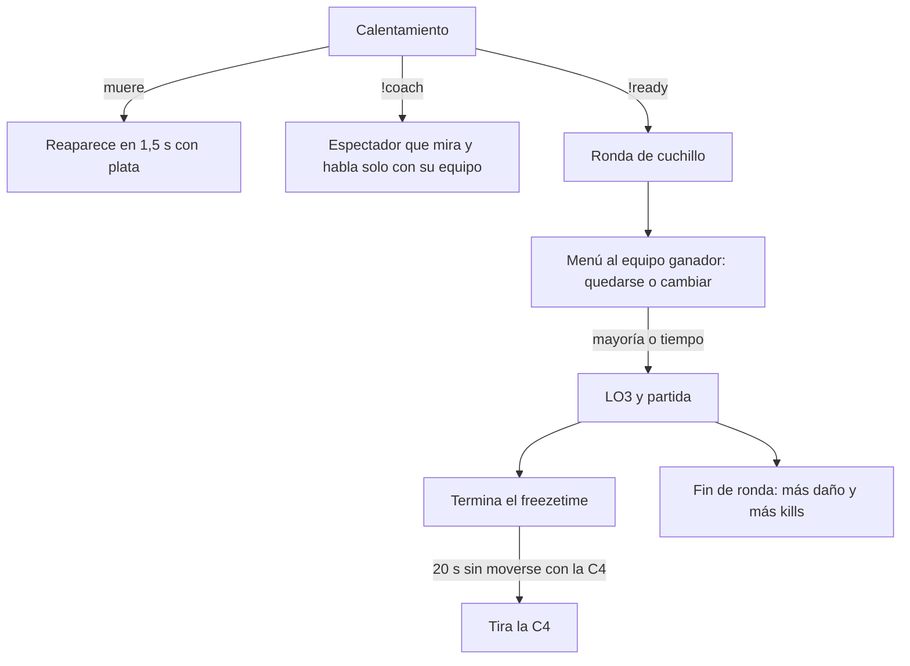

# Plan: QOL, segunda tanda (calentamiento, cuchillo, mejor de la ronda, coach y C4 de un AFK)

> Planeación original. Estado: **aprobado por Kyan** el 2026-11-02, en el chat ("dale todas menos la 3 y la 5", más la C4).

## Decisiones tomadas

| Tema | Decisión | Por qué |
|---|---|---|
| Qué entra | Reaparecer en el calentamiento, votación de lado tras el cuchillo, mejor de la ronda, `!coach` y la C4 de un jugador quieto | Lo eligió Kyan. Quedan afuera el aviso de flash/daño aliado y el aviso de AFK |
| Dónde va cada cosa | Plugin nuevo `csstv_qol` (calentamiento, mejor de la ronda, C4), plugin nuevo `csstv_coach`, y la votación dentro del reporter | Lo que puede ir aparte va aparte, como `!sell` y `!as`: no hay que portarlo a las tres líneas del reporter |
| Estado del mix en los plugins aparte | Se lee de `sm_csstv_status` (`estado: calentamiento`, `en vivo`…), como hace `v34_retake` | Funciona con la 2.7.x y la 2.8.x sin tocar el reporter |
| Modos | Con retake, wingman o deathmatch prendidos (`sm_retake`, `sm_2v2`, `sm_dm` dicen "prendido") `csstv_qol` no hace nada | Esos modos tienen su propia aparición y su propia C4 |
| C4 de un AFK | Si quien tiene la C4 no se movió en los primeros 20 s después del freezetime, la tira al piso con un aviso a su equipo. `csstv_qol_c4_afk "20"` (0 = no) | Kyan pidió 20/30 s: se deja en 20 y se cambia con la ConVar |
| Votación del cuchillo | Menú para cada jugador del equipo ganador; decide la mayoría del equipo, y `!stay`/`!switch` cuentan como voto. Si se acaba el tiempo, gana lo más votado, y con empate o sin votos se queda | Que no decida uno solo, el primero que escribe |
| Coach | `!coach` en el calentamiento: pasa a espectador, solo puede mirar a su equipo, habla y escribe solo con su equipo. Uno por equipo. Sigue a su equipo en el cambio de lado | Como en FACEIT |
| Versiones del reporter | 2.7.5 (producción, sobre la 2.7.4), 2.8.5 en `aurav34` (sobre la 2.8.4 de Daniel + charla) y 2.8.5 en `kyan/pruebas` | Las tres líneas que hay hoy |

## 1. El flujo completo

## 2. `csstv_qol` 1.0.0

- **Calentamiento:** en `player_death` y al entrar a CT o T, si el reporter dice `calentamiento` y no hay otro modo prendido, reaparece a los 1,5 s con la plata de `mp_startmoney`.
- **Mejor de la ronda:** con el reporter `en vivo`, suma el daño real (sin pasar la vida que tenía la víctima) y las kills a enemigos de cada jugador en la ronda, y al `round_end` lo dice en el chat.
- **C4:** en `round_freeze_end` guarda dónde está quien tiene la C4. A los 20 s, si sigue teniéndola y se movió menos de 32 unidades, la tira (`CS_DropWeapon`) y avisa a los T.
- ConVars: `csstv_qol_warmup_respawn`, `csstv_qol_round_best` y `csstv_qol_c4_afk`.

## 3. `csstv_coach` 1.0.0

- `!coach` abre un menú (CT o T), y `!coach off` lo deja. Solo en el calentamiento, uno por equipo.
- El coach queda de espectador. Un timer y `player_death` le corrigen la cámara para que solo mire a jugadores vivos de su equipo, en primera persona o de cerca. `spec_mode` no deja la cámara libre.
- Voz con `SetListenOverride`, en los dos sentidos, entre el coach y su equipo.
- `say_team` del coach llega a su equipo y el de su equipo le llega a él.
- Su equipo se recalcula en cada ronda como el lado donde están la mayoría de los jugadores que había cuando se anotó, así sigue al equipo en el medio tiempo.

## 4. Reporter: votación de lado

En `csstv/knife.inc`: `Knife_OnRoundEnd` abre el menú a los humanos del equipo ganador, `Knife_Choose` pasa a ser un voto y se decide cuando una opción tiene más de la mitad del equipo, o al terminar `csstv_knife_time`.

## 5. Requisitos antes de empezar

`cssds` local con bots, y spcomp 1.8.

## 6. Orden de implementación

1. `csstv_qol` y prueba con bots.
2. `csstv_coach` y prueba con bots (la voz y la cámara las tiene que mirar una persona).
3. Votación en el reporter, en las tres líneas, y prueba con bots.
4. Documentación, guía y changelog. El despliegue se hace cuando lo pida Kyan.
