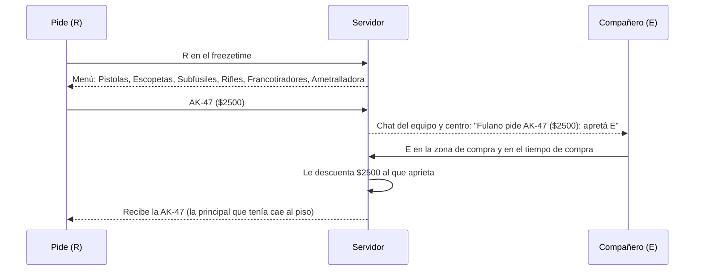

# QOL, tercera tanda: documentación

## Qué hace

| Mejora | Dónde | Qué ve el jugador |
|---|---|---|
| Pausa técnica | Reporter 2.7.6 / 2.8.6 | `!tech`: una por equipo y por mitad, de 2 minutos. Termina antes si los dos equipos escriben `!unpause`. No gasta las tácticas. A mitad de ronda queda pedida para la próxima |
| Cuenta atrás | Reporter | Al terminar cualquier pausa: "Sigue en 3", "2", "1" en el centro y la campana con "¡Sigue!" |
| Volver con tu plata y tu equipo | `csstv_qol` 1.1.0 | Si te vas en vivo y volvés en la misma mitad, al aparecer recuperás tu plata y, si estabas vivo, tus armas, chaleco, kit y granadas |
| Equipamiento del equipo | `csstv_qol` | 6 s antes de que termine el freezetime, a cada equipo: "Fulano: AK-47 · Glock · chaleco y casco · kit · HE 2 flash · $1200" por jugador. También `!eq` |
| Clutch | `csstv_qol` | "Fulano: 1 vs 3" en el centro para los muertos y los espectadores. Si gana: "¡Fulano ganó el clutch 1 vs 3!" |
| Práctica de granadas | `csstv_qol` | `!nades` en el calentamiento: granadas infinitas y la trayectoria dibujada. `!rethrow` te lleva al lugar y la mira de la última que tiraste |
| Pedir un arma | `csstv_pedir` 1.0.0 | R en el freezetime: menú con las armas de tu lado. El primero de tu equipo que aprieta E en la zona de compra te la compra con su plata |

## Pedir un arma

- La R abre el menú solo en el freezetime, para que recargar en plena ronda no lo abra.
- La E compra si apuntás a quien pidió, y si no, el pedido más viejo de tu equipo. Si nadie pidió nada, la E hace lo de siempre.
- Si no te alcanza: "No te alcanza para AK-47 ($2500)".
- Los pedidos se borran al empezar cada ronda. El menú tiene "Cancelar mi pedido".
- Precios y lados como en CS:S: la AK, la Galil, la MAC-10 y el resto de las de T solo para T, y lo mismo para CT.
- Funciona con el reporter en calentamiento o en vivo, y no con retake, wingman ni deathmatch prendidos.

## Pausa técnica

- La mitad se cuenta con el segmento y la ronda del reporter (`Tech_HalfKey`), así que en cada mitad de una prórroga también hay una.
- Se cuenta como pausa con tiempo (`csstv_tech_time`, 120 s), pero `!unpause` de los dos equipos la termina en cualquier `csstv_pause_mode`.
- Si un jugador se va y hay una técnica pedida, la automática la reemplaza, igual que con una táctica.

## `csstv_qol` 1.1.0: detalles

- **Reconexión:** se guarda por SteamID al irse (`OnClientDisconnect`) con el reporter en vivo. Se devuelve 0,3 s después de aparecer, si es la misma mitad. La plata solo se sube, nunca se baja. Se borra todo al salir de la partida.
- **Equipamiento:** solo jugadores vivos. `sm_eq` desde la consola o por rcon muestra los dos equipos.
- **Clutch:** se anuncia una vez por ronda y por equipo, cuando queda uno vivo contra 2 o más. `sm_qol_status` muestra el último.
- **Granadas:** la que tiraste vuelve a los 0,4 s si no te queda de ese tipo. La trayectoria es un rayo amarillo que sigue a la granada 6 s. Se apaga sola al terminar el calentamiento.

| ConVar | Valor | Qué hace |
|---|---|---|
| `csstv_tech_time` (reporter) | `120` | Segundos de la pausa técnica |
| `csstv_qol_restore` | `1` | Volver con tu plata y tu equipo |
| `csstv_qol_eq` | `6` | Segundos antes del fin del freezetime para el equipamiento (0 = solo `!eq`) |
| `csstv_qol_clutch` | `1` | Anunciar los clutch |
| `csstv_qol_nades` | `1` | Permitir `!nades` |
| `csstv_pedir` | `1` | Pedir armas con la R y la E |

## Dónde está cada cosa

| Qué | Dónde |
|---|---|
| Pausa técnica y cuenta atrás | `server/addons/sourcemod/scripting/csstv/qol.inc` |
| `csstv_qol` | `server/addons/sourcemod/scripting/csstv_qol.sp` |
| `csstv_pedir` | `server/addons/sourcemod/scripting/csstv_pedir.sp` |
| Reporter de producción 2.7.6 | `pruebas/reporter-2.7.6.patch` sobre `6898c05` |
| Pruebas | `pruebas/qol3.sh` y `pruebas/qol_prueba.sp` |
