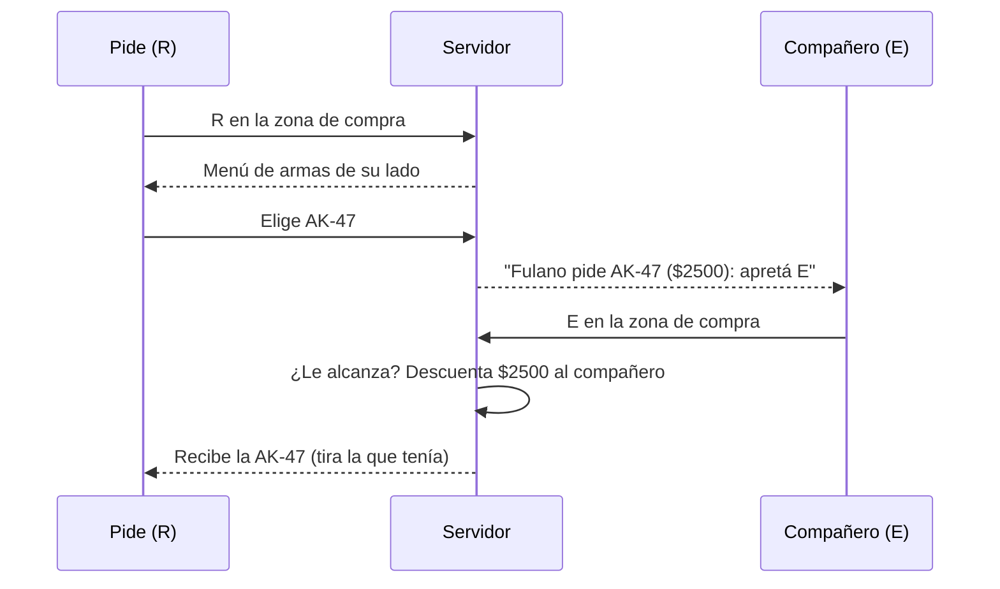

# Plan: QOL, tercera tanda (pausa técnica, cuenta atrás, reconexión, equipamiento, clutch, granadas y pedir armas)

> Planeación original. Estado: **aprobado por Kyan** el 2026-11-02, en el chat ("hace todo, menos el 7", más su versión de pedir armas).

## Decisiones tomadas

| Tema | Decisión | Por qué |
|---|---|---|
| Pausa técnica | `!tech`: una por equipo y por mitad, de hasta 2 minutos (`csstv_tech_time "120"`), termina antes si los dos equipos escriben `!unpause` (en cualquier modo de pausa). No gasta las tácticas | Para un crash o un problema sin esperar una desconexión |
| Cuenta atrás | Al terminar cualquier pausa: "3", "2", "1" en el centro y la campana al seguir | Hoy la ronda arranca sin aviso |
| Volver con tu plata y tus armas | Al irse en vivo se guarda la plata y, si estaba vivo, armas, chaleco, kit y granadas. Al reaparecer en la misma mitad se le devuelve. Se borra en el medio tiempo y al terminar | Hoy vuelve con la plata inicial |
| Equipamiento del equipo | 6 s antes de que termine el freezetime, a cada equipo: arma, pistola, chaleco, kit, granadas y plata de cada uno. También con `!eq` | Ordenar el drop sin hablar |
| Clutch | Cuando un equipo queda con uno vivo contra 2 o más: "Fulano: 1 vs 3" en el centro para los muertos y los espectadores. Si gana la ronda, en el chat | Le da emoción y se entiende rápido |
| Práctica de granadas | `!nades` en el calentamiento: granadas infinitas, la trayectoria visible y `!rethrow`, que te devuelve al lugar y la mira de la última que tiraste. Se apaga al salir del calentamiento | Practicar mientras esperan el `!ready` |
| Pedir un arma | Con la R (recargar), en el tiempo de compra y en la zona de compra, se abre un menú con las armas de su lado. Su equipo ve el pedido, y el primero que aprieta la E (usar) estando en la zona de compra se la compra: se le descuenta a él, no al que pidió. Si apunta a quien pidió, le compra a ese; si no, al pedido más viejo | Lo pidió así Kyan |
| Dónde va | `!tech` y la cuenta atrás en el reporter (2.7.6 y 2.8.6), lo demás en `csstv_qol` 1.1.0 y pedir armas en un plugin nuevo, `csstv_pedir` 1.0.0 | Lo que no necesita el sistema de pausas va aparte y sirve con cualquier versión |
| Versiones del reporter | 2.7.6 sobre la 2.7.5 (producción) y 2.8.6 en `kyan/pruebas`. Sin línea de `aurav34`, que ya no tiene matchmaking | |

## 1. El flujo de pedir un arma

## 2. Reporter

- `csstv/qol.inc`: `Cmd_Tech`, `g_bPauseTech`, `g_iTechHalf[2]`, y `Pause_Start`/`Cmd_Unpause` contemplan la técnica. `Pause_End` arranca la cuenta atrás.

## 3. `csstv_qol` 1.1.0

Reconexión, equipamiento, clutch y granadas, con el estado del reporter leído como hasta ahora.

## 4. `csstv_pedir` 1.0.0

`OnPlayerRunCmd` detecta cuándo se aprieta la R y la E. Precios y lado de cada arma como en CS:S. El arma llega como una compra: la del mismo slot se tira al piso.

## 5. Orden

1. Reporter y prueba con bots.
2. `csstv_qol` 1.1.0 y prueba.
3. `csstv_pedir` y prueba (los bots aprietan la R y la E con un comando de prueba).
4. Documentación. El despliegue, cuando lo pida Kyan.
