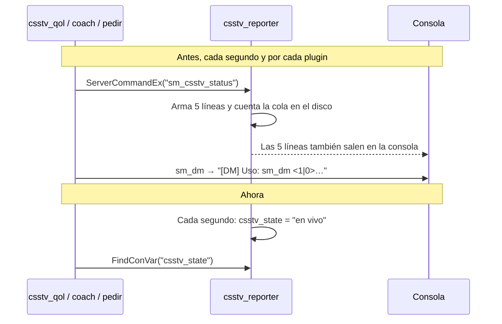

# QOL, cuarta tanda: documentación

## Qué hace

| Mejora | Dónde | Qué ve el jugador |
|---|---|---|
| Consola limpia | Reporter 2.7.7 / 2.8.7, `csstv_qol` 1.2.0, `csstv_coach` 1.1.0, `csstv_pedir` 1.0.1, `v34_retake`, `v34_wingman` y `v34_dm` 1.0.1 | Nada. Los admins dejan de ver cada segundo el bloque de `sm_csstv_status` y "[DM] Uso: sm_dm…" en la consola |
| Coach en primera persona | `csstv_coach` 1.1.0 | El coach solo mira en primera persona. Los rivales, y la C4 si es coach CT, le aparecen solo cuando el compañero que mira los ve |
| Silencio en el clutch | `csstv_qol` 1.2.0 | Quien queda último vivo de su equipo no escucha a sus compañeros muertos hasta el final de la ronda. `!voz` lo desactiva |
| Sonidos | Reporter | Un pitido al empezar la última ronda antes del cambio de lado y tres en cada match point |
| Plata para casters | `csstv_qol` 1.2.0 | Al empezar cada ronda en vivo, a los espectadores y a la SourceTV: "Plata · CT $23.400 (compra completa) · T $8.200 (eco)". Los coaches no lo ven |
| Resumen del medio tiempo | Reporter | Al terminar cada mitad: "MVP hasta ahora: Fulano (14 kills, 101 ADR)" y "Mejor ADR: 1. Fulano 101 · 2. … · 3. …" |
| `!faltan` | Reporter | En el calentamiento: "Listos 6/10. Faltan: …" |
| Pausa en pantalla | Reporter | Mientras dura la pausa, en el cuadro de ayuda: "Pausa táctica · 0:45" (o quién falta escribir `!unpause`) y "Pausas: Equipo A 1 · Equipo B 2", las tácticas que le quedan a cada uno |
| Marcador en el nombre | Reporter | Durante la partida, "CMLeague #1 \| 7-4" en el nombre del servidor y "SourceTV \| 7-4" en el título de la SourceTV. Al terminar o cancelar vuelven solos |
| SourceTV | Reporter y `csstv_qol` | Los mensajes del reporter (encabezado de ronda, match point, pausas…), la pausa en pantalla, el clutch en el centro, el 4k y el ace también le llegan a la SourceTV y quedan en la demo |
| 4 kills y ace | `csstv_qol` | Al terminar la ronda: "¡Fulano hizo un ACE!" o "Fulano hizo 4 kills en la ronda." |
| La C4 | `csstv_qol` | A los T, al empezar la ronda: "La C4 la tiene Fulano." Si muere con ella: "Fulano murió con la C4: quedó en el sitio B" |
| Espectadores | `csstv_qol` | Durante la partida no escriben en el chat general (los admins sí y los comandos `!` siguen andando), y los jugadores no los escuchan. El coach sigue hablando con su equipo |
| Nombres | `csstv_qol` | Durante la partida, un cambio de nombre se deshace: "Durante la partida no se puede cambiar el nombre." |
| `!admins` | `csstv_qol` | "Admins conectados: …", o que no hay y que use `!calladmin` |
| Despedida | `csstv_qol` | Durante la partida: "Fulano se fue de la partida (12/9)." |
| Plata para el coach | `csstv_coach` 1.1.0 | En cada ronda en vivo: "Plata: Fulano $4300 · Mengano $800 …" y "Total del equipo: $12400" |
| `!pause` del coach | Reporter y `csstv_coach` | El coach pide la pausa táctica de su equipo, y gasta una de las de su equipo. `!unpause` lo siguen escribiendo los jugadores |
| `!rr` de los capitanes | Reporter | Sin admin, `!rr` lo pide el capitán de cada equipo (el que le dio nombre; si se fue, cualquiera del equipo). Con el segundo pedido se repite la ronda. Los admins la repiten directo |
| MVP para la SourceTV | Reporter | En el medio tiempo, "MVP hasta ahora" también en el centro de la pantalla de la SourceTV. El resumen sale 0,3 s después del fin de la ronda, así queda en la demo |
| Sin `kill` | `csstv_qol` | Durante la partida, `kill` y `explode` no hacen nada: "Durante la partida no te podés suicidar con kill." |
| `!rtv` en vivo | Reporter (ya estaba) | "El mapa solo se puede votar en el calentamiento." No hizo falta código |

La idea 31, limpiar las armas tiradas al empezar el vivo, no necesitó código: el juego ya las saca en cada reinicio. En la prueba había 5 en el piso antes del LO3 y 0 después.

## Por qué se llenaba la consola

- En los servidores, la respuesta que captura `ServerCommandEx` también se imprime en la consola. Con tres plugins consultando cada segundo, eran unas 6 líneas por segundo. En la prueba local, 690 líneas en 3 minutos.
- Además, cada consulta contaba los archivos de la cola en el disco. Leer una ConVar no imprime nada y no toca el disco.
- Si la ConVar no existe (un reporter o un modo de una versión anterior), los plugins vuelven al comando, así que siguen funcionando con versiones mezcladas.

| ConVar | Quién la crea | Valor |
|---|---|---|
| `csstv_state` | Reporter | El mismo texto de `sm_csstv_status`: "calentamiento", "en vivo", "medio tiempo", "terminada"… Vacía si se descarga el reporter |
| `sm_retake_on`, `sm_2v2_on`, `sm_dm_on` | Cada modo | 1 con el modo prendido |

## Coach

- Un rival se le transmite al coach solo si el compañero que mira tiene línea de visión a sus ojos, su pecho o sus pies. Si no, no le llega: no está en el mapa ni se ve a través de una pared.
- La C4 tirada o plantada sigue la misma regla para el coach CT. La que lleva un T sigue a ese T.
- `spec_mode` no cambia nada: siempre primera persona.
- La native `CSSTV_IsCoach` (librería `csstv_coach`) la usa `csstv_qol` para no mostrarle la plata.

## Plata para casters

| Estimación | Regla |
|---|---|
| Compra completa | A 4 de cada 5 jugadores les alcanza para todo |
| Eco | A 1 de cada 5 o menos, y menos de $2000 de promedio |
| Compra parcial | El resto |

"Les alcanza" quiere decir tener $4300 si es CT (M4, chaleco con casco y kit) o $3500 si es T (AK y chaleco con casco), o tener ya un arma principal y $1000.

## SourceTV y la demo

- La SourceTV es un cliente falso: los mensajes que mandaba el reporter salteaban a todos los falsos y no quedaban en la demo. Ahora a la SourceTV le llegan con los colores básicos.
- Lo que se manda en el mismo instante en que termina la ronda tampoco queda grabado. Por eso el mejor de la ronda, el clutch ganado, el 4k y el ace salen 0,3 s después.
- El resumen del medio tiempo también sale 0,3 s después y queda en la demo.
- **Sigue sin quedar en la demo** lo que el reporter manda en ese instante: el marcador de cada ronda, "Medio tiempo. Se cambian los lados." y el resumen del final. Se arregla igual, con una demora, si se quiere.

## Lugar de la C4

Sale del lugar del radar donde murió el jugador (`m_szLastPlaceName`). Los más comunes se traducen ("el sitio B", "la base T", "Mid"…) y el resto se muestra como lo nombra el mapa.

## ConVars nuevas

| ConVar | Valor | Qué hace |
|---|---|---|
| `csstv_round_sounds` (reporter) | `1` | Pitidos de la última ronda y del match point |
| `csstv_half_summary` (reporter) | `1` | Resumen del medio tiempo |
| `csstv_qol_clutch_mute` | `1` | Silencio en el clutch |
| `csstv_qol_spec_money` | `1` | Plata para los espectadores y la SourceTV |
| `csstv_pause_hud` (reporter) | `1` | Pausa en pantalla |
| `csstv_score_title` (reporter) | `1` | Marcador en `hostname` y `tv_title` |
| `csstv_qol_ace` | `1` | 4 kills y ace |
| `csstv_qol_c4_info` | `1` | Quién tiene la C4 y dónde quedó |
| `csstv_qol_spec_chat` | `1` | Espectadores sin chat general |
| `csstv_qol_spec_voice` | `1` | Espectadores sin voz para los jugadores |
| `csstv_qol_lock_names` | `1` | Nombres bloqueados |
| `csstv_qol_goodbye` | `1` | Despedida con K/D |
| `csstv_qol_block_kill` | `1` | `kill` y `explode` bloqueados en la partida |

`!rr` sin admin no tiene ConVar: si se quiere solo para admins, se le da a todos el override `csstv_rr_admin` o se vuelve a la 2.7.6. Ojo: como `sm_rr` pasó a ser un comando para todos, los permisos de admin se preguntan con `csstv_rr_admin` (ADMFLAG_GENERIC).
