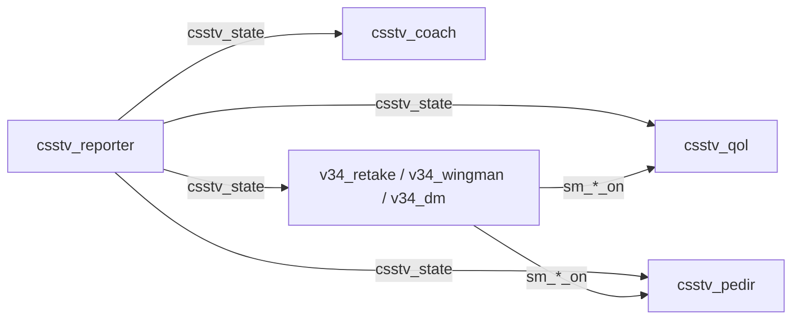

# Plan: QOL, cuarta tanda (consola limpia, coach en primera persona, silencio en el clutch, sonidos, plata para casters, resumen del medio tiempo y !faltan)

> Planeación original. Estado: **aprobado por Kyan** el 2026-11-02, en el chat ("hace lo de 1, 3, 5, 6 el 9", el coach "solo spec en primera persona y no ver a los rivales en el mapa", y "ver por qué el servidor muestra tantas veces esto en consola").

## Decisiones tomadas

| Tema | Decisión | Por qué |
|---|---|---|
| Consola llena | `csstv_qol`, `csstv_coach` y `csstv_pedir` leen el estado con `sm_csstv_status` (y `sm_retake`, `sm_2v2`, `sm_dm`) cada segundo, y en estos servidores esas respuestas salen en la consola. El reporter publica el estado en una ConVar de solo lectura (`csstv_state`) y cada modo publica si está prendido (`sm_retake_on`, `sm_2v2_on`, `sm_dm_on`). Los plugins leen las ConVars y usan el comando solo si la ConVar no existe (versión vieja) | Leer una ConVar no imprime nada y es más barato |
| Coach | Solo primera persona (sin la cámara de cerca). Los rivales, y la C4 para el coach CT, le llegan solo si el compañero que está mirando los ve (rayo de ojo a ojo, pecho o pies). Así no aparecen en el mapa ni a través de paredes | Pedido de Kyan: no tiene que ver a los rivales en el mapa |
| 1. Silencio en el clutch | Cuando un equipo queda con uno vivo, ese jugador deja de escuchar a sus compañeros muertos hasta el final de la ronda. `!voz` lo desactiva para uno mismo. El coach no se silencia | Que no lo aturdan en el momento clave |
| 3. Sonidos | Un pitido al empezar la última ronda antes del cambio de lado y tres en cada match point (`csstv_round_sounds`) | Hoy solo está el texto del encabezado |
| 5. Plata para casters | En cada ronda en vivo, al empezar el freezetime, los espectadores y la SourceTV ven la plata de cada equipo y una estimación: compra completa, compra parcial o eco. Los coaches no la ven | Para narrar sin abrir el TAB |
| 6. Resumen del medio tiempo | Al terminar cada mitad (también en la prórroga): MVP hasta ahora (más kills, después más daño) y top 3 por ADR (`csstv_half_summary`) | Mismo cálculo que el resumen final |
| 9. Quién falta | El recordatorio de cada 30 s ya decía "Faltan: …". Se agrega `!faltan`, que lo muestra en cualquier momento del calentamiento | Lo único que faltaba |
| Versiones | Reporter 2.7.7 (producción) y 2.8.7 (`kyan/pruebas`), `csstv_qol` 1.2.0, `csstv_coach` 1.1.0, `csstv_pedir` 1.0.1, y `v34_retake`, `v34_wingman` y `v34_dm` 1.0.1 | |

## 1. Estado sin la consola

- El reporter actualiza `csstv_state` cada segundo con el mismo texto que `sm_csstv_status` ("calentamiento", "en vivo", "medio tiempo"…).
- Los modos ponen su ConVar en 1 al prenderse y en 0 al apagarse.

## 2. Coach

- `SDKHook_SetTransmit` en cada jugador, y en la C4 tirada o plantada. Para un coach, un rival se transmite solo si el compañero que mira tiene línea de visión.
- `csstv_coach` registra la librería `csstv_coach` con la native `CSSTV_IsCoach`, para que `csstv_qol` no le muestre la plata del rival.

## 3. Orden

1. Reporter (estado, sonidos, resumen del medio tiempo y `!faltan`).
2. Modos 1.0.1.
3. `csstv_qol` 1.2.0, `csstv_pedir` 1.0.1 y `csstv_coach` 1.1.0.
4. Prueba con bots en `cssds`, con `-condebug` para revisar que la consola quede limpia.
5. Documentación. El despliegue, cuando lo pida Kyan.
