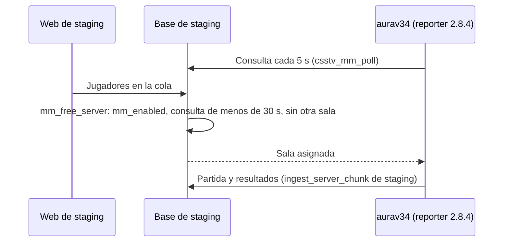

# aurav34 como único servidor de prueba del matchmaking: documentación

## Qué es

Desde el 2026-11-02, por decisión de Kyan, el matchmaking se prueba solo en `aurav34` (`45.235.98.57:27062`, el servidor de retake, `#3`), contra la base de **staging**. flow y MVZG no reciben salas.

## Cómo queda cada servidor

| Servidor | Reporter | Matchmaking | Base |
|---|---|---|---|
| `aurav34` (`#3`) | 2.8.4 genérico, activo en `plugins/` | `csstv_mm "1"`, `csstv_claim "1"`, `mm_enabled = true` (región `Sudamerica`) | Staging |
| MVZG (`#1`) | 2.7.4 licenciado | `csstv_mm "0"`, `csstv_claim "0"`, `mm_enabled = false` | Staging (ver el punto 1.36 de `PENDIENTES.md`) |
| flow (`#2`) | 2.7.4 licenciado | Sin líneas de matchmaking, `mm_enabled = false` | Producción |

## El reporter 2.8.4

- Es el 2.8.2 de Daniel (`origin/feat/mm-claim-en-sala`, `7338f86`) más la charla nueva del medio tiempo de [`2026-11-02-aviso-y-pausa-automatica`](../2026-11-02-aviso-y-pausa-automatica/) (la de la 2.7.4).
- No está en ninguna rama. El código sale de aplicar `pruebas/reporter-2.8.4.patch` sobre `7338f86`.
- `csstv_password` 1.1.0, de la misma rama de Daniel, porque lee `csstv_mm` para dejarle la contraseña a la web.

## El retake

`aurav34` prendía el retake solo en cada mapa (`sm_retake_autostart "1"`). El matchmaking no sabe del retake, así que una sala podía jugarse en modo retake. Mientras dure la prueba queda en `"0"`: el retake lo prende un admin con `sm_retake 1`.

## Dónde está cada cosa

| Qué | Dónde |
|---|---|
| Código del 2.8.4 | `pruebas/reporter-2.8.4.patch` sobre `7338f86` |
| Cfg del reporter en `aurav34` | `cstrike/cfg/sourcemod/csstv_reporter.cfg` |
| Retake | `cstrike/cfg/sourcemod/v34_retake.cfg` |
| Matchmaking en la base | `game_servers.mm_enabled`, `region` y `mode` (staging) |
