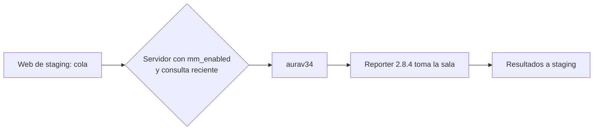

# Plan: aurav34 como único servidor de prueba del matchmaking

> Planeación original. Estado: **aprobado por Kyan** el 2026-11-02, en el chat.

## Decisiones tomadas

| Tema | Decisión | Por qué |
|---|---|---|
| Dónde se prueba | Solo en `aurav34` (el servidor de retake, `#3`) | Lo pidió Kyan. flow y MVZG quedan para mixes normales |
| flow y MVZG | Sin matchmaking: `mm_enabled = false` en staging y `csstv_mm "0"` en el cfg de MVZG | Que la web de staging no les mande salas |
| Plugin | Reporter 2.8.4: el 2.8.2 de Daniel (`feat/mm-claim-en-sala`, `7338f86`) más la charla nueva del medio tiempo | Tener el matchmaking sin volver a la charla que no dejaba comprar |
| Rama | Ninguna: worktree desacoplado y parche en `pruebas/` | Regla de Kyan: solo `kyan/pruebas`, sin ramas nuevas, y no tocar la de Daniel |
| Base | Staging, con la identidad de `aurav34` en staging que preparó Daniel (`csstv_reporter.cfg.mm_staging`) | El matchmaking existe solo en staging |
| Retake | `sm_retake_autostart "0"` mientras dure la prueba | El matchmaking no sabe del retake: una sala podría jugarse en modo retake |

## 1. El flujo completo

## 2. Servidores

- `aurav34`: reporter 2.8.4 genérico en `plugins/`, `csstv_password` 1.1.0, cfg con identidad de staging, `csstv_claim "1"`, `csstv_mm "1"`, `csstv_mm_poll "5"` y retake sin arranque automático.
- MVZG: `csstv_mm "0"` y `csstv_claim "0"`. Sigue con la 2.7.4.
- flow: sin cambios en el cfg (no tiene las líneas del matchmaking). Sigue con la 2.7.4.

## 3. Base de staging

`game_servers`: `mm_enabled = true`, `region = 'Sudamerica'` y `mode = 'competitive'` para `aurav34`, y `mm_enabled = false` para flow y `CMLeague #1`.

## 4. Requisitos antes de empezar

SFTP de los tres servidores y la clave de servicio de staging, todo en el `.env`.

## 5. Orden de implementación

1. Apagar el matchmaking de flow y MVZG.
2. Armar el 2.8.4 en un worktree desacoplado y probar el medio tiempo con bots en local.
3. Subir el plugin, `csstv_password` y el cfg a `aurav34`, con respaldos.
4. Habilitar `aurav34` en staging.
5. Apagar el retake automático.
