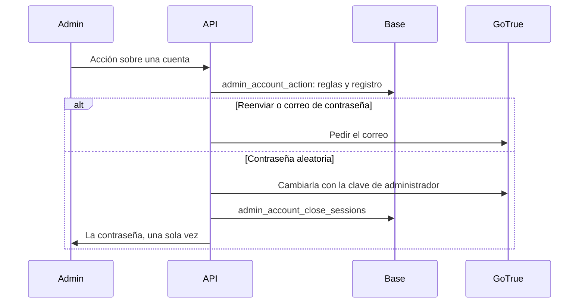

# Acciones de cuenta en Administración › Usuarios: documentación

## Qué hace

Un admin puede ayudar a alguien a entrar sin tocar la base. En Administración › Usuarios, cada cuenta tiene una sección **Acceso** que muestra si confirmó su correo y cuándo entró por última vez, con tres acciones: reenviar la activación, enviar el correo para cambiar la contraseña y cambiarla por una aleatoria.

Además, la confirmación del correo al registrarse se enciende y se apaga con un solo comando en el VPS, por si el flujo empieza a fallar.



## Reglas

| Acción | Disponible | Efecto |
|---|---|---|
| Reenviar activación | Cuentas sin confirmar (si no, 409) | GoTrue manda el correo de activación |
| Correo de contraseña | Cualquier cuenta | GoTrue manda el link a `/reset-password`; la contraseña actual sigue valiendo |
| Contraseña aleatoria | Ni la propia ni la de otro admin (403) | 16 caracteres sin signos que se confunden. Cierra sus sesiones |

- **Solo admins:** lo comprueban la API (`requireAdmin`) y también las funciones de la base (`is_admin()`).
- **La contraseña aleatoria** no se guarda ni se registra. La API responde con `Cache-Control: no-store`, y la web no la guarda en su caché de consultas.
- **El registro se escribe antes de la acción.** Una fila en `account_admin_actions` indica que se pidió, aunque GoTrue haya fallado después.
- **Sesiones:** se borran de `auth.sessions`, así que ya no se pueden renovar. Un token de acceso ya emitido puede seguir valiendo hasta que venza, como mucho 1 hora.
- **Si no se pudieron cerrar las sesiones**, la contraseña se entrega igual y el diálogo lo avisa.

## Encender y apagar la confirmación del correo

En el VPS. Reinicia unos segundos solo el servicio de login:

```bash
sudo sb confirmar-correo                               # estado y cuentas sin confirmar
sudo sb confirmar-correo on                            # el registro pide activar la cuenta
sudo sb confirmar-correo off                           # las cuentas nuevas quedan activas al registrarse
sudo sb confirmar-correo off --confirmar-pendientes    # además, deja entrar a las que estaban esperando el correo
```

Apagarla no confirma a quienes ya estaban esperando el correo: para eso está `--confirmar-pendientes`.

## Datos

| Qué | Dónde |
|---|---|
| `account_admin_actions` | Admin, cuenta, acción y fecha. Solo la leen los admins |
| `admin_account_status(p_user)` | Si confirmó el correo y el último inicio de sesión |
| `admin_account_action(p_user, p_action)` | Reglas, registro y el correo de la cuenta para la API |
| `admin_account_close_sessions(p_user)` | Cierra las sesiones |
| `SUPABASE_SERVICE_KEY` en `/etc/cmleague/api.env` | Clave de administrador. Solo la usa la contraseña aleatoria |

## Qué cambia para cada rol

| Rol | Qué cambia | Página del manual |
|---|---|---|
| Admin | La sección Acceso en Usuarios | [`admin/usuarios-y-fichas`](../../manual/admin/usuarios-y-fichas.md) |
| Jugador | Con la confirmación encendida, activa su cuenta desde el correo. Si no le llega, un admin se lo reenvía | [`jugador/crear-cuenta`](../../manual/jugador/crear-cuenta.md) |
| Capitán, organizador, moderador, streamer y dueño de un servidor externo | Nada | — |

## Términos y privacidad

`/privacidad` y `terms/privacidad.html`: decían que nadie del staff puede ver la contraseña. Ahora aclaran que eso vale para la que eligió el jugador, y que un admin ve una sola vez la aleatoria, con registro de quién lo hizo. `/terminos` no cambia.

## Dónde está cada cosa

| Qué | Archivo / ubicación |
|---|---|
| Base | `supabase/replanteo/72_admin_cuentas.sql` |
| Rutas | `web/backend/src/routes/admin-players.ts` |
| Contraseña aleatoria | `web/backend/src/lib/password.ts` |
| Clave de administrador | `serviceClient` en `web/backend/src/lib/supabase.ts` |
| Panel | `web/frontend/src/features/admin/users/components/AccountSection.tsx` |
| Comando | `sb confirmar-correo`, en `deploy/supabase/instalar.sh` |
